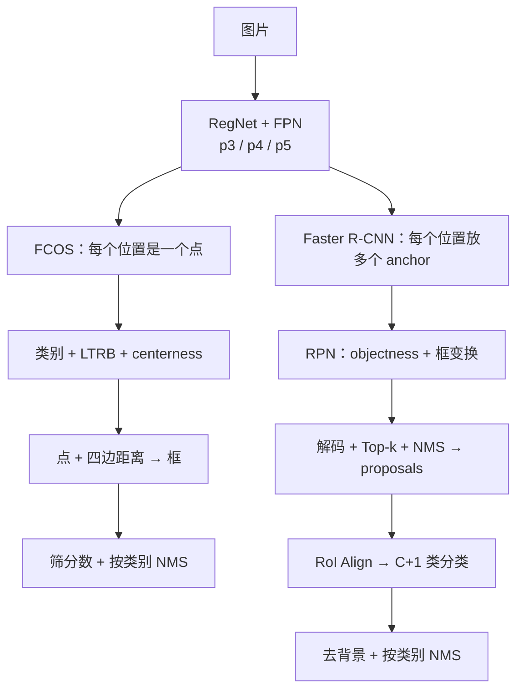
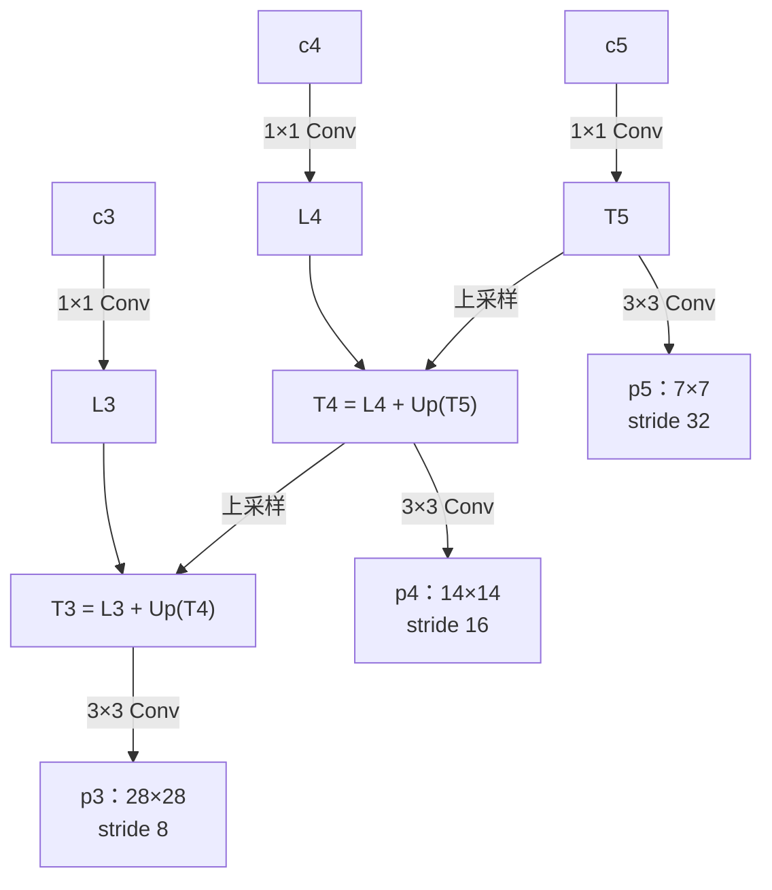
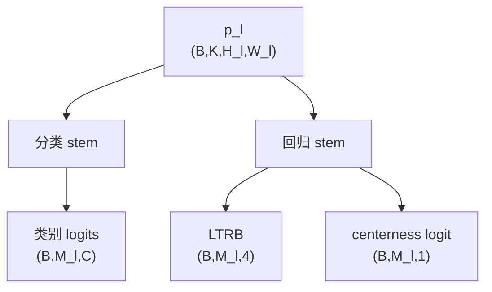
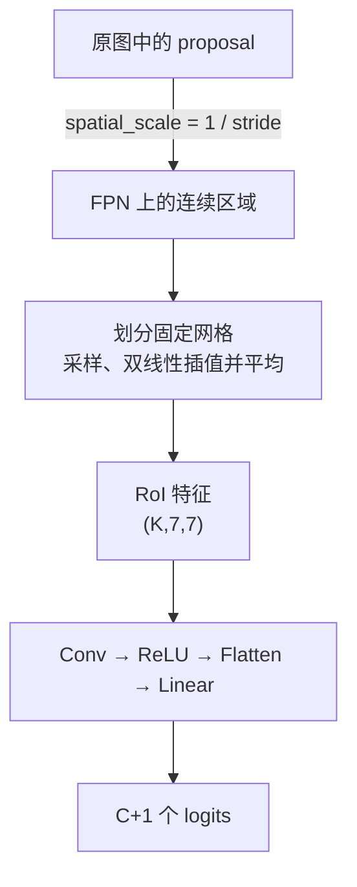
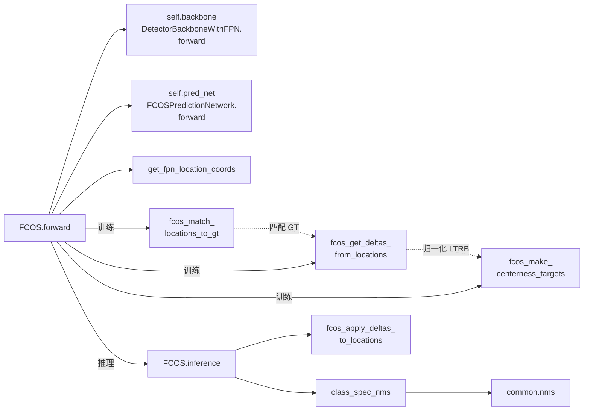
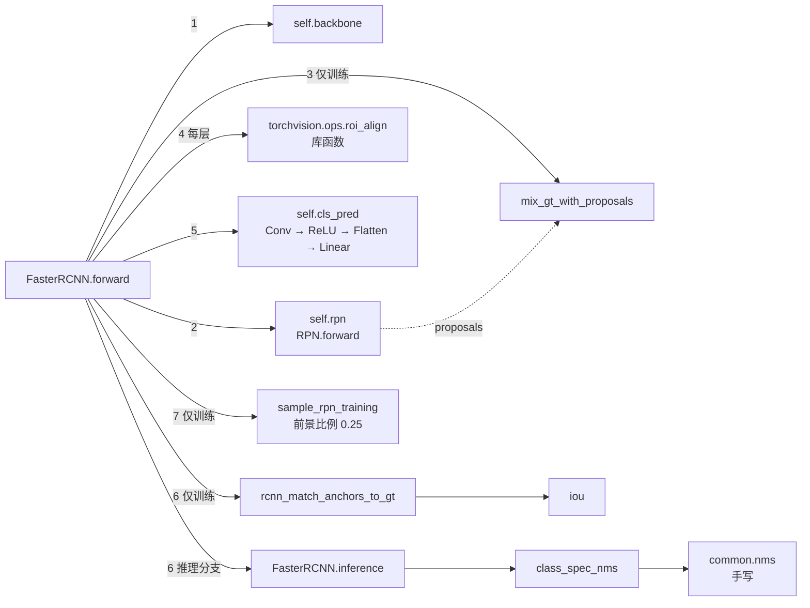
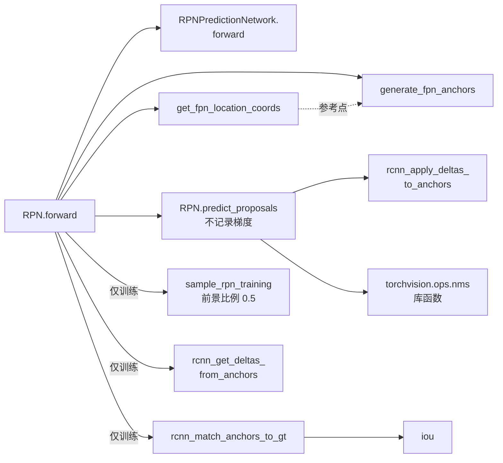

# Faster R-CNN 与 FCOS：从特征到检测框

对应 [common.py](/D:/Study/Phd-Study/EECS498-WI22-main/A4/common.py)、[one_stage_detector.py](/D:/Study/Phd-Study/EECS498-WI22-main/A4/one_stage_detector.py)、[two_stage_detector.py](/D:/Study/Phd-Study/EECS498-WI22-main/A4/two_stage_detector.py)。两者共用 Backbone + FPN：**FCOS 从点回归四边距离；Faster R-CNN 先调整 anchor，再对候选区域分类。**

本作业的 Faster R-CNN 第二阶段只有 RoI 分类，最终框来自 RPN，不进行第二次框回归。

## 1. 共有部分：多尺度特征与原图坐标

### 1.1 两条检测流程



| 符号 | 含义 |
| --- | --- |
| `B,C,K` | 图片数、目标类别数、FPN 通道数 |
| `H_l,W_l,s_l` | 第 l 层的特征高、宽和 stride |
| `M_l=H_lW_l` | 第 l 层空间位置数 |
| `A` | 每个位置的 anchor 数，默认 3 |
| `P` | 合计保留的 proposal 数，可随图片变化 |

### 1.2 FPN：高层语义向下传递

设横向投影 $L_l=\operatorname{Conv}_{1\times1}(c_l)$：

$$
T_5=L_5,\qquad
T_4=L_4+\operatorname{Up}(T_5),\qquad
T_3=L_3+\operatorname{Up}(T_4)
$$

$$
p_l=\operatorname{Conv}_{3\times3}(T_l),\qquad l\in\{3,4,5\}
$$



图中空间尺寸对应 `224×224` 输入；各层输出通道统一为 `K`。

### 1.3 网格位置如何对应原图

行号 `i`、列号 `j` 对应参考点：

$$
\boxed{(x_c,y_c)=((j+0.5)s_l,\ (i+0.5)s_l)}
$$

stride 为 8、网格为 `2×3` 时，原图参考点如下：

| 行 ＼ 列 | j=0 | j=1 | j=2 |
| :--- | :---: | :---: | :---: |
| i=0 | (4,4) | (12,4) | (20,4) |
| i=1 | (4,12) | (12,12) | (20,12) |

展平顺序：先第一行，再第二行。

FCOS 直接使用这些点；RPN 在这些点上放置不同形状的 anchors。位置、anchor 和预测张量的展平顺序必须一致。

## 2. FCOS：一个点预测一个框

### 2.1 三个预测头



分类对 `C` 个类别分别使用 sigmoid；背景的所有类别目标均为 0，没有单独的背景输出通道。

### 2.2 LTRB：从点到四条边

给定 GT 框 $(x_1,y_1,x_2,y_2)$ 和参考点 $(x_c,y_c)$：

| 从参考点出发 | 到达的框边 | 距离 |
| :---: | :---: | :---: |
| ← | 左边 x₁ | l |
| ↑ | 上边 y₁ | t |
| → | 右边 x₂ | r |
| ↓ | 下边 y₂ | b |

$$
(l,t,r,b)=(x_c-x_1,\ y_c-y_1,\ x_2-x_c,\ y_2-y_c)
$$

点必须在框内，且满足当前层的尺度范围：

$$
\min(l,t,r,b)>0,\qquad
a_l<\max(l,t,r,b)<b_l
$$

| 层 | 本作业的范围（原图像素） |
| --- | --- |
| p3 | `0 < max(LTRB) < 64` |
| p4 | `64 < max(LTRB) < 128` |
| p5 | `128 < max(LTRB) < ∞` |

实现采用严格不等式；若多个 GT 都满足，选面积最小的一个。没有匹配则为背景。

### 2.3 编码与解码互为逆操作

训练目标除以 stride：

$$
\boxed{
d^*=(l^*,t^*,r^*,b^*)=\frac1{s_l}(l,t,r,b)
}
$$

推理先将负预测截为 0，再解码：

$$
\boxed{
\hat x_1=x_c-s_l\hat l,\quad
\hat y_1=y_c-s_l\hat t,\quad
\hat x_2=x_c+s_l\hat r,\quad
\hat y_2=y_c+s_l\hat b
}
$$

例：参考点 `(20,12)`、GT `(8,4,40,28)`、stride 为 8：

$$
(l,t,r,b)=(12,8,20,16),\qquad d^*=(1.5,1,2.5,2)
$$

解码回来恰好是 `(8,4,40,28)`。

### 2.4 Centerness：点靠近中心吗

$$
\boxed{
q^*=\sqrt{
\frac{\min(l,r)}{\max(l,r)}
\frac{\min(t,b)}{\max(t,b)}
}
}
$$

$$
l=r,\ t=b\ \Rightarrow q^*=1;\qquad
l\rightarrow0\ \Rightarrow q^*\rightarrow0
$$

上述例子的 $q^*=\sqrt{(12/20)(8/16)}=\sqrt{0.3}\approx0.548$。用原图距离或 stride 归一化后的距离计算，比例相同。

### 2.5 三项损失

定义二分类交叉熵：

$$
\operatorname{BCE}(p,y)=-y\log p-(1-y)\log(1-p)
$$

Focal Loss 进一步降低容易样本的权重：

$$
p_t=yp+(1-y)(1-p),\qquad
\alpha_t=y\alpha+(1-y)(1-\alpha)
$$

$$
\operatorname{FL}(p,y)=-\alpha_t(1-p_t)^\gamma\log p_t
$$

$p_t\to1$ 时权重趋近 0；当前调用使用默认 $\alpha=0.25,\gamma=2$。令 $\mathcal P$ 为前景点集合：

$$
L_{\mathrm{cls}}=\frac1Z\sum_{u,c}\operatorname{FL}(\sigma(z_{u,c}),y_{u,c})
$$

$$
L_{\mathrm{box}}=\frac{0.25}{Z}\sum_{u\in\mathcal P}\|\hat d_u-d_u^*\|_1,
\qquad
L_{\mathrm{ctr}}=\frac1Z\sum_{u\in\mathcal P}
\operatorname{BCE}(\sigma(v_u),q_u^*)
$$

$$
\boxed{L_{\mathrm{FCOS}}=L_{\mathrm{cls}}+L_{\mathrm{box}}+L_{\mathrm{ctr}}}
$$

分类包括前景和背景；框和 centerness 只包括前景。这里使用 `L1`，不是标准 FCOS 常见的 IoU 类回归损失。

归一化采用前景数量的滑动平均：

$$
\nu\leftarrow0.9\nu+0.1\frac{|\mathcal P|}{B},\qquad Z=B\nu
$$

### 2.6 推理分数与筛选

$$
s_{u,c}=\sqrt{\sigma(z_{u,c})\,\sigma(v_u)},\qquad
\hat c_u=\arg\max_c s_{u,c},\qquad s_u=\max_c s_{u,c}
$$

例如类别概率为 `0.81`、centerness 为 `0.64`，最终分数为 $\sqrt{0.81\times0.64}=0.72$。

```text
每点取最高类别 → 过滤低分 → 解码 LTRB → 裁剪到图片
→ 合并 p3/p4/p5 → 按类别 NMS → 框、类别、分数
```

## 3. Faster R-CNN：先找候选框，再分类

### 3.1 Anchor：每个位置放置多个参考框

设 `q` 为 `stride_scale`，宽高比 `r=h/w`：

$$
a=(qs_l)^2,\qquad
w_a=\sqrt{a/r},\qquad h_a=\sqrt{ar}
$$

$$
\mathrm{anchor}=
(x_c-w_a/2,\ y_c-h_a/2,\ x_c+w_a/2,\ y_c+h_a/2)
$$

| 宽高比 r=h/w | anchor 形状 |
| :---: | :---: |
| r < 1 | 横向较宽 |
| r = 1 | 正方形 |
| r > 1 | 纵向较高 |

同一中心默认放 `A=3` 个框，每层共 `M_l*A` 个 anchors。

RPN 输出：

| 输出 | 卷积输出 | 展平后 |
| --- | --- | --- |
| objectness logits | `(B,A,H_l,W_l)` | `(B,M_l*A)` |
| box deltas | `(B,4A,H_l,W_l)` | `(B,M_l*A,4)` |
| anchors | 与图片内容无关 | `(M_l*A,4)` |

顺序为“位置 0 的 A 个框 → 位置 1 的 A 个框 → …”，预测与 anchors 必须逐行对应。

### 3.2 IoU 匹配与采样

对两个框 `a/g`：

$$
w_\cap=\max(0,\min(x_2^a,x_2^g)-\max(x_1^a,x_1^g))
$$

$$
h_\cap=\max(0,\min(y_2^a,y_2^g)-\max(y_1^a,y_1^g))
$$

$$
\boxed{
\operatorname{IoU}(a,g)=
\frac{w_\cap h_\cap}{|a|+|g|-w_\cap h_\cap}
}
$$

每个 anchor 选 IoU 最大的 GT，记最大值为 `u`：

$$
\mathrm{label}(a)=
\begin{cases}
0\ \text{背景},&u\le0.3\\
\text{忽略},&0.3<u<0.6\\
1\ \text{前景},&u\ge0.6
\end{cases}
$$

RPN 每张图的采样中前景最多占 50%，其余用背景尽量补足；忽略区间不参与损失。Objectness 只回答“有没有目标”，不区分猫、狗等具体类别。

### 3.3 Anchor → GT：编码和解码

设 anchor 中心、尺寸为 $(x_a,y_a,w_a,h_a)$，GT 为 $(x_g,y_g,w_g,h_g)$：

$$
\boxed{
d_x^*=\frac{x_g-x_a}{w_a},\quad
d_y^*=\frac{y_g-y_a}{h_a},\quad
d_w^*=\log\frac{w_g}{w_a},\quad
d_h^*=\log\frac{h_g}{h_a}
}
$$

预测后逆变换：

$$
\boxed{
\hat x=x_a+\hat d_xw_a,\quad
\hat y=y_a+\hat d_yh_a,\quad
\hat w=w_ae^{\hat d_w},\quad
\hat h=h_ae^{\hat d_h}
}
$$

再由中心与尺寸转回四角：

$$
(\hat x_1,\hat y_1,\hat x_2,\hat y_2)
=(\hat x-\hat w/2,\hat y-\hat h/2,\hat x+\hat w/2,\hat y+\hat h/2)
$$

例：anchor `(0,0,32,32)`，GT `(8,4,48,36)`：

$$
(x_a,y_a,w_a,h_a)=(16,16,32,32)
$$

$$
(x_g,y_g,w_g,h_g)=(28,20,40,32)
$$

$$
d^*=(0.375,\ 0.125,\ \log1.25,\ 0)
$$

位置偏移按原框宽高归一化；尺寸变化使用对数比例。零 deltas 表示保持原 anchor。

### 3.4 RPN 损失与 proposals

令 $\mathcal S$ 为采样 anchors，$\mathcal S_+$ 为其中前景，$D_{\mathcal S}=\max(|\mathcal S|,1)$：

$$
L_{\mathrm{obj}}=\frac1{D_{\mathcal S}}
\sum_{u\in\mathcal S}\operatorname{BCE}(\sigma(o_u),y_u)
$$

$$
L_{\mathrm{rpn\ box}}=\frac1{D_{\mathcal S}}
\sum_{u\in\mathcal S_+}\|\hat d_u-d_u^*\|_1
$$

注意框损失虽只在前景求和，分母仍是采样的前景加背景数量。

```text
anchors + 预测 deltas
→ 解码 → 裁剪
→ 按 objectness 取 pre-NMS top-k
→ 不区分类别的 NMS
→ 取 post-NMS top-k
→ proposals
```

上述筛选按“每张图、每个 FPN 层”执行；不同图可保留不同数量，所以 proposals 使用列表保存。训练时 RPN 的 proposal 筛选不记录梯度，两个 RPN 损失直接监督原始预测。

### 3.5 RoI Align：不同尺寸的框 → 相同尺寸特征

训练时先把 GT 混入 proposals，以补充高质量正样本。新增 GT 的层级为：

$$
l=\operatorname{clip}\left(
\left\lfloor5+\log_2\frac{\sqrt{wh}}{224}\right\rfloor,\ 3,\ 5
\right)
$$

RPN 已有 proposals 保留来源层级。然后：



`7×7` 是示例 RoI 大小。双线性插值可写成四邻点的加权和：

$$
F(u,v)=\sum_{i,j}
F[i,j]\max(0,1-|u-j|)\max(0,1-|v-i|)
$$

每个 bin 对采样值求平均，所有 proposals 因而得到相同尺寸。当前调用使用 `aligned=True`，包含半像素对齐；它不是把原图矩形裁出后直接送进分类器。

### 3.6 第二阶段分类与总损失

第二阶段重新匹配 proposals 与 GT：

$$
u=\max_g\operatorname{IoU}(p,g),\qquad
\mathrm{label}(p)=
\begin{cases}
\text{背景},&u\le0.5\\
\text{对应目标类别},&u>0.5
\end{cases}
$$

每图采样的前景最多占 25%。训练标签整体加 1：

$$
-1\ (\text{数据中的背景})\mapsto0,\qquad
c\in\{0,\ldots,C-1\}\mapsto c+1
$$

对采样集合 $\mathcal R$：

$$
L_{\mathrm{roi}}
=-\frac1{|\mathcal R|}\sum_{u\in\mathcal R}
\log\frac{e^{z_{u,y_u}}}{\sum_{c=0}^{C}e^{z_{u,c}}}
$$

$$
\boxed{
L_{\mathrm{FasterRCNN}}
=L_{\mathrm{obj}}+L_{\mathrm{rpn\ box}}+L_{\mathrm{roi}}
}
$$

本作业没有第二阶段框回归损失。RoI 特征、logits 和匹配标签都必须保持同样的“FPN 层级 → 图片 → proposal”顺序。

### 3.7 推理：分类后过滤

$$
p_{u,c}=\frac{e^{z_{u,c}}}{\sum_{j=0}^{C}e^{z_{u,j}}},
\qquad
\tilde c_u=\arg\max_c p_{u,c},\qquad
s_u=\max_c p_{u,c}
$$

```text
RPN proposals → RoI Align → C+1 类 softmax → 每框取最高类别
→ 去背景、去低分框 → 类别编号减1 → 按类别 NMS
```

推理不混入 GT。最终框坐标仍是 RPN proposal，第二阶段只更新其类别与分类分数。

## 4. NMS：删除同一个目标的重复框

按分数从高到低循环：

$$
m=\arg\max_{i\in\mathcal U}s_i,\qquad
\mathcal K\leftarrow\mathcal K\cup\{m\}
$$

$$
\mathcal U\leftarrow
\{j\in\mathcal U\setminus\{m\}:\operatorname{IoU}(b_m,b_j)\le\tau\}
$$

| 框编号 | 分数 | 与框 0 的 IoU | τ=0.5 时 |
| :---: | :---: | :---: | :---: |
| 0 | 0.9 | — | 首先保留 |
| 1 | 0.8 | 0.68 | 删除 |
| 2 | 0.7 | 0 | 保留 |

输出原始下标 `[0,2]`。

RPN 的 NMS 不区分类别；最终 NMS 只在同类别之间抑制。IoU 等于阈值时保留。

当前 `class_spec_nms` 用坐标平移实现类别隔离：

$$
\tilde b_i=b_i+c_i(M+1),\qquad M=\max\{\text{全部框坐标}\}
$$

同类别一起平移，IoU 不变；不同类别移开后统一 NMS。该技巧要求坐标非负，当前最终框已裁剪到图片范围；返回的是原始框下标。

## 5. 两种框表示放在一起看

| 项目 | FCOS | 本作业 Faster R-CNN |
| --- | --- | --- |
| 起点 | 参考点 $(x_c,y_c)$ | 参考框 $(x_a,y_a,w_a,h_a)$ |
| 回归量 | 四边距离 $(l,t,r,b)/s$ | 中心偏移 + 对数宽高比 |
| 前景匹配 | 框内 + 尺度范围 + 最小面积 | anchor/proposal 与 GT 的 IoU |
| 第一轮类别判断 | 直接预测 C 类 | RPN 只预测 objectness |
| 额外质量分数 | centerness | 第二阶段 RoI 分类 |
| 背景处理 | C 个 sigmoid 全为 0 | RPN 二分类；RoI softmax 背景类 0 |
| 框损失 | 前景 L1，系数 0.25 | 前景 RPN L1 |
| 最终位置 | 点 + LTRB 解码 | RPN proposal |
| 最终输出 | 框 + 类别 + 分数 | 框 + 类别 + 分数 |

两种检测器在当前作业的最终推理接口都按单张图片使用。训练时依据 GT 匹配与损失学习参数；推理时只依赖模型预测和筛选规则。


## 6. 组件与手写代码如何对应

表中链接定位到当前源码定义；`self.xxx` 表示类里保存的组件。`model(...)` 由 PyTorch 调度到检测器的 `forward`。

### 6.1 共用组件与外层入口

| 组件 | 代码入口 | 对应作用 |
| --- | --- | --- |
| Backbone + FPN | [DetectorBackboneWithFPN.<br/>forward](/D:/Study/Phd-Study/EECS498-WI22-main/A4/common.py:116) | 图片 → p3/p4/p5，供两个检测器复用 |
| 网格参考点 | [get_fpn_location_coords](/D:/Study/Phd-Study/EECS498-WI22-main/A4/common.py:162) | 特征图位置 → 原图中心坐标 |
| 最终按类去重 | [class_spec_nms](/D:/Study/Phd-Study/EECS498-WI22-main/A4/common.py:281)<br/>[nms](/D:/Study/Phd-Study/EECS498-WI22-main/A4/common.py:218) | 类别坐标平移 → 手写 NMS |
| 多尺度张量合并 | [FCOS.<br/>_cat_across_fpn_levels](/D:/Study/Phd-Study/EECS498-WI22-main/A4/one_stage_detector.py:663)<br/>[RPN.<br/>_cat_across_fpn_levels](/D:/Study/Phd-Study/EECS498-WI22-main/A4/two_stage_detector.py:825)<br/>[FasterRCNN.<br/>_cat_across_fpn_levels](/D:/Study/Phd-Study/EECS498-WI22-main/A4/two_stage_detector.py:1043) | 按字典层级顺序 cat；预测、框和标签的顺序须一致 |
| 训练／测试循环 | [train_detector](/D:/Study/Phd-Study/EECS498-WI22-main/A4/a4_helper.py:219)<br/>[inference_with_detector](/D:/Study/Phd-Study/EECS498-WI22-main/A4/a4_helper.py:289) | 训练：损失字典求和、backward、SGD；测试：eval 后调用模型 |

### 6.2 FCOS：公式落在哪个函数

| 组件／公式 | 代码入口 | 对应作用 |
| --- | --- | --- |
| 总装配 | [FCOS.forward](/D:/Study/Phd-Study/EECS498-WI22-main/A4/one_stage_detector.py:489) | self.backbone、self.pred_net；按 training 分流 |
| 三个预测头 | [FCOSPredictionNetwork.<br/>forward](/D:/Study/Phd-Study/EECS498-WI22-main/A4/one_stage_detector.py:119) | stem_cls → pred_cls；stem_box → pred_box / pred_ctr |
| 点与 GT 匹配 | [fcos_match_<br/>locations_to_gt](/D:/Study/Phd-Study/EECS498-WI22-main/A4/one_stage_detector.py:185) | 框内、尺度范围、最小面积 |
| LTRB 编码 | [fcos_get_deltas_<br/>from_locations](/D:/Study/Phd-Study/EECS498-WI22-main/A4/one_stage_detector.py:274) | 点 + GT → 四边距离 / stride |
| LTRB 解码 | [fcos_apply_deltas_<br/>to_locations](/D:/Study/Phd-Study/EECS498-WI22-main/A4/one_stage_detector.py:339) | 预测距离 + 点 → XYXY 框 |
| 中心度目标 | [fcos_make_<br/>centerness_targets](/D:/Study/Phd-Study/EECS498-WI22-main/A4/one_stage_detector.py:404) | LTRB → $q^*$ |
| 损失／预测输出 | [FCOS.forward](/D:/Study/Phd-Study/EECS498-WI22-main/A4/one_stage_detector.py:489)<br/>[FCOS.inference](/D:/Study/Phd-Study/EECS498-WI22-main/A4/one_stage_detector.py:673) | forward 内算三项损失；inference 内筛分数、解码、NMS |

实线表示函数调用，虚线表示目标或结果传递。训练入口在得到损失字典后统一更新参数。



Focal Loss、L1、BCE 直接写在 `FCOS.forward` 中，没有独立的手写 `fcos_loss` 函数。

### 6.3 RPN 与 RoI 分类：两阶段如何连接

| 组件／公式 | 代码入口 | 对应作用 |
| --- | --- | --- |
| RPN 装配与预测头 | [RPN.forward](/D:/Study/Phd-Study/EECS498-WI22-main/A4/two_stage_detector.py:565)<br/>[RPNPredictionNetwork.<br/>forward](/D:/Study/Phd-Study/EECS498-WI22-main/A4/two_stage_detector.py:97) | self.pred_net；stem_rpn → pred_obj / pred_box |
| 参考框生成 | [generate_fpn_anchors](/D:/Study/Phd-Study/EECS498-WI22-main/A4/two_stage_detector.py:144) | 网格点 + stride + 宽高比 → anchors |
| IoU 与 GT 匹配 | [rcnn_match_<br/>anchors_to_gt](/D:/Study/Phd-Study/EECS498-WI22-main/A4/two_stage_detector.py:273)<br/>[iou](/D:/Study/Phd-Study/EECS498-WI22-main/A4/two_stage_detector.py:228) | 匹配函数内部调用 iou；RPN 和 RoI 均复用 |
| 编码／解码 | [rcnn_get_deltas_<br/>from_anchors](/D:/Study/Phd-Study/EECS498-WI22-main/A4/two_stage_detector.py:324)<br/>[rcnn_apply_deltas_<br/>to_anchors](/D:/Study/Phd-Study/EECS498-WI22-main/A4/two_stage_detector.py:381) | anchor ↔ 中心偏移与对数宽高比 |
| 前景／背景采样 | [sample_rpn_training](/D:/Study/Phd-Study/EECS498-WI22-main/A4/two_stage_detector.py:426) | RPN 前景最多 50%；RoI 最多 25% |
| 生成候选框 | [RPN.predict_proposals](/D:/Study/Phd-Study/EECS498-WI22-main/A4/two_stage_detector.py:731) | 解码 → 裁剪 → Top-k → 库 NMS → Top-k |
| GT 混入候选框 | [mix_gt_with_proposals](/D:/Study/Phd-Study/EECS498-WI22-main/A4/two_stage_detector.py:467) | 训练时补充正样本，按尺寸分配新增 GT 的层级 |
| RoI Align 与分类头 | [FasterRCNN.\_\_init\_\_](/D:/Study/Phd-Study/EECS498-WI22-main/A4/two_stage_detector.py:846)<br/>[FasterRCNN.forward](/D:/Study/Phd-Study/EECS498-WI22-main/A4/two_stage_detector.py:902) | 库 roi_align → self.cls_pred；后者是 nn.Sequential |
| 最终预测筛选 | [FasterRCNN.inference](/D:/Study/Phd-Study/EECS498-WI22-main/A4/two_stage_detector.py:1053) | softmax → 去背景／低分 → class_spec_nms |

`RPN.forward` 在训练和推理时都会调用 `predict_proposals`；只有训练时额外匹配、采样并计算 RPN 损失。



RoI 分类交叉熵直接在 `FasterRCNN.forward` 内计算。训练返回 RPN 两项损失与分类损失；推理返回框、类别和分数。

### 6.4 追到 RPN 内部：哪些是你写的函数



**两处 NMS 的实际入口不同**：RPN proposal 筛选调用 `torchvision.ops.nms`；两个检测器的最终筛选调用你写的 `class_spec_nms → common.nms`。`iou` 用于 GT 匹配，手写 `nms` 内部自行计算重叠，不调用这个 `iou` 函数。
