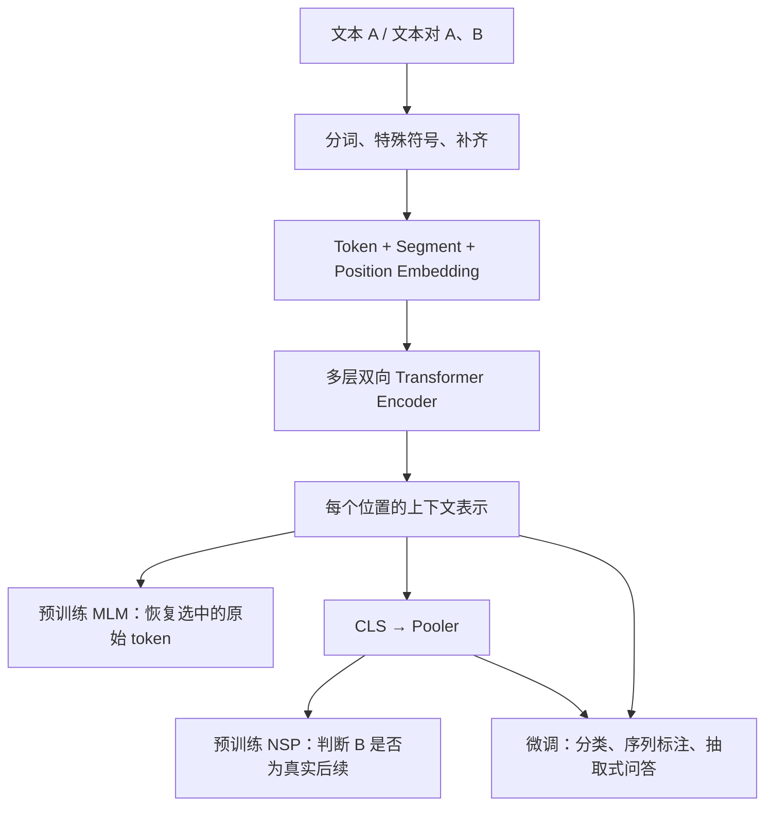

# BERT：输入表示、双向预训练与下游微调

BERT 全称是 **Bidirectional Encoder Representations from Transformers**。它用双向 Transformer Encoder 为输入中的每个 token 生成上下文相关表示，先在大量文本上预训练，再接任务头进行微调。

主要参考大雄007的[《读懂BERT，看这一篇就够了》](https://zhuanlan.zhihu.com/p/403495863)，沿着文章的 **介绍 → 模型结构（Embedding、Encoder、注意力可视化）→ 训练（预训练与微调）→ BERT/GPT/ELMo 对比 → 优缺点** 整理，公式和实现细节结合原论文与官方代码核对。

注意力和残差的基础可先看 [Transformer 学习总结](/D:/Study/Phd-Study/EECS498-WI22-main/A5/Transformer_学习总结.md)。下文组件代码可按顺序放在同一个 Python 文件中，组成一个可运行的小模型；它用于理解计算过程，不包含预训练权重或真实训练结果。

本文的计算主线是 **token 编号 → Embedding → Encoder 表示 → 任务头 logits → 概率与 loss → 梯度更新**。BERT 主干输出表示，不会在没有任务头和标签时自动产生训练 loss。

| 符号 | 含义 |
| --- | --- |
| N、T、H | batch 大小、补齐后的 token 数、隐藏维度 |
| V、A、d | 词表大小、注意力头数、每头维度 `d=H/A` |
| x、x̃ | 干净 token 编号、MLM 扰动后的输入编号 |
| h、o、π | 隐藏表示、未归一化 logits、softmax 后的概率 |
| 𝒮 | batch 内被选作 MLM 目标的位置集合，包含样本和位置索引 |
| θ | Embedding 与 Encoder 等共享主干参数 |
| ψ、C | 当前任务头参数、下游类别数 |

公式中的单个向量按列向量理解，例如 `h∈Rᴴ`；代码把一批位置堆成 `(N,T,H)`，矩阵乘法由 `Linear/F.linear` 完成。

## 1. BERT 要解决什么问题

BERT 由 Google 于 2018 年提出。核心思路是先用大量文本学习通用表示，再通过少量任务专用结构适配分类、实体识别、阅读理解等任务，减少每个任务从头设计和训练整套模型的成本。

### 1.1 从固定词向量到上下文表示

Word2Vec 等方法为一个词保存一组固定向量；但“苹果很好吃”和“苹果发布新电脑”中的“苹果”具有不同含义。BERT 的输入词嵌入仍是查表，**经过 Encoder 后的向量会随整段上下文变化**。

$$
h_i=\mathrm{BERT}(x_1,\ldots,x_T)_i
$$

相同 token 出现在不同句子中，其最终的 `h_i` 可以不同。预训练希望这些表示保留语法、语义和文本关系，下游任务再学习如何读取这些信息。

### 1.2 为什么强调“双向”

普通左到右语言模型根据前缀预测后面的 token：

$$
p(x_1,\ldots,x_T)=\prod_{i=1}^Tp(x_i\mid x_{<i})
$$

BERT 的每一层自注意力都可以读取左右两侧的有效输入。双向不是“先正向运行一次，再反向运行一次”，而是在同一层内直接融合两侧上下文。

但若输入中保留所有正确 token，又让模型预测同一位置的 token，任务会退化为复制。BERT 用 MLM 扰动部分输入，再要求恢复这些位置，解决主要的目标泄漏问题。

### 1.3 整体流程



预训练同时优化 MLM 和 NSP；微调时通常移除这两个任务头，换成下游任务头，并更新 BERT 参数。

## 2. BERT 模型结构

BERT 的主干是 **输入 Embedding + 多层双向 Transformer Encoder**。先把文本转换成向量，再让每个位置逐层融合上下文，最后由不同任务头读取这些表示。

### 2.1 Embedding：文本怎样变成张量

#### 2.1.1 WordPiece 与特殊 token

BERT 使用 WordPiece 子词词表。一个词可能被拆成多个 token，例如某个词被拆成首片段和带 `##` 的后续片段；具体结果由 tokenizer 的词表和预处理决定，不能把“一个 token”等同于“一个单词”。

原始中文 BERT 的预处理会分隔中文字符，许多汉字对应独立 token；混合英文和其他内容仍按相应分词规则处理。使用预训练模型时，必须配套使用对应 tokenizer。

| 特殊 token | 用途 |
| --- | --- |
| `[CLS]` | 放在序列开头，其最终表示常用于整体分类 |
| `[SEP]` | 分隔两段文本，并标记文本末尾 |
| `[PAD]` | 将不同长度的样本补齐到相同长度 |
| `[MASK]` | MLM 中用于替换部分待预测 token |
| `[UNK]` | 无法被词表正常表示的内容 |

#### 2.1.2 单文本与文本对

```text
单文本：[CLS] 文本 A [SEP]
文本对：[CLS] 文本 A [SEP] 文本 B [SEP]
```

这里 A、B 可以是连续文本片段，不要求各自严格只有一个自然语言句子。两段文本放入同一个 Encoder 后，可以直接通过自注意力交换信息。

例如 `I like dog` 若被分成 `I / like / dog`，加上 CLS 和 SEP 后一共是 **5 个 token**；BERT-Base 的 Embedding 形状为 `(1,5,768)`，具体数量以 tokenizer 结果为准。

下面只是字符级示意；position 连续编号，进入 B 段时不归零：

| token | CLS | 我 | 爱 | 学 | 习 | SEP | 很 | 有 | 趣 | SEP | PAD |
| --- | --- | --- | --- | --- | --- | --- | --- | --- | --- | --- | --- |
| token_type_ids | 0 | 0 | 0 | 0 | 0 | 0 | 1 | 1 | 1 | 1 | 0 |
| position_ids | 0 | 1 | 2 | 3 | 4 | 5 | 6 | 7 | 8 | 9 | 10 |
| attention_mask | 1 | 1 | 1 | 1 | 1 | 1 | 1 | 1 | 1 | 1 | 0 |

`token_type_ids` 指示 A/B 段，`attention_mask` 指示哪些位置有效，两者作用不同。单文本通常所有 token type 都为 0；PAD 的 type 可设为 0，因为它不会作为有效内容被读取。

#### 2.1.3 三种 Embedding 相加

设 batch size 为 `N`、序列长度为 `T`、隐藏维度为 `H`、词表大小为 `V`：

$$
e_i=E_{\mathrm{token}}[x_i]+E_{\mathrm{segment}}[s_i]+E_{\mathrm{position}}[i]
$$

$$
X=\mathrm{Dropout}(\mathrm{LayerNorm}(e))
$$

| 输入／组件 | 形状 |
| --- | --- |
| input_ids、token_type_ids、attention_mask | `(N,T)` |
| Token Embedding 表 | `(V,H)` |
| Segment Embedding 表 | 原始 BERT 使用两类 A/B：`(2,H)` |
| Position Embedding 表 | 原始常见配置为 `(512,H)` |
| 相加、LayerNorm、Dropout 后 | `(N,T,H)` |

BERT 的位置向量是可训练的绝对位置 Embedding，不是前文 Transformer 中的固定正弦编码。没有位置信息时，普通双向自注意力无法区分输入的排列顺序，因此需要把“第几个位置”的信息加入向量。

Segment ID 的 0/1 只是查表索引，对应两组学出来的 H 维向量，不是给所有维度直接加 0 或 1。它们区分两段输入，不限制文本只能含两个自然句。

标准 BERT 的 512 长度上限主要来自位置表，且包含 CLS、SEP 等特殊符号。单文本通常最多留 510 个内容 token，文本对合计通常最多留 509 个；扩展长度需要扩展位置参数并做适当训练，不能只改配置就让已有权重自动支持更长输入。

#### 2.1.4 输入层参考代码

下面以 PyTorch 实现主要结构。默认用 `H=64`，后续使用两层 Encoder；这与完整 BERT 的规模和参数初始化不同，不能直接加载官方 checkpoint。

```python
import torch
from torch import nn
import torch.nn.functional as F

class BertEmbeddings(nn.Module):
    def __init__(self, vocab_size, hidden_size=64, max_length=512,
                 dropout=0.1):
        super().__init__()
        self.word = nn.Embedding(vocab_size, hidden_size)
        self.segment = nn.Embedding(2, hidden_size)
        self.position = nn.Embedding(max_length, hidden_size)
        self.norm = nn.LayerNorm(hidden_size, eps=1e-12)
        self.dropout = nn.Dropout(dropout)

    def forward(self, input_ids, token_type_ids):
        T = input_ids.shape[1]
        if T > self.position.num_embeddings:
            raise ValueError("Sequence exceeds position embedding capacity")
        positions = torch.arange(T, device=input_ids.device)[None, :]
        x = (self.word(input_ids) + self.segment(token_type_ids)
             + self.position(positions))
        return self.dropout(self.norm(x))
```

三种向量都是 H 维，相加后仍为 H 维，不会拼接成 `3H`。Word Embedding 只提供当前 token 的初始表示，语境相关的变化来自后续 Encoder。

### 2.2 Transformer Encoder：怎样融合左右上下文

#### 2.2.1 多头自注意力与 padding mask

每层的 Q、Key、Value 来自同一组隐藏表示，分别经过各自投影。对单个头：

$$
\mathrm{Attention}(Q,K,V)=
\mathrm{softmax}\left(\frac{QK^\top}{\sqrt d}+M\right)V,
\qquad d=H/A
$$

其中 A 为头数，每头的分数矩阵形状为 `(N,T,T)`；合并全部头后为 `(N,A,T,T)`。M 屏蔽 PAD 等不可读取的位置，**没有左到右生成所需的因果三角 mask**。

将单个 query 位置 i 的计算展开，忽略头和 batch 下标：

$$
e_{ij}=\frac{q_i^\top k_j}{\sqrt d},
\qquad
\alpha_{ij}=\frac{\exp(e_{ij})}
{\sum_{k\in\mathcal V}\exp(e_{ik})}
\quad (j\in\mathcal V)
$$

$$
u_i=\sum_{j\in\mathcal V}\alpha_{ij}v_j
$$

𝒱 是有效 token 位置集合，允许 j 小于、等于或大于 i。这里 softmax 选择的是“读取哪个位置”，不是“预测哪个词”；后者需要第 3.1 节的 MLM 词表头。

普通词可以读到左右两边，A 段也可以读 B 段。Segment Embedding 只标记来源，不建立注意力屏障，也不需要额外增加一个 cross-attention 子层。

#### 2.2.2 FFN、残差与 LayerNorm

原始 BERT 使用 post-norm：

$$
U=\mathrm{LN}_1\bigl(X+\mathrm{Dropout}(\mathrm{MHA}(X))\bigr)
$$

$$
Y=\mathrm{LN}_2\bigl(U+\mathrm{Dropout}(\mathrm{FFN}(U))\bigr),
\qquad\mathrm{FFN}(u)=W_2\,\mathrm{GELU}(W_1u+b_1)+b_2
$$

FFN 的中间维度通常是 `4H`；注意力混合不同位置的信息，FFN 在各位置独立加工特征。这里使用 GELU，原官方实现采用它的 tanh 近似。

#### 2.2.3 EncoderBlock 参考代码

沿用第 2.1.4 节的导入。`nn.MultiheadAttention` 内部已有 Q/K/V 和输出投影，因此无需重复实现基础注意力。

```python
class BertBlock(nn.Module):
    def __init__(self, hidden_size=64, num_heads=4, dropout=0.1):
        super().__init__()
        self.attn = nn.MultiheadAttention(
            hidden_size, num_heads, dropout=dropout, batch_first=True)
        self.ffn = nn.Sequential(
            nn.Linear(hidden_size, 4 * hidden_size),
            nn.GELU(approximate="tanh"),
            nn.Linear(4 * hidden_size, hidden_size),
        )
        self.norm1 = nn.LayerNorm(hidden_size, eps=1e-12)
        self.norm2 = nn.LayerNorm(hidden_size, eps=1e-12)
        self.drop1 = nn.Dropout(dropout)
        self.drop2 = nn.Dropout(dropout)

    def forward(self, x, attention_mask):
        attended, _ = self.attn(
            x, x, x,
            key_padding_mask=~attention_mask.bool(),
            need_weights=False,
        )
        x = self.norm1(x + self.drop1(attended))
        return self.norm2(x + self.drop2(self.ffn(x)))
```

输入的 `attention_mask=1` 表示有效；PyTorch 的 `key_padding_mask=True` 表示忽略，所以这里需要取反。它屏蔽 PAD 作为 Key/Value 被读取，不保证 PAD 的输出向量为零；损失和池化仍应忽略 PAD。

#### 2.2.4 Encoder 输出与 CLS Pooler

```python
class TinyBert(nn.Module):
    def __init__(self, vocab_size, hidden_size=64, num_layers=2,
                 num_heads=4, dropout=0.1):
        super().__init__()
        self.embeddings = BertEmbeddings(
            vocab_size, hidden_size, dropout=dropout)
        self.blocks = nn.ModuleList([
            BertBlock(hidden_size, num_heads, dropout)
            for _ in range(num_layers)
        ])
        self.pooler = nn.Linear(hidden_size, hidden_size)

    def forward(self, input_ids, token_type_ids, attention_mask):
        x = self.embeddings(input_ids, token_type_ids)
        for block in self.blocks:
            x = block(x, attention_mask)
        pooled = torch.tanh(self.pooler(x[:, 0]))
        return x, pooled
```

| 输出 | 形状 | 典型用途 |
| --- | --- | --- |
| 全部 token 的最后层表示 | `(N,T,H)` | MLM、实体识别、抽取式问答 |
| 原始 CLS 最后层表示 `x[:,0]` | `(N,H)` | 整体表示，可接任务头 |
| Pooler：`tanh(Linear(CLS))` | `(N,H)` | 原官方 NSP／分类路径 |

CLS 通过注意力读取全序列，其能力来自训练目标，不是天然就等于“语义最好的句向量”。未经句相似度训练的 CLS 或 pooler，不保证适合直接计算句子相似度。

使用标准预训练模型时，非分类任务通常也保留 CLS、SEP，遵循对应 tokenizer 的输入约定。CLS 本身是可学习的特殊 token；它能汇总信息，不能仅用“没有词义，所以更公平”解释其效果。

#### 2.2.5 BERT-Base 与 BERT-Large

| 模型 | Encoder 层数 | 隐藏维度 H | 注意力头数 | FFN 中间维度 | 参数量约 |
| --- | --- | --- | --- | --- | --- |
| BERT-Base | 12 | 768 | 12 | 3072 | 110M |
| BERT-Large | 24 | 1024 | 16 | 4096 | 340M |

两个配置每头维度都是 64。它们不只是层数不同，隐藏维度和头数也不同；注意力计算的基本形式相同。

### 2.3 BERT 可视化：怎样理解文章中的六种注意力模式

文章使用两个句子观察不同层、不同头的注意力：

```text
A: I went to the store.
B: At the store, I bought fresh strawberries.

[CLS] i went to the store . [SEP]
at the store , i bought fresh straw ##berries . [SEP]
```

注意力权重记为 `A[n,h,i,j]`，表示第 n 个样本、第 h 个头中，位置 i 读取位置 j 的 Value 时所用的权重；对固定 i，在所有有效 j 上归一化。图里颜色区分头，连线越深通常表示权重越大。

| 文章归纳的模式 | 例子 | 可以帮助理解的关系 |
| --- | --- | --- |
| 1. 注意下一个 token | `i → went` | 利用右侧邻近上下文 |
| 2. 注意前一个 token | `went → i` | 利用左侧邻近上下文 |
| 3. 注意相同或相关 token | `store → 自身或其他 store` | 聚合同词、相关词的信息 |
| 4. 注意另一段中的相关 token | B 段 `store →` A 段 `store` | 句对在同一 Encoder 中直接交互 |
| 5. 注意有助于预测当前 token 的内容 | `straw ↔ ##berries` | 利用子词关联恢复词形、语义 |
| 6. 注意特殊 token | 普通 token `→ [CLS] / [SEP]` | 观察特殊符号参与信息汇总和分段的方式 |

这些是对特定样本、层和头的**观察性归纳**，不是模型内置的六种规则，也不意味着六个头各负责一种模式。注意力集中在某个词或特殊符号上，并不能单独证明它的语义功能或因果贡献。

查看时应保留 `(N,A,T,T)` 中的头维度，区分“谁在读取”和“读取谁”，并排除 PAD。多个头平均后可能掩盖不同模式；BERT 的双向性由不使用因果 mask 的结构保证，不需要每个头都同时关注两侧。

## 3. BERT 训练：先预训练，再微调

预训练从普通语料自动构造 MLM 与 NSP 标签，属于自监督学习；微调则加载预训练参数，换上任务头，用下游标注数据继续优化。

### 3.1 Masked Language Model：恢复选中的 token

#### 3.1.1 15% 与 80/10/10 的含义

先从可预测的 WordPiece 位置中抽取约 15%，再对这些位置分别处理：

| 在选中位置中的比例 | 输入怎么改 | 标签是什么 |
| --- | --- | --- |
| 80% | 换成 `[MASK]` | 原始 token |
| 10% | 换成随机 token | 原始 token |
| 10% | 保持原样 | 原始 token |

约占所有普通 token 的 12% 被换成 MASK、1.5% 被随机替换、1.5% 被选中但保持原样。其余未选中的位置不计算 MLM 损失；保持原样的选中位置仍然计算损失。

例如原句是“我喜欢学习”，选中“学”时，输入可能变成“我喜欢[MASK]习”“我喜欢猫习”，也可能维持原句；三种情况都要求在相应位置预测原来的“学”。

这种混合策略减轻预训练中大量出现 MASK、下游输入通常没有 MASK 的差异。它不完全消除差异，也不代表每一个选中位置都隐藏了答案。

#### 3.1.2 构造 MLM 输入和标签

下面函数只服务于教学用词表：约定 `0..4` 分别是 PAD、UNK、CLS、SEP、MASK，普通 token 从 5 开始。每行按候选数选约 15%、至少选 1 个；随机替换也只从普通 token 中抽取。

```python
def make_mlm_batch(input_ids, attention_mask, vocab_size):
    if vocab_size <= 5:
        raise ValueError("Toy vocabulary needs ordinary tokens after ID 4")
    candidates = attention_mask.bool() & input_ids.ge(5)
    selected = torch.zeros_like(candidates)
    for row in range(input_ids.shape[0]):
        positions = candidates[row].nonzero(as_tuple=True)[0]
        if positions.numel() == 0:
            raise ValueError("Every sample needs at least one ordinary token")
        count = max(1, round(0.15 * positions.numel()))
        order = torch.randperm(positions.numel(), device=input_ids.device)
        selected[row, positions[order[:count]]] = True

    labels = input_ids.clone()
    labels[~selected] = -100
    corrupted = input_ids.clone()
    draw = torch.rand(input_ids.shape, device=input_ids.device)
    corrupted[selected & (draw < 0.8)] = 4
    random_positions = selected & (draw >= 0.8) & (draw < 0.9)
    random_ids = torch.randint(5, vocab_size, input_ids.shape,
                               device=input_ids.device)
    corrupted[random_positions] = random_ids[random_positions]
    return corrupted, labels
```

`-100` 是下面交叉熵约定的忽略标签，不是词表中的 token 编号。传入的“干净文本”编号保持不变，函数另建扰动后的副本。

真实 tokenizer 的特殊 ID 并非这里的 `0..4`，实际应用应读取 tokenizer 的特殊 token ID 及 `special_tokens_mask`，排除不能选作 MLM 目标的位置；不要直接把这个教学函数用于官方词表。原始 BERT 在数据生成阶段制作并复制多份不同 mask 的样本；这里每次调用重新采样，是便于演示的在线做法。

#### 3.1.3 MLM Head 与损失

MLM 不直接取隐藏向量中最大的一维作为答案，而是先映射回整个词表：

$$
z_{n,t}=\mathrm{LN}\!\left(\mathrm{GELU}(W_hh_{n,t}+b_h)\right)
$$

$$
o_{n,t}=E_{\mathrm{token}}z_{n,t}+b_v\in\mathbb{R}^{V}
$$

这里 `E_token:(V,H)`、`z:(H,)`、`b_v:(V,)`，所以输出有 V 个词表分数。输出权重与输入 Token Embedding 共享；代码用行批量表示，对应 `F.linear(z, E_token, b_v)`。

先对词表维做 softmax，再取**干净输入中原始 token**的概率：

$$
\pi_{n,t,v}=\frac{\exp(o_{n,t,v})}{\sum_{u=0}^{V-1}\exp(o_{n,t,u})}
$$

$$
L_{\mathrm{MLM}}=-\frac1{|\mathcal S|}
\sum_{(n,t)\in\mathcal S}\log\pi_{n,t,x_{n,t}}
$$

𝒮 只包含被抽中的目标位置，分母是 batch 中这些位置的总数。输入 Encoder 的是 x̃，标签读取原始 x；例如“北京是中国的[MASK]都”选中该位置时，标签应为“首”的 token ID，不是 MASK ID。

这不是把所有 token 都当成标签，也不需要将答案序列向后错开一位。MLM 的目标是**当前选中位置的原始 token**，与自回归 next-token loss 的目标排列不同。选中但保留原词的位置也计入 𝒮；其余标签设为 `-100`，交叉熵跳过它们。

### 3.2 Next Sentence Prediction：判断文本是否连续

#### 3.2.1 正负样本怎么构造

| 样本类型 | 文本对构造 | 官方代码标签 |
| --- | --- | --- |
| IsNext，约 50% | B 是 A 在原文中的实际后续文本 | 0 |
| NotNext，约 50% | 从语料中随机选择 B | 1 |

NSP 是“真实后续／随机配对”的二分类，既不是生成下一句话，也不等同于判断语义相似。A/B 可以分别包含多个自然句；构造过程依赖保留文档连续性的原始语料。

例如 A 为“我喜欢玩英雄联盟”，B 为原文接着出现的“我最擅长的英雄是亚索”，可作为正例；把 B 换成另一文档中的“今天的天气很好”，可作为负例。标签依赖原文的实际顺序，不能只凭两句话读起来相关就认定为正例。MLM 扰动与 NSP 配对可以作用于同一条训练样本。

随机 B 可能在主题等表面特征上就与 A 不同，因此该任务并不保证只学到深层逻辑。后续模型是否保留 NSP 属于训练方案选择，见第 5.3 节。

#### 3.2.2 分类头与联合损失

CLS 先经过 pooler，再输出两个类别的 logits：

$$
c_n=\tanh(W_p h_{n,\mathrm{CLS}}+b_p),
\qquad a_n=W_Nc_n+b_N\in\mathbb{R}^{2}
$$

$$
q_{n,r}=\frac{\exp(a_{n,r})}{\exp(a_{n,0})+\exp(a_{n,1})},
\qquad r\in\{0,1\}
$$

$$
L_{\mathrm{NSP}}=-\frac1N\sum_{n=1}^{N}\log q_{n,y_n}
$$

这里 yₙ 是该文本对的 IsNext/NotNext 标签，每个样本一个；MLM 则是每个选中 token 一个词表标签。两种 loss 的 softmax 维度分别是 2 和 V。

原始训练目标是两个平均损失相加：

$$
L=L_{\mathrm{MLM}}+L_{\mathrm{NSP}}
$$

两个头共享同一个 Encoder，反向传播时共同更新它；MLM Head 读取各 token，NSP Head 读取整体表示。

两个损失已分别按 MLM 目标数、文本对数取平均，再相加，不是把所有标签合起来除同一个数。共享主干的梯度为：

$$
\nabla_\theta L=\nabla_\theta L_{\mathrm{MLM}}
+\nabla_\theta L_{\mathrm{NSP}}
$$

训练时 `backward()` 计算这些梯度，优化器更新主干和两个头；预训练数据的标签是自动构造的，不依赖人工情感或实体标注。

#### 3.2.3 组合两个预训练任务头

以下接在 `TinyBert` 后。为了看清形状，先为全部 T 个位置输出 MLM logits，再在损失中忽略非目标；大规模实现可只提取选中位置，以节省词表投影的计算和显存。

```python
class TinyBertForPreTraining(nn.Module):
    def __init__(self, vocab_size, hidden_size=64):
        super().__init__()
        self.bert = TinyBert(vocab_size, hidden_size)
        self.mlm_transform = nn.Sequential(
            nn.Linear(hidden_size, hidden_size),
            nn.GELU(approximate="tanh"),
            nn.LayerNorm(hidden_size, eps=1e-12),
        )
        self.mlm_bias = nn.Parameter(torch.zeros(vocab_size))
        self.nsp_head = nn.Linear(hidden_size, 2)

    def forward(self, input_ids, token_type_ids, attention_mask):
        hidden, pooled = self.bert(
            input_ids, token_type_ids, attention_mask)
        mlm_hidden = self.mlm_transform(hidden)
        mlm_logits = F.linear(
            mlm_hidden, self.bert.embeddings.word.weight, self.mlm_bias)
        nsp_logits = self.nsp_head(pooled)
        return mlm_logits, nsp_logits
```

`F.linear` 直接引用 Embedding 参数，保证共享的是同一份权重，而不是数值相同的两个副本。

### 3.3 Pre-training：一次更新怎样贯穿全部组件

#### 3.3.1 可运行的最小训练步骤

先准备两条教学文本对，`nsp_labels` 按实际后续／随机配对预先构造。数字仅用于演示计算，不对应中文 BERT 的实际词表：

```python
torch.manual_seed(231)
vocab_size = 32
clean_ids = torch.tensor([
    [2, 5, 6, 7, 3, 8, 9, 3, 0],
    [2, 10, 11, 3, 12, 13, 14, 3, 0],
])
token_type_ids = torch.tensor([
    [0, 0, 0, 0, 0, 1, 1, 1, 0],
    [0, 0, 0, 0, 1, 1, 1, 1, 0],
])
attention_mask = clean_ids.ne(0).long()
nsp_labels = torch.tensor([0, 1])
input_ids, mlm_labels = make_mlm_batch(
    clean_ids, attention_mask, vocab_size)

model = TinyBertForPreTraining(vocab_size)
optimizer = torch.optim.AdamW(model.parameters(), lr=1e-4)
model.train()
optimizer.zero_grad()
mlm_logits, nsp_logits = model(
    input_ids, token_type_ids, attention_mask)
mlm_loss = F.cross_entropy(
    mlm_logits.reshape(-1, vocab_size),
    mlm_labels.reshape(-1), ignore_index=-100)
nsp_loss = F.cross_entropy(nsp_logits, nsp_labels)
loss = mlm_loss + nsp_loss
loss.backward()
optimizer.step()
```

| 步骤 | 张量形状 |
| --- | --- |
| token 编号与两种输入标记 | `(2,9)` |
| Embedding 与两层 Encoder | `(2,9,64)` |
| MLM logits | `(2,9,32)` |
| MLM 交叉熵输入 | `(18,32)` 与 `(18,)`，仅选中位置有效 |
| Pooler → NSP logits | `(2,64) → (2,2)` |
| 两个交叉熵与总损失 | 各为标量 |

这里只有一次更新，能验证前向、损失和反向传播，不能让随机模型获得语言理解能力。真实预训练还需要语料构造、长时间训练、学习率调度和保存恢复。

#### 3.3.2 原始 BERT 的训练设置

论文报告的英文预训练语料为 BooksCorpus 约 8 亿词、英文 Wikipedia 约 25 亿词；这不是中文 BERT 的语料说明。

原论文使用 batch size 256、100 万步、Adam 学习率 `1e-4`、weight decay `0.01`、前 1 万步 warmup 后线性衰减、Dropout `0.1`。为降低序列平方级注意力开销，前 90% 步数使用长度 128，最后 10% 使用长度 512。

这些是原论文配置，不是当前教学小模型或所有 BERT 变体的统一要求。工业训练还会按参数类型设置 weight decay，不能仅凭上面的最小 AdamW 示例复现原实验。

### 3.4 Fine-tuning：同一个 Encoder 怎样适配不同任务

#### 3.4.1 预训练与微调改变了什么

预训练获得 Encoder 的初始参数；微调换任务数据和任务头，用带标签样本继续训练。原始 BERT 的典型用法是端到端更新全部参数，也可以另行选择冻结 Encoder 做特征提取，但那是不同的训练方案。

下游输入通常不再人为加入 MLM 扰动。预训练的 MLM 和 NSP loss 不会自动继续计算；只有明确选择联合训练时，才额外保留它们。

设预训练得到 θ₀，任务头参数为 ψ。端到端微调初始化 `θ=θ₀`，然后最小化下游任务自己的 loss。以梯度下降示意：

$$
\theta\leftarrow\theta-\eta\nabla_\theta L_{\mathrm{task}},
\qquad \psi\leftarrow\psi-\eta\nabla_\psi L_{\mathrm{task}}
$$

如果冻结 θ，只更新 ψ，就是固定特征的训练方案。**因此“用 loss 微调”还需要说清：用哪个任务的标签、计算哪个 loss、解冻哪些参数。** AdamW 的具体更新与上面的简单梯度下降示意不同。

#### 3.4.2 单句分类与句对分类

情感分类输入一段文本；自然语言推断、复述判断等任务输入文本对。两者都可用 CLS／pooler 接分类头，输出 `(N,C)`。

设分类头输出 oₙ，真实类别为 yₙ：

$$
o_n=Wc_n+b\in\mathbb{R}^{C},
\qquad
L_{\mathrm{cls}}=-\frac1N\sum_{n=1}^{N}
\log\frac{\exp(o_{n,y_n})}{\sum_{k=0}^{C-1}\exp(o_{n,k})}
$$

C 来自下游类别集合，与词表大小 V 和 NSP 的两类都没有必然关系。回归任务则换标量输出与回归损失，不能统一套分类交叉熵。

以下沿用前面的示例对象，演示“复用 Encoder、换头、共同更新”；真实任务应先加载有效的预训练 Encoder，再使用真实标签：

```python
bert = model.bert
classifier = nn.Sequential(nn.Dropout(0.1), nn.Linear(64, 2))
optimizer = torch.optim.AdamW(
    list(bert.parameters()) + list(classifier.parameters()), lr=2e-5)
bert.train()
classifier.train()
optimizer.zero_grad()
_, pooled = bert(clean_ids, token_type_ids, attention_mask)
class_logits = classifier(pooled)
task_labels = torch.tensor([1, 0])
task_loss = F.cross_entropy(class_logits, task_labels)
task_loss.backward()
optimizer.step()
```

这里使用的是干净文本；`task_labels` 表示下游类别，与前面的 NSP 标签没有固定联系。句对中的交互已经发生在所有 Encoder 层，不是最后才拼接两个独立句向量。

文章列举的任务可以按下面方式理解：

| 任务 | 输入与要判断的内容 | 输出形式 |
| --- | --- | --- |
| SST-2 | 一句电影评论的情感 | 二分类 |
| CoLA | 一句话在语言学上是否可接受 | 二分类，不是主题或一般语义分类 |
| MNLI / RTE | 前提是否蕴含假设 | MNLI 三分类：蕴含／矛盾／中立；RTE 二分类 |
| QQP / MRPC | 两个问题或句子是否等价 | 二分类 |
| QNLI | 候选句是否包含问题的答案 | 二分类 |
| STS-B | 两句话的语义相似程度 | 连续分数回归 |
| SWAG | 从四个候选中选最合理的后续 | 四选一 |

STS-B 通常用 `Linear(H,1)` 与回归损失，不是把相似度分成五类。SWAG 则将上下文与每个候选分别配对编码，得到 `(N,4)` 的候选分数，再计算交叉熵。

#### 3.4.3 Token Classification：实体识别等序列标注

为每个 token 的表示接一个共享的 `Linear(H,C)`，输出 `(N,T,C)`。标签和 token 对齐，并忽略 PAD、特殊符号，以及按标注方案不参与监督的子词位置。

设 𝒰 是确实有监督标签的位置集合，`oₙₜ=Linear(hₙₜ)`，则：

$$
L_{\mathrm{NER}}=-\frac1{|\mathcal U|}
\sum_{(n,t)\in\mathcal U}
\log\frac{\exp(o_{n,t,y_{n,t}})}
{\sum_{k=0}^{C-1}\exp(o_{n,t,k})}
$$

形式像 MLM，但标签是实体类型／BIO 编码，softmax 的候选是 C 个标注类别；不是恢复 V 个词表 token。

例如一个原始单词被 WordPiece 拆成多个片段时，可以只监督首片段，也可以传播标签到各片段；需要明确对齐规则，不能直接把原单词标签列表套到变长的子词序列上。

文章中的 CoNLL-2003 NER 属于这一类任务，目标是识别人名、组织、地点、其他实体，通常配合 BIO 等标签编码标出实体边界。

#### 3.4.4 Extractive QA：在上下文里找答案区间

输入为 `[CLS] 问题 [SEP] 上下文 [SEP]`。对每个 token 输出两个分数，分别表示答案的起点和终点：

$$
\mathrm{span\_logits}=\mathrm{Linear}_{H\to2}(h)
$$

logits 为 `(N,T,2)`，拆开后 start/end 分数 s、e 各为 `(N,T)`。这里并不是对“起点／终点”两类做 softmax，而是分别在 T 个位置中选择起点和终点：

$$
p^s_{n,t}=\frac{\exp(s_{n,t})}{\sum_{j=0}^{T-1}\exp(s_{n,j})},
\qquad
p^e_{n,t}=\frac{\exp(e_{n,t})}{\sum_{j=0}^{T-1}\exp(e_{n,j})}
$$

$$
L_{\mathrm{QA}}=-\frac1{2N}\sum_{n=1}^{N}
\left[\log p^s_{n,y^s_n}+\log p^e_{n,y^e_n}\right]
$$

yˢ、yᵉ 是答案边界的位置索引。预测时只允许有效上下文位置作为候选，满足 `start≤end`，还可限制答案长度；实现若在 softmax 前额外屏蔽位置，分母也相应只在允许的位置上归一化。

文章中的 SQuAD v1.1 是这类任务：从给定段落中抽取答案区间。它不要求判断“下一句话是什么”，也不是自由生成回答。长文档通常需要截断或滑动窗口；扩展到含无答案问题的数据集时，还需约定无答案的位置和分数。

#### 3.4.5 训练时看什么指标

| 阶段／任务 | 目标与评估 |
| --- | --- |
| MLM | 只在选中的位置计算 loss 与 token accuracy |
| NSP | 每个文本对一个二分类标签 |
| 句子／句对分类 | 按任务使用 accuracy、F1、MCC 等 |
| 句对相似度回归 | 常用 Pearson / Spearman 相关系数 |
| 实体识别 | 通常看实体级 Precision / Recall / F1，不能只看含大量非实体词的 token accuracy |
| 抽取式问答 | 常用 Exact Match 和答案 token F1 |

| 阶段 | softmax 候选 | 标签来源 | 更新哪些参数 |
| --- | --- | --- | --- |
| MLM 预训练 | V 个词表 token | 扰动前的原始 token | 主干 + MLM 头，与 NSP 联合训练 |
| NSP 预训练 | IsNext / NotNext | 原文顺序或随机配对 | 主干 + NSP 头，与 MLM 联合训练 |
| 下游分类微调 | C 个任务类别 | 人工任务标注 | 主干 + 新分类头 |
| NER 微调 | C 个序列标签 | 对齐后的实体标注 | 主干 + token 分类头 |
| QA 微调 | 输入中的起点／终点位置 | 答案边界标注 | 主干 + 问答头 |
| 加载模型做推理 | 按任务计算分数 | 无需训练标签 | 参数不更新 |

原论文常用微调学习率候选为 `2e-5/3e-5/5e-5`、batch size 16 或 32、2–4 个 epoch；应在验证集选参数，不将测试集作为调参依据。

### 3.5 实际使用：加载预训练模型做填空

上面的纯 PyTorch 代码不需要额外 NLP 库；实际应用通常使用已经训练好的模型和匹配的 tokenizer。下面是独立的 Transformers 示例，需要另行安装 `transformers` 并首次下载权重，未在本环境下载运行：

```python
import torch
from transformers import AutoTokenizer, AutoModelForMaskedLM

checkpoint = "google-bert/bert-base-chinese"
tokenizer = AutoTokenizer.from_pretrained(checkpoint)
pretrained = AutoModelForMaskedLM.from_pretrained(checkpoint)
pretrained.eval()
inputs = tokenizer("北京是中国的[MASK]都。", return_tensors="pt")
mask_position = (inputs["input_ids"][0] == tokenizer.mask_token_id)
mask_position = mask_position.nonzero(as_tuple=True)[0].item()
with torch.no_grad():
    logits = pretrained(**inputs).logits[0, mask_position]
top_ids = logits.topk(5).indices.tolist()
print(tokenizer.convert_ids_to_tokens(top_ids))
```

这里恰好有一个 MASK，输出的是该位置的候选 token。展示的预测只用于填空；没有 `loss` 是因为没有提供监督标签，不代表模型没有经过预训练。

微调分类、实体识别、问答时，分别换用对应任务模型类，并准备任务数据。纯 `BertModel` 主要返回隐藏表示，`BertForMaskedLM` 等模型则额外计算任务头输出，不能混淆两者的 logits 和 hidden states。

## 4. BERT、GPT、ELMo 与已有 Transformer 的关系

| 项目 | 你的 A5 Encoder–Decoder | 原始 BERT | 典型因果 GPT |
| --- | --- | --- | --- |
| 主体 | Encoder + Decoder | 仅 Encoder | 仅因果 Decoder 栈 |
| 可见上下文 | Encoder 双向；Decoder 受因果约束 | 所有有效输入的双向上下文 | 左侧前缀 |
| 主要预测目标 | 给定表达式生成答案 | MLM + NSP 预训练，随后微调 | 下一个 token |
| 序列损失排列 | 目标错开一位 | MLM 对齐当前选中位置 | 目标错开一位 |
| 输入位置表示 | 作业使用固定位置公式 | 可学习绝对位置 Embedding | 取决于具体模型 |
| 常见用途 | 条件序列生成 | 文本理解、分类、抽取 | 自回归生成 |

ELMo 使用独立的正向和反向 LSTM 语言模型，再组合两侧表示；BERT 在同一深层网络的每层就让左右上下文交互。BERT 的“双向”不是简单把两个方向的输出拼起来。

| 对比点 | ELMo | 原始 BERT / GPT 的典型方案 |
| --- | --- | --- |
| 主干 | 双向 LSTM 语言模型 | Transformer |
| 下游使用 | 常冻结语言模型，学习组合其各层特征，再接任务网络 | 接任务头，端到端微调主干 |
| 双向融合 | 两个方向分别计算，再组合特征 | BERT 每层联合读两侧；因果 GPT 只能读左侧 |

这是原始方法的典型用法，不是结构强制的限制。实验效果还受语料、模型规模和训练目标影响，不能只用“Transformer 一定强于 LSTM”解释全部差异。

BERT 能做掩码填空，但其原始目标不是从左到右生成任意长文本；要用于生成，需要额外的任务设计。多个 MASK 的并行预测也不等于一个标准自回归的整句联合概率模型。

## 5. BERT 的优缺点与后续改进

### 5.1 优点

- **上下文相关表示**：同一个 token 在不同文本中可以得到不同表示，缓解固定词向量的一词多义问题。
- **双向交互与并行计算**：每层直接建立任意有效位置之间的联系，训练时可并行处理各位置，无需按时间步递推。
- **统一的迁移方式**：同一个预训练 Encoder 可接分类、序列标注、问答等任务头，减少对每个任务单独训练主干的需求。

### 5.2 局限

- **计算和数据成本**：参数多，全注意力矩阵随长度按平方增长；微调数据少时仍可能过拟合，需要验证集选参数。
- **预训练与下游输入有差异**：下游通常没有 MASK；80/10/10 只缓解这一差异。每个样本也只有少部分位置直接贡献 MLM 目标。
- **词级信息可能被拆散**：WordPiece 级独立采样可能只遮住一个词的部分子词，模型可从剩余片段猜答案，不一定充分学习更大语义单位。
- **NSP 的收益依赖训练方案**：随机负例可能通过主题差异被识别；它的有效性需要实验验证，不能把它视作所有任务的必要条件。
- **长文本与生成能力受限**：标准预训练权重通常支持最多 512 个位置，原始目标也不是自回归生成；长文和自由生成需要额外设计。

### 5.3 后续模型改变了什么

| 方法 | 相对原始 BERT 的相关变化 |
| --- | --- |
| Whole Word Masking（WWM） | 按完整词选择一组子词作为遮蔽候选；并未取消 WordPiece 或改变 Encoder 结构 |
| RoBERTa | 调整数据和训练设置，使用动态 mask，去掉 NSP |
| ALBERT | 使用 Embedding 因式分解、跨层参数共享，并用句子顺序预测 SOP 替换 NSP |

SOP 主要比较原文相邻片段的正确顺序与交换后的顺序，尽量减少仅凭主题区分正负例的捷径。因而“ALBERT 去掉 NSP”不等于“ALBERT 不再训练句间关系”。比较改进模型时，应分别看结构、语料与训练目标。

## 6. 易混淆点

| 容易混淆的说法 | 应如何理解 |
| --- | --- |
| 双向意味着训练时允许看到所有答案 | 允许读取扰动后的全部输入；被 MASK 或随机替换位置的原答案仅作为标签 |
| mask 就是把注意力对应行列清零 | MLM 替换 token 与 attention padding mask 是两件事；MASK 位置仍是有效输入 |
| 15% 全部换成 MASK | 选中的 15% 再按 80/10/10 处理 |
| 只有真正出现 MASK 的位置计算 MLM loss | 随机替换、选中但不变的位置也参与 |
| NSP 就是两个句子是否意思相同 | 它判断真实后续与随机配对，不是复述判断 |
| Segment 1 表示额外的一套 Encoder | A/B 使用同一个 Encoder，只加不同的 segment 向量 |
| 所有 BERT 变体都必须有 NSP | NSP 属于原始训练方案，不是 Encoder 结构的必要组成 |
| CLS 一定是通用句向量 | 其效果依赖训练目标；相似度／检索常需专门训练 |
| 512 限制来自只能输入两句话 | 主要来自预训练位置表；两种 segment 可以各包含多个自然句 |
| 六种注意力模式就是六种固定功能 | 它们是对一些头的观察，不是预设规则或因果解释 |
| 用小模型成功 backward 就复现了 BERT | 只验证了计算过程；语言能力还依赖数据、权重与训练规模 |

## 7. 参考资料

1. [大雄007：《读懂BERT，看这一篇就够了》](https://zhuanlan.zhihu.com/p/403495863)。本文的章节主线、六种注意力模式和下游任务梳理参考该文；部分简化表述结合原论文与官方实现校正。
2. [BERT 原论文：Pre-training of Deep Bidirectional Transformers for Language Understanding](https://arxiv.org/html/1810.04805)。重点看第 3 节的输入、预训练和微调，以及附录 A 的训练设置。
3. [官方 modeling.py](https://github.com/google-research/bert/blob/master/modeling.py)：Embedding、双向 Encoder、GELU、post-norm 和 CLS Pooler。
4. [官方 run_pretraining.py](https://github.com/google-research/bert/blob/master/run_pretraining.py)：共享词表权重的 MLM Head、NSP Head 与两个损失相加。
5. [官方 create_pretraining_data.py](https://github.com/google-research/bert/blob/master/create_pretraining_data.py)：文本对构造、MLM 采样与标签约定。仓库也包含后续 Whole Word Masking 支持；原论文设置是在 WordPiece 级选择位置。
6. [RoBERTa 原论文](https://arxiv.org/html/1907.11692)：去掉 NSP、动态 mask 与训练设置的调整。
7. [ALBERT 原论文](https://arxiv.org/html/1909.11942)：Embedding 因式分解、跨层参数共享与 SOP，重点看第 3.1 节。
