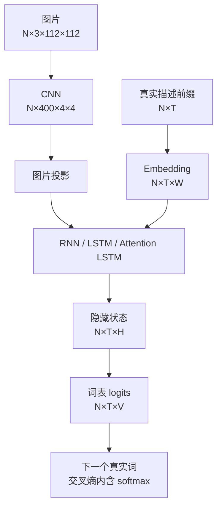
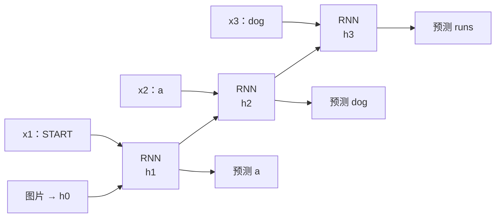
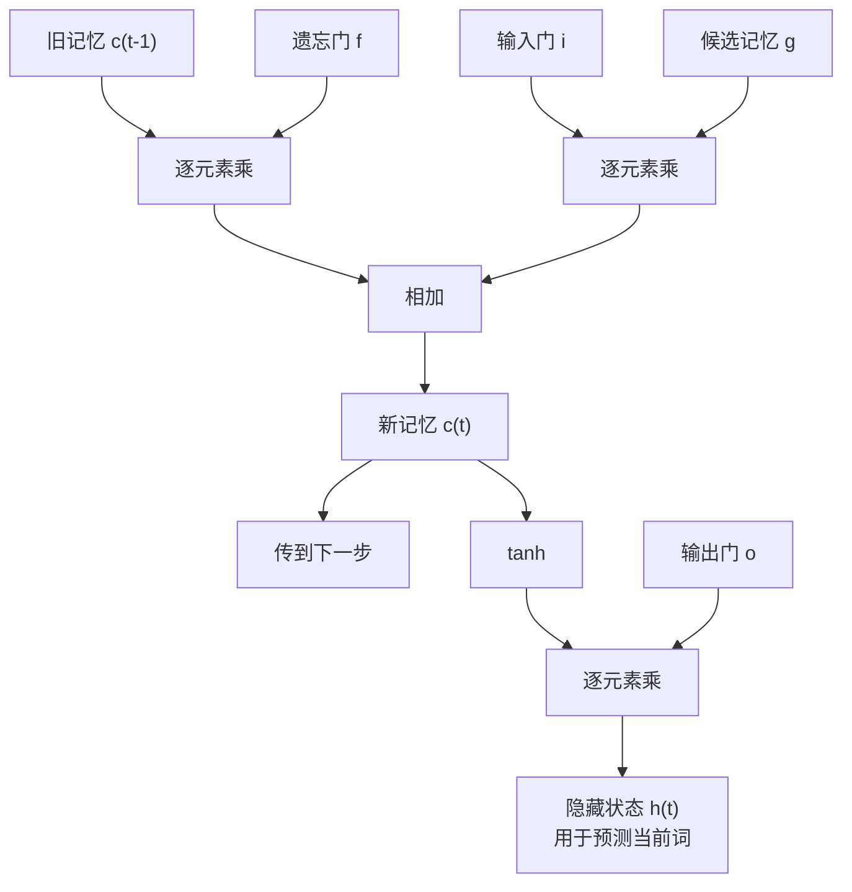
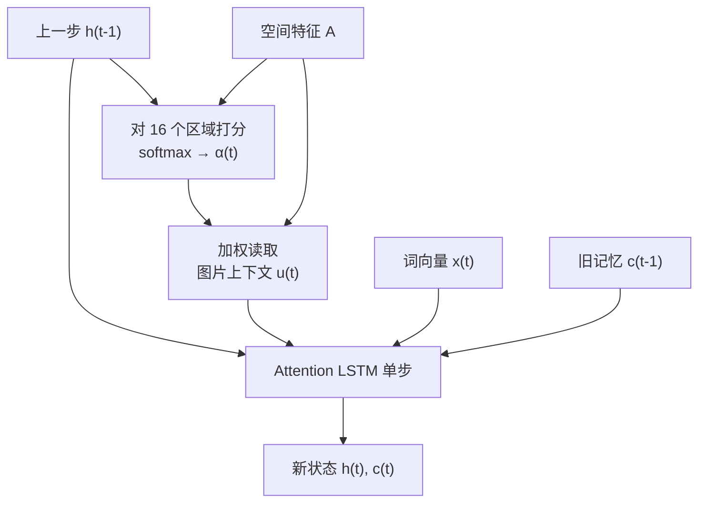
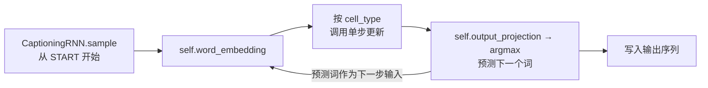
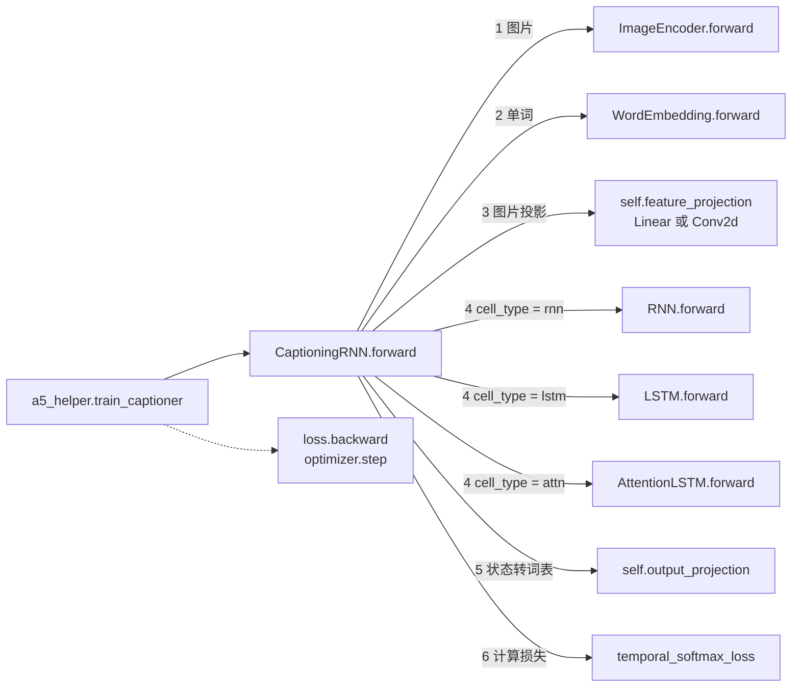
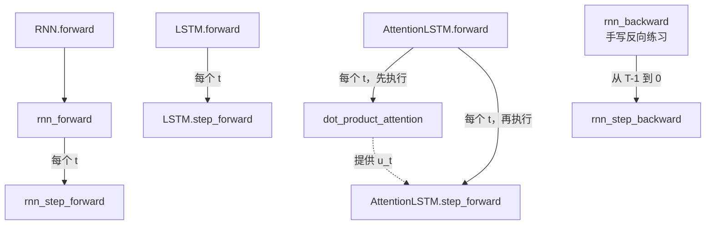

# 图像描述：RNN、LSTM 与 Attention LSTM

对应 [rnn_lstm_captioning.py](/D:/Study/Phd-Study/EECS498-WI22-main/A5/rnn_lstm_captioning.py)。三种模型都学习：**图片 + 已有单词 → 下一个单词**；区别在于如何保存历史、如何读取图片。

## 1. 共有流程：图片与单词在哪里汇合



| 符号 | 含义 | 对应张量 |
| --- | --- | --- |
| `N,T` | batch 大小、预测步数 | 描述前缀 `(N,T)` |
| `W,H,V` | 词向量维度、状态维度、词表大小 | 词向量 `(N,T,W)`；状态 `(N,T,H)` |
| `F,A` | CNN 特征、投影后的空间特征 | `F:(N,400,4,4)`；`A:(N,H,4,4)` |

### 1.1 图片编码与单词查表

$$
F=\operatorname{CNN}(I),\qquad
x_t=E[y_{t-1}],\qquad E\in\mathbb R^{V\times W}
$$

`E` 是可训练词表，`x_t` 是输入的上一个词的向量。以 `y_0=<START>` 为起点：

完整描述：`<START> a dog runs <END>`。

| 时间步 | 1 | 2 | 3 | 4 |
| :--- | :---: | :---: | :---: | :---: |
| 输入词 | `<START>` | `a` | `dog` | `runs` |
| 预测标签 | `a` | `dog` | `runs` | `<END>` |

### 1.2 预测概率与损失

下面的词向量和循环状态按单个样本的行向量书写；batch 只是把样本堆叠起来：

$$
s_t=h_tW_o+b_o,\qquad
W_o\in\mathbb R^{H\times V},\qquad
p_t(v)=\frac{e^{s_{t,v}}}{\sum_{u=1}^{V}e^{s_{t,u}}}
$$

对未补齐的一句描述，链式法则给出：

$$
p_\theta(y_{1:T}\mid I)
=\prod_{t=1}^{T}p_\theta(y_t\mid y_{<t},I)
$$

因此负对数似然变成各步交叉熵之和：

$$
\boxed{
L=-\frac1N\sum_{n=1}^{N}\sum_{t=1}^{T}
m_{n,t}\log p_{n,t}(y_{n,t}),\qquad
m_{n,t}=\mathbf1[y_{n,t}\ne\texttt{<NULL>}]
}
$$

`<NULL>` 补齐位置不贡献损失。当前作业**对时间步求和、对图片数取平均**，不是对全部有效 token 求平均。

## 2. Vanilla RNN：只传递一个隐藏状态

### 2.1 图片初始化

$$
\bar F=\left(\frac1{16}\sum_{j=1}^{16}F_j\right)^\mathsf T
\in\mathbb R^{1\times400},\qquad
h_0=\bar F W_{\mathrm{img}}+b_{\mathrm{img}}
$$

```text
(N,400,4,4) → 空间平均 → (N,400) → Linear → h0:(N,H)
```

### 2.2 时间展开与更新公式



$$
\boxed{
a_t=x_tW_x+h_{t-1}W_h+b,\qquad h_t=\tanh(a_t)
}
$$

$$
\underbrace{x_t}_{1\times W}
\underbrace{W_x}_{W\times H}
+
\underbrace{h_{t-1}}_{1\times H}
\underbrace{W_h}_{H\times H}
+\underbrace{b}_{1\times H}
\longrightarrow h_t\in\mathbb R^{1\times H}
$$

**同一组 `Wx/Wh/b` 在所有时间步共享**，不同时间步的状态不同。

### 2.3 梯度为什么可能消失或爆炸

令 $\bar h_t$ 表示该步汇总了当前损失与未来步骤的梯度。单步反向为：

$$
\delta_t=\bar h_t\odot(1-h_t^2)
$$

$$
\bar x_t=\delta_tW_x^\mathsf T,\qquad
\bar h_{t-1}\mathrel{+}=\delta_tW_h^\mathsf T
$$

$$
\nabla_{W_x}L=\sum_t x_t^\mathsf T\delta_t,\qquad
\nabla_{W_h}L=\sum_t h_{t-1}^\mathsf T\delta_t,\qquad
\nabla_bL=\sum_t\delta_t
$$

跨越很多步时，会反复乘 `Wh` 和 `tanh` 的导数；前者可能放大或缩小梯度，后者在饱和区接近 0。早期信息因此较难长期保留。

## 3. LSTM：用门控制记忆流

图片仍用于初始化 `h0`，额外增加细胞状态 `c_t`；普通 LSTM 在本作业中取 `c0=0`。

### 3.1 一次线性变换，得到四组门

$$
[a_i,a_f,a_o,a_g]
=x_tW_x+h_{t-1}W_h+b\in\mathbb R^{1\times4H}
$$

$$
W_x\in\mathbb R^{W\times4H},\qquad
W_h\in\mathbb R^{H\times4H}
$$

| 门 | 公式 | 值域 | 控制什么 |
| --- | --- | --- | --- |
| 输入门 | $i_t=\sigma(a_i)$ | `(0,1)` | 写入多少新信息 |
| 遗忘门 | $f_t=\sigma(a_f)$ | `(0,1)` | 保留多少旧记忆 |
| 输出门 | $o_t=\sigma(a_o)$ | `(0,1)` | 暴露多少内部记忆 |
| 候选记忆 | $g_t=\tanh(a_g)$ | `(-1,1)` | 准备写入的内容 |

### 3.2 记忆更新图



$$
\boxed{
c_t=\underbrace{f_t\odot c_{t-1}}_{\text{保留旧记忆}}
+\underbrace{i_t\odot g_t}_{\text{写入新信息}},\qquad
h_t=\underbrace{o_t\odot\tanh(c_t)}_{\text{输出可见状态}}
}
$$

单个维度的数值例子：

$$
c_{t-1}=2,\quad f=0.9,\quad i=0.2,\quad g=0.5,\quad o=0.8
$$

$$
c_t=0.9\times2+0.2\times0.5=1.9,\qquad
h_t=0.8\tanh(1.9)\approx0.765
$$

`c_t` 是内部记忆；`h_t` 是经过筛选后供预测和下一步门计算使用的状态。

### 3.3 为什么有利于长期记忆

沿细胞状态的直接传递路径、暂时固定各门时：

$$
\frac{\partial c_t}{\partial c_{t-1}}
=\operatorname{diag}(f_t),\qquad
\frac{\partial c_t}{\partial c_k}
=\operatorname{diag}\left(\prod_{r=k+1}^{t}f_r\right)
$$

例如 $0.98^{50}\approx0.364$：遗忘门接近 1 时，较早记忆能保留更多。该式描述直接路径；完整导数还包含门对状态的依赖，LSTM 也不保证梯度永不消失。

## 4. Attention LSTM：每个词重新读取图片

### 4.1 空间特征与初始状态

$$
A_j=W_AF_j+b_A,\qquad
W_A\in\mathbb R^{H\times400},\qquad j=1,\ldots,16
$$

```text
CNN 特征 (N,400,4,4)
→ 1×1 Conv：每个位置 400→H，不混合位置
→ A (N,H,4,4)
→ 展平空间维度 (N,H,16)
```

这里每个图片区域的特征列向量为 $F_j\in\mathbb R^{400\times1}$、$A_j\in\mathbb R^{H\times1}$。本作业将空间均值转为状态行向量：

$$
h_0=c_0=\left(\frac1{16}\sum_{j=1}^{16}A_j\right)^\mathsf T
$$

这里保留全部空间特征 `A`，同时用其均值初始化状态；普通 LSTM 则只有 `h0` 来自图片，`c0=0`。

### 4.2 匹配 → 归一化 → 加权读取

对单张图片，`A` 视为 `H×16` 矩阵，每一列是一个区域：

$$
\underbrace{e_t}_{1\times16}
=\frac{\underbrace{h_{t-1}}_{1\times H}
\underbrace{A}_{H\times16}}{\sqrt H}
$$

$$
\alpha_{t,j}
=\frac{e^{e_{t,j}}}{\sum_{r=1}^{16}e^{e_{t,r}}},
\qquad \sum_j\alpha_{t,j}=1
$$

$$
\boxed{
u_t=\sum_{j=1}^{16}\alpha_{t,j}A_j^\mathsf T
=\alpha_tA^\mathsf T\in\mathbb R^{1\times H}
}
$$

`u_t` 是当前步读取的图片信息，权重取决于上一步状态 `h(t-1)`。以下用 `2×2` 网格示意权重变化，实际是 `4×4`：

$$
\alpha_{\text{预测 dog}}=
\begin{bmatrix}0.05&0.10\\0.70&0.15\end{bmatrix},
\qquad
\alpha_{\text{预测 grass}}=
\begin{bmatrix}0.05&0.05\\0.25&0.65\end{bmatrix}
$$

每张权重图总和为 1；较大值表示该步从相应区域读取更多信息。这是示意值，不是模型实测结果。

### 4.3 图片信息进入四个门

$$
[a_i,a_f,a_o,a_g]
=x_tW_x+h_{t-1}W_h+\underbrace{u_tW_{\mathrm{attn}}}_{\text{当前图片上下文}}+b
$$

其中 $W_{\mathrm{attn}}\in\mathbb R^{H\times4H}$，之后仍按普通 LSTM 更新 `c_t/h_t`：



## 5. 三种模型的差别

| 项目 | RNN | LSTM | Attention LSTM |
| --- | --- | --- | --- |
| 传递状态 | $h_t$ | $h_t,c_t$ | $h_t,c_t$ |
| 图片初始化 | $h_0=\operatorname{Linear}(\bar F)$ | 同左，$c_0=0$ | $h_0=c_0=\bar A$ |
| 每步更新 | tanh | 四个门 | 四个门 + 图片上下文 |
| 图片是否每步重新读取 | 否 | 否 | 是，$u_t=\alpha_tA^\mathsf T$ |
| 图片表示 | 一个全局向量 | 一个全局向量 | 16 个区域向量 |
| 额外可视化 | — | — | 每步 `4×4` 注意力图 |

## 6. 训练与生成：输入来自哪里

| 阶段 | 第 t 步输入 | 输出的用途 |
| --- | --- | --- |
| 训练 | 真实词向量 $E[y_{t-1}]$ | 与真实下一个词 $y_t$ 计算损失 |
| 生成 | 上一步预测词向量 $E[\hat y_{t-1}]$ | 选择当前词并回送下一步 |

$$
\hat y_0=\texttt{<START>},\qquad
\hat y_t=\arg\max_v p_\theta(v\mid\hat y_{<t},I)
$$



当前 `sample` 使用贪心选择，按 `max_length` 固定次数生成，未提前在 `<END>` 停止；返回序列不包含起始 `<START>`。Attention LSTM 额外返回 `(N,T,4,4)` 的注意力图。


## 7. 组件与手写代码如何对应

`model(...)` 由 PyTorch 调度到 `CaptioningRNN.forward(...)`。点击函数名可定位源码；`self.xxx` 是该模型中的属性名。

| 组件／属性 | 代码入口 | 对应步骤 |
| --- | --- | --- |
| 训练循环 | [train_captioner](/D:/Study/Phd-Study/EECS498-WI22-main/A5/a5_helper.py:59) | 调用模型、loss.backward、AdamW 更新 |
| 图片特征 `self.encoder` | [ImageEncoder.forward](/D:/Study/Phd-Study/EECS498-WI22-main/A5/rnn_lstm_captioning.py:70) | 图片 → CNN 空间特征 |
| 图片投影 `self.feature_projection` | [CaptioningRNN.\_\_init\_\_](/D:/Study/Phd-Study/EECS498-WI22-main/A5/rnn_lstm_captioning.py:422) | RNN/LSTM 用 Linear；Attention 用 1×1 Conv |
| 词向量 `self.word_embedding` | [WordEmbedding.forward](/D:/Study/Phd-Study/EECS498-WI22-main/A5/rnn_lstm_captioning.py:340) | 编号 → 可训练词向量 |
| 训练前向总入口 | [CaptioningRNN.forward](/D:/Study/Phd-Study/EECS498-WI22-main/A5/rnn_lstm_captioning.py:488) | 选择 cell_type，连接所有组件 |
| RNN 整段序列 | [RNN.forward](/D:/Study/Phd-Study/EECS498-WI22-main/A5/rnn_lstm_captioning.py:291)<br/>[rnn_forward](/D:/Study/Phd-Study/EECS498-WI22-main/A5/rnn_lstm_captioning.py:161) | 循环调用单步函数，堆叠 h_t |
| RNN 单步 | [RNN.step_forward](/D:/Study/Phd-Study/EECS498-WI22-main/A5/rnn_lstm_captioning.py:303)<br/>[rnn_step_forward](/D:/Study/Phd-Study/EECS498-WI22-main/A5/rnn_lstm_captioning.py:89) | tanh 更新 |
| 手写 RNN 反向 | [rnn_backward](/D:/Study/Phd-Study/EECS498-WI22-main/A5/rnn_lstm_captioning.py:206)<br/>[rnn_step_backward](/D:/Study/Phd-Study/EECS498-WI22-main/A5/rnn_lstm_captioning.py:124) | 时间倒序、累加梯度 |
| LSTM | [LSTM.forward](/D:/Study/Phd-Study/EECS498-WI22-main/A5/rnn_lstm_captioning.py:728)<br/>[LSTM.step_forward](/D:/Study/Phd-Study/EECS498-WI22-main/A5/rnn_lstm_captioning.py:687) | 整段循环 → 四门更新 |
| 图片区域注意力 | [dot_product_attention](/D:/Study/Phd-Study/EECS498-WI22-main/A5/rnn_lstm_captioning.py:775) | 打分 → softmax → 区域加权和 |
| Attention LSTM | [AttentionLSTM.forward](/D:/Study/Phd-Study/EECS498-WI22-main/A5/rnn_lstm_captioning.py:884)<br/>[AttentionLSTM.<br/>step_forward](/D:/Study/Phd-Study/EECS498-WI22-main/A5/rnn_lstm_captioning.py:845) | 每步先读图片，再更新四门 |
| 输出层与损失 | [CaptioningRNN.forward](/D:/Study/Phd-Study/EECS498-WI22-main/A5/rnn_lstm_captioning.py:488)<br/>[temporal_softmax_loss](/D:/Study/Phd-Study/EECS498-WI22-main/A5/rnn_lstm_captioning.py:355) | output_projection → 词表 logits → CE |
| 生成与文字显示 | [CaptioningRNN.sample](/D:/Study/Phd-Study/EECS498-WI22-main/A5/rnn_lstm_captioning.py:561)<br/>[decode_captions](/D:/Study/Phd-Study/EECS498-WI22-main/A5/a5_helper.py:121) | 贪心生成编号 → 转成单词 |

### 7.1 训练调用：三种序列模块选一个

实线表示调用，边上的数字表示同一函数内部的执行顺序；虚线表示后续参数更新。



`RNN.forward / LSTM.forward / AttentionLSTM.forward` 是三个互斥分支；它们的返回值都为 `(N,T,H)`，随后才进入输出层。

### 7.2 单步逻辑：对照你写的循环体



这里虚线表示数据传递。**实际训练的 `loss.backward()` 由 autograd 处理，不会自动调用你写的 `rnn_backward`**；后者用于手写梯度练习与测试。

生成入口 `CaptioningRNN.sample` 复用同一组参数，但每轮调用 `RNN.step_forward`、`LSTM.step_forward` 或“`dot_product_attention` + `AttentionLSTM.step_forward`”，不运行整段序列的 `forward`。其中 `RNN.step_forward` 再调用 `rnn_step_forward`。
