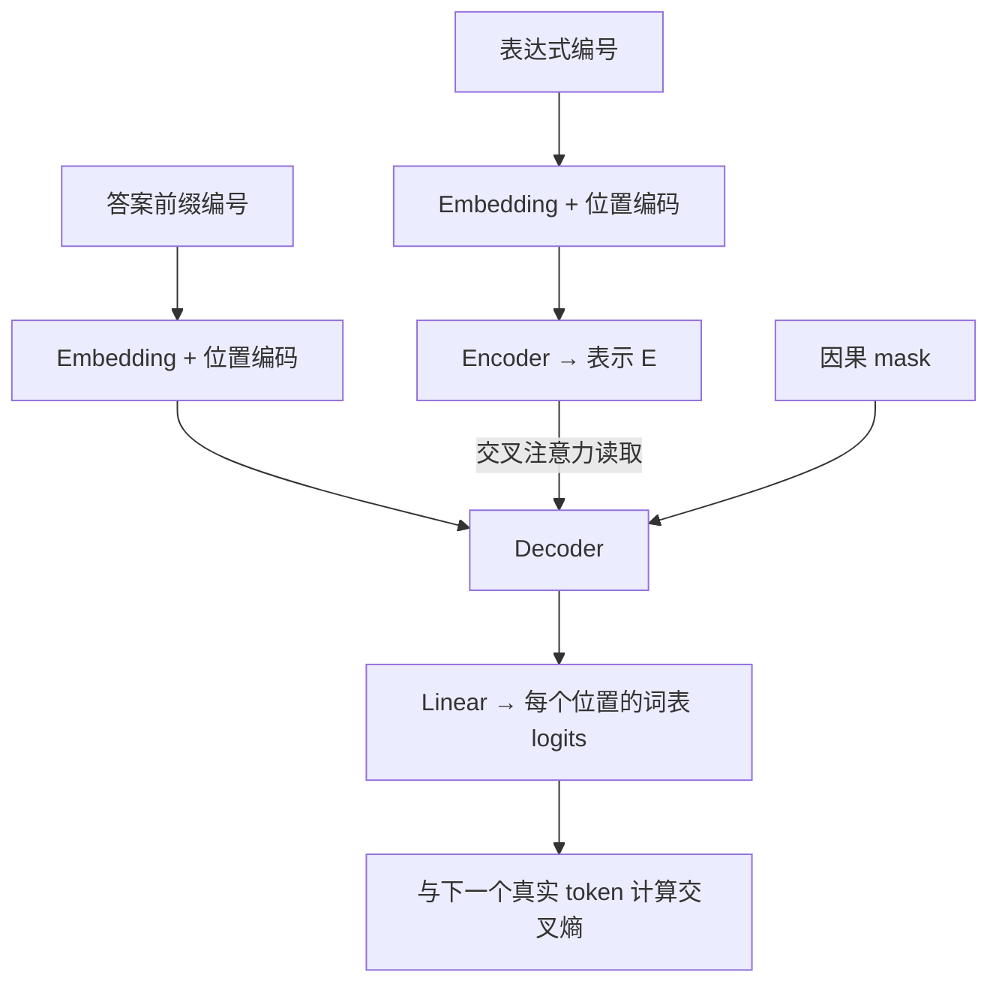
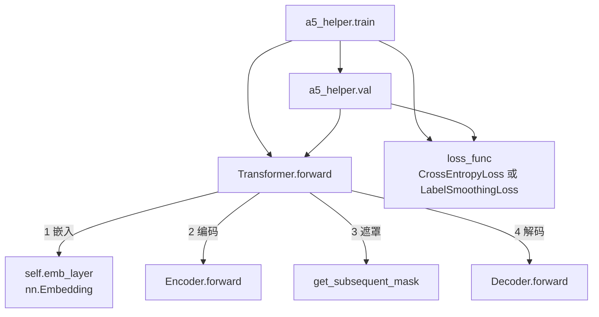
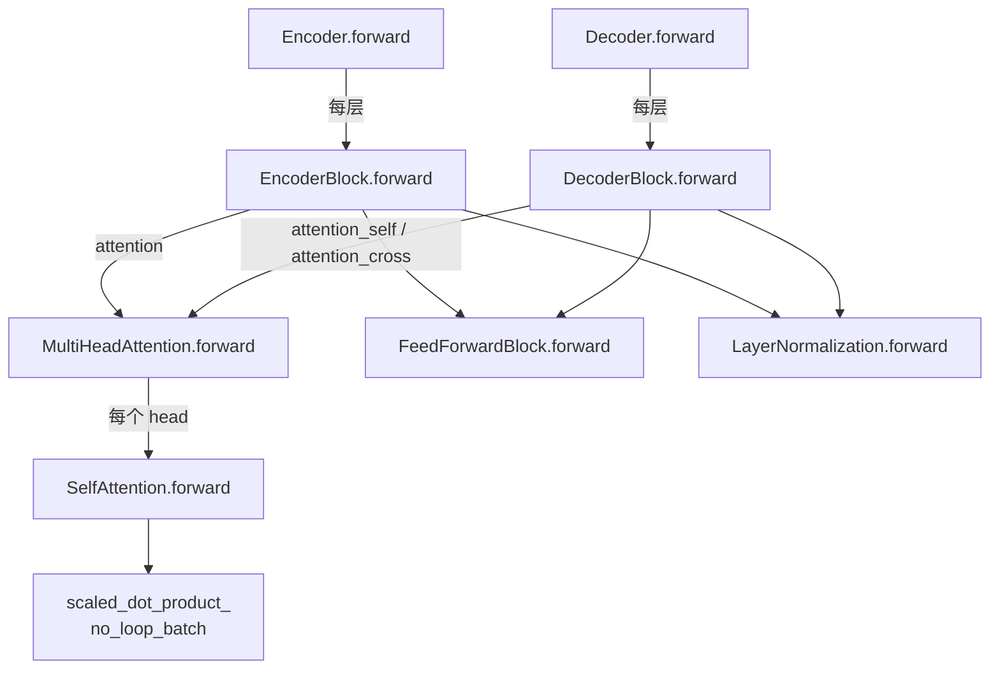
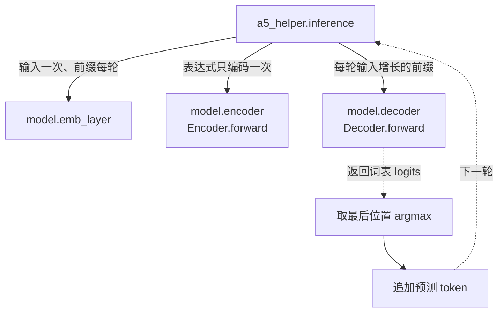

# Transformer：训练、推理、图像描述与 ViT

本文对应 A5 的 [transformers.py](/D:/Study/Phd-Study/EECS498-WI22-main/A5/transformers.py)。任务是根据带符号的加减法表达式生成答案，例如输入 `(-30)-(-34)`，输出 `+04`。这里使用 Encoder–Decoder Transformer：Encoder 编码完整表达式，Decoder 根据表达式和答案历史预测下一个 token。

第 9–11 节补充 [assignment3 的 Transformer 作业](/D:/Study/Phd-Study/EECS498-WI22-main/assignment3/Transformer_Captioning.ipynb)：图像描述与 Vision Transformer。只为新增组件给出参考代码。

先按训练目标区分三个任务；**Transformer 是网络组件，loss 由具体任务决定**：

| 任务 | 模型直接输出 | 标签与 loss | 本题更新什么 |
| --- | --- | --- | --- |
| A5 加减法 | 每个目标位置的词表 logits | 下一个答案 token；交叉熵／标签平滑 | Embedding、Encoder、Decoder、词表投影 |
| 图像描述 | 每个目标位置的词表 logits | 下一个描述词；忽略 NULL 的交叉熵 | 图像投影、文字 Embedding、Decoder、词表投影 |
| ViT 分类 | 每张图的类别 logits | CIFAR-10 类别；分类交叉熵 | patch 投影、Encoder、分类头 |

这些训练按 Notebook 从初始化模型开始，不应把所有 `backward()` 都称为微调；微调强调从预训练权重出发适配下游任务。推理则固定参数，只根据分数生成答案或选择类别。

## 1. 共有训练流程



| 符号 | 第 1–9 节的含义 |
| --- | --- |
| N | batch size |
| K、O、T | 输入长度、含 BOS/EOS 的完整答案长度、预测长度 `T=O-1` |
| M、H、d | 模型维度、注意力头数、每头维度 `d=M/H` |
| F、V | FFN 中间维度、词表大小 |
| o、π、y | 未归一化 logits、softmax 后的概率、真实目标 token |
| θ、η | 当前任务的可训练参数、学习率 |

后文图片的高宽另在第 10 节局部定义，避免与注意力头数混淆。

本作业词表有 16 个 token：数字 `0–9`，以及 `POSITIVE/NEGATIVE/add/subtract/BOS/EOS`。数字按字符编码，`04` 保留为两个 token。一个样本为：

输入：`BOS NEGATIVE 3 0 subtract NEGATIVE 3 4 EOS`，`K=9`。  
答案：`BOS POSITIVE 0 4 EOS`，`O=5`。

| 预测位置 | 0 | 1 | 2 | 3 |
| :--- | :---: | :---: | :---: | :---: |
| Decoder 输入 | BOS | POSITIVE | 0 | 4 |
| 预测目标 | POSITIVE | 0 | 4 | EOS |

训练使用真实答案前缀预测下一个 token，称为 teacher forcing。虽然完整答案已经给定，Decoder 仍必须使用因果 mask，避免读取目标序列的未来位置。

## 2. Encoder：编码输入表达式

### 2.1 词向量与位置编码

`nn.Embedding(V,M)` 是可训练的 `(V,M)` 查找表，将每个 token 编号映射成向量。表达式和答案共享这个 Embedding：

| 步骤 | 张量形状 |
| --- | --- |
| 表达式编号 | `(N,K)` |
| Embedding | `(N,K,M)` |
| 加上位置编码 | `(N,K,M)` |

位置编码与词向量逐元素相加：

$$
X_{n,p,:}=E_{\mathrm{token}}[\mathrm{token}_{n,p}]+PE_{p,:}
$$

词向量提供 token 内容，位置编码提供顺序。标准正弦位置编码为：

$$
PE_{p,2i}=\sin\left(\frac p{10000^{2i/M}}\right),\qquad
PE_{p,2i+1}=\cos\left(\frac p{10000^{2i/M}}\right)
$$

不同特征对使用不同频率。当前作业还提供简单版本 `PE[p,j]=p/K`；其正弦函数使用了取整指数，与标准公式的区别见第 7 节。

### 2.2 Scaled dot-product attention

先对输入做三个独立的可学习投影：

$$
Q=\operatorname{Linear}_q(X),\qquad
K_{\mathrm{attn}}=\operatorname{Linear}_k(X),\qquad
V_{\mathrm{attn}}=\operatorname{Linear}_v(X)
$$

这里用 $K_{\mathrm{attn}}$ 区分 Key 张量和输入长度 `K`。注意力先计算匹配分数，再读取 Value：

$$
A=\operatorname{softmax}\left(
\frac{QK_{\mathrm{attn}}^\mathsf T}{\sqrt d}
\right),\qquad Y=AV_{\mathrm{attn}}
$$

| 张量 | 单个 Encoder 头的形状 | 含义 |
| --- | --- | --- |
| Q、Key、Value | `(N,K,d)` | 输入位置的三种投影 |
| 分数、权重 A | `(N,K,K)` | 每个 query 对各 key 的关注程度 |
| 输出 Y | `(N,K,d)` | Value 的加权和 |

softmax 沿 key 维度进行，因此每个 query 对所有 key 的权重和为 1。除以 `sqrt(d)` 用于控制点积分数的尺度，降低 softmax 过早饱和的倾向。

忽略 batch 和头下标，把一行注意力展开会更清楚。令 `𝒜(i)` 是 query i 可以读取的 Key 位置集合：

$$
e_{ij}=\frac{q_i^\top k_j}{\sqrt d},
\qquad A_{ij}=\frac{\exp(e_{ij})}
{\sum_{k\in\mathcal A(i)}\exp(e_{ik})}
\quad (j\in\mathcal A(i))
$$

$$
y_i=\sum_{j\in\mathcal A(i)}A_{ij}v_j
$$

这里 softmax 的候选是 Key 位置，输出是 Value 的加权和，还不是词表概率，也不是训练 loss。Encoder 允许集合是全部有效输入位置；Decoder 自注意力只允许到当前位置为止的前缀。

自注意力的 Q/K/V 来自同一组输入，但使用不同的投影参数，因此数值通常不同。Encoder 可以读取完整表达式，包括当前位置之后的输入 token。

### 2.3 Multi-head attention

每个头有自己的 Q/K/V 投影，读取不同的特征组合；各头输出沿最后一维拼接，再投影回 `M` 维：

$$
\operatorname{MHA}(X)
=\operatorname{Linear}_{\mathrm{out}}
\left(\operatorname{Concat}(\mathrm{head}_1,\ldots,\mathrm{head}_H)\right)
$$

```text
输入 (N,K,M)
  → H 个独立注意力头，各输出 (N,K,d)
  → 拼接 (N,K,H*d)
  → 输出 Linear
  → (N,K,M)
```

当前 Block 选择 `d=M//H`，要求 `M` 能被 `H` 整除。多头接收同一个输入，各自学习投影，不是把原始输入直接平均分成几段后不再变换。

### 2.4 FFN、LayerNorm 与残差

FFN 在每个位置独立执行相同的非线性变换：

$$
\operatorname{FFN}(x)
=\operatorname{Linear}_2\left(\operatorname{ReLU}(\operatorname{Linear}_1(x))\right)
$$

```text
(N,K,M) → Linear(M,F) → ReLU → Linear(F,M) → (N,K,M)
```

注意力负责混合位置之间的信息，FFN 负责加工每个位置内部的特征。所有位置共享 FFN 参数。

LayerNorm 对每个位置的 `M` 个特征计算均值和方差：

$$
\mu=\frac1M\sum_jx_j,\qquad
v=\frac1M\sum_j(x_j-\mu)^2,\qquad
\operatorname{LN}(x)_j
=\gamma_j\frac{x_j-\mu}{\sqrt{v+\epsilon}}+\beta_j
$$

$\gamma,\beta$ 是可训练的 `(M,)` 参数。归一化不依赖其他样本的统计量。残差连接 `x+f(x)` 保留原特征，也提供直接的梯度传播路径。

当前一个 EncoderBlock 的计算为：

$$
U=\operatorname{Dropout}\left(\operatorname{LN}_1
(X+\operatorname{MHA}(X,X,X))\right)
$$

$$
Y=\operatorname{Dropout}\left(\operatorname{LN}_2
(U+\operatorname{FFN}(U))\right)
$$

`Encoder` 串联多个参数独立的 Block，始终保持 `(N,K,M)`，输出全部输入位置的表示 `E`，供 Decoder 读取。

## 3. Decoder：根据答案历史读取表达式

### 3.1 带因果 mask 的自注意力

Decoder 输入为答案去掉最后一个 token，形状为 `(N,T)`。位置 `i` 只能关注 `j<=i` 的输入位置：

| Query ＼ Key | 0 | 1 | 2 | 3 |
| :--- | :---: | :---: | :---: | :---: |
| 0 | 可见 | 遮住 | 遮住 | 遮住 |
| 1 | 可见 | 可见 | 遮住 | 遮住 |
| 2 | 可见 | 可见 | 可见 | 遮住 |
| 3 | 可见 | 可见 | 可见 | 可见 |

本作业 mask 的 `True` 表示遮住，形状为 `(N,T,T)`。在 softmax 前将被遮住的分数设为很小的负数，使其权重接近 0。

主对角线可以保留，因为位置 `i` 的输入用于预测它后面的那个 token；如果不遮住后续位置，训练时就可能直接看到需要预测的答案。

### 3.2 交叉注意力与前馈网络

带 mask 的自注意力先整合答案历史；交叉注意力再根据当前目标表示，从 Encoder 的输出中读取表达式信息：

| 注意力 | Q 来源 | Key、Value 来源 | 权重形状 |
| --- | --- | --- | --- |
| Encoder 自注意力 | Encoder 当前层输入 | 同一输入 | `(N,K,K)` |
| Decoder 自注意力 | Decoder 当前层输入 | 同一输入，带因果 mask | `(N,T,T)` |
| Decoder 交叉注意力 | 本层自注意力及残差、LN、Dropout 后的表示 | Encoder 最终输出 E | `(N,T,K)` |

一个 DecoderBlock 为：

$$
U_1=\operatorname{Dropout}\left(\operatorname{LN}_1
(X+\operatorname{MaskedMHA}(X,X,X))\right)
$$

$$
U_2=\operatorname{Dropout}\left(\operatorname{LN}_2
(U_1+\operatorname{CrossMHA}(U_1,E,E))\right)
$$

$$
Y=\operatorname{Dropout}\left(\operatorname{LN}_3
(U_2+\operatorname{FFN}(U_2))\right)
$$

交叉注意力中，每个答案位置从全部表达式位置读取信息，因此不使用答案的三角 mask。输入长度 `K` 与输出长度 `T` 可以不同，输出位置数量由 Query 决定。

多层 Decoder 最后通过 `Linear(M,V)` 输出 `(N,T,V)` 的词表 logits。此输出层与输入 Embedding 不共享权重。

## 4. 训练损失与形状

完整形状变化为：

| 步骤 | 输入／输出形状 |
| --- | --- |
| 表达式 → Encoder 表示 E | `(N,K) → (N,K,M)` |
| 答案前缀 + E → Decoder 表示 | `(N,T) → (N,T,M)` |
| 词表投影 | `(N,T,M) → (N,T,V)` |
| logits 与目标分别展平 | `(N*T,V)`、`(N*T,)` |
| 交叉熵 → backward → Adam | 标量损失 → 梯度 → 参数更新 |

真实目标是 `ans[:,1:]`。数学中令 `y₀=BOS`、`t=1,…,T`，第 t 个目标是 yₜ，其输入只含 `y₀,…,yₜ₋₁`。先将词表 logits 转为概率：

$$
\pi_{n,t,v}=\frac{\exp(o_{n,t,v})}
{\sum_{u=0}^{V-1}\exp(o_{n,t,u})}
=p_\theta(y_{n,t}=v\mid y_{n,0:t-1},x_n)
$$

单个位置的 loss 是真实目标的负对数概率；A5 对全部位置求和：

$$
\ell_{n,t}=-\log\pi_{n,t,y_{n,t}},
\qquad L=\sum_{n=1}^{N}\sum_{t=1}^{T}\ell_{n,t}
$$

模型传出未归一化 logits，交叉熵内部处理 log-softmax，无需提前做 softmax。作业的 `CrossEntropyLoss` 使用求和，helper 显示 loss 时再进行归一化。

Label smoothing 不改模型的 softmax，而是把 one-hot 监督改成更平滑的目标分布。本作业 `ε=0.1`：

$$
q_{n,t,v}=\begin{cases}
1-\varepsilon,&v=y_{n,t},\\
\varepsilon/(V-1),&v\ne y_{n,t}.
\end{cases}
$$

$$
L_{\mathrm{smooth}}=-\sum_{n,t,v}q_{n,t,v}\log\pi_{n,t,v}
$$

普通交叉熵对某位置 logit 的梯度是 `π-one_hot(y)`，标签平滑后是 `π-q`；梯度再经过词表投影、Decoder、交叉注意力回到 Encoder 和 Embedding。用梯度下降示意参数更新：

$$
\theta\leftarrow\theta-\eta\nabla_\theta L
$$

实际作业使用 Adam。loss 的类别维度是 V 个词；注意力 softmax 的维度是输入位置，两者不能混淆。训练时真实前缀已知，可以并行计算所有目标位置；生成时前缀未知，仍需逐步预测。

## 5. 推理：从 BOS 自回归生成

推理只提供表达式，先运行一次 Encoder，再从 `BOS` 开始：

| 轮次 | Decoder 已有前缀 | 追加预测 |
| :---: | --- | --- |
| 1 | `BOS` | POSITIVE |
| 2 | `BOS POSITIVE` | 0 |
| 3 | `BOS POSITIVE 0` | 4 |
| 4 | `BOS POSITIVE 0 4` | EOS |

每轮将已有前缀送入 Decoder，只取最后一个位置的 logits，选择下一个 token 并追加。Encoder 输出可复用；当前实现没有 KV cache，会重复计算 Decoder 前缀。

位置编码应预先准备，再按前缀长度切片。尤其简单编码 `p/K` 依赖总长度，若每轮按新前缀长度重算，同一位置的表示会变化。

`model.eval()` 关闭 Dropout 等训练行为，但不自动执行生成循环，也不关闭梯度记录。正常生成还应关闭梯度，并设置 EOS 停止和最大长度。

## 6. 与 RNN、LSTM 的区别

| 项目 | RNN / LSTM | Encoder–Decoder Transformer |
| --- | --- | --- |
| 历史信息 | 逐步传递隐藏状态，LSTM 额外维护细胞状态 | 通过注意力读取前缀各位置 |
| 顺序来源 | 循环的处理顺序 | 位置编码和因果约束 |
| 输入读取 | Attention LSTM 根据当前状态读取图片区域 | 交叉注意力根据目标表示读取输入位置 |
| 训练 | 时间步之间存在循环依赖 | 已知目标前缀的各位置可并行计算 |
| 生成 | 上一步预测进入下一步 | 同样逐 token 生成 |

例如 `N=2,M=32,H=4,d=8,K=9,T=4,V=16` 时，Encoder 每头权重为 `(2,9,9)`，Decoder 自注意力权重为 `(2,4,4)`，交叉注意力权重为 `(2,4,9)`，最终 logits 为 `(2,4,16)`，展平后为 `(8,16)`。

## 7. 当前作业的实现约定

当前实现与常见标准写法有几处差异，理解公式和结果时需要对应实际代码：

| 位置 | 当前行为 |
| --- | --- |
| 正弦位置编码 | 指数使用 `floor(2*i/M)`，有效索引下全部为 0，因此没有标准公式的多频率结构 |
| Block 顺序 | 子层 → 残差相加 → LayerNorm → Dropout，不能随意替换成其他排列来匹配固定测试 |
| 多头接口 | `MultiHeadAttention` 的 `dim_out` 表示每个头的维度，最终模块投影回 `dim_in` |
| 验证 accuracy | helper 返回的分子仅来自最后一个 batch；总体应使用累计正确数 |
| 验证 loss | helper 按 `batch_size*4` 归一化，依赖每个样本预测 4 个 token |
| 训练中的验证 | helper 调用验证时未传 device，验证默认 CPU |
| 生成 helper | 固定 BOS、CUDA 和生成轮数，不传因果 mask，也不按 EOS 提前停止 |

验证采用真实答案前缀，所以 token accuracy 不等于自主生成完整答案的准确率。生成时保留因果 mask，可使多层 Decoder 内前缀的信息传播方式与训练一致。

最近一次注意力权重保存在 `heads[h].weights_softmax`；Encoder 的注意力属性为 `attention`，Decoder 分别为 `attention_self` 和 `attention_cross`。绘图的纵轴是 Query、横轴是 Key，交叉注意力不一定是方阵。

这些是当前作业的接口与辅助代码约定，不改变 Encoder 编码输入、Decoder 根据历史逐步生成的整体流程。


## 8. 组件与手写代码如何对应

主要定义均在 [transformers.py](/D:/Study/Phd-Study/EECS498-WI22-main/A5/transformers.py)；训练、验证和生成入口在 [a5_helper.py](/D:/Study/Phd-Study/EECS498-WI22-main/A5/a5_helper.py)。`model(...)` 进入 `Transformer.forward`，但生成 helper 直接调用 Encoder/Decoder。

| 组件／属性 | 代码入口 | 对应步骤 |
| --- | --- | --- |
| 词表与字符串编码 | [generate_token_dict](/D:/Study/Phd-Study/EECS498-WI22-main/A5/transformers.py:15)<br/>[prepocess_input_sequence](/D:/Study/Phd-Study/EECS498-WI22-main/A5/transformers.py:46) | 字符串 → token 编号 |
| 样本与位置编码 | [AddSubDataset.<br/>\_\_getitem\_\_](/D:/Study/Phd-Study/EECS498-WI22-main/A5/transformers.py:1275)<br/>[AddSubDataset.preprocess](/D:/Study/Phd-Study/EECS498-WI22-main/A5/transformers.py:1270) | 调用字符串编码和 self.pos_encode |
| 两种位置公式 | [position_encoding_simple](/D:/Study/Phd-Study/EECS498-WI22-main/A5/transformers.py:1035)<br/>[position_encoding_<br/>sinusoid](/D:/Study/Phd-Study/EECS498-WI22-main/A5/transformers.py:1066) | 输出 `(1,L,M)`，Dataset 去掉首维 |
| 训练前向与 Embedding | [Transformer.\_\_init\_\_](/D:/Study/Phd-Study/EECS498-WI22-main/A5/transformers.py:1120)<br/>[Transformer.forward](/D:/Study/Phd-Study/EECS498-WI22-main/A5/transformers.py:1179) | emb_layer → Encoder → mask → Decoder |
| 输入编码栈 | [Encoder.forward](/D:/Study/Phd-Study/EECS498-WI22-main/A5/transformers.py:978)<br/>[EncoderBlock.forward](/D:/Study/Phd-Study/EECS498-WI22-main/A5/transformers.py:724) | 多层自注意力与 FFN |
| 目标解码栈 | [Decoder.forward](/D:/Study/Phd-Study/EECS498-WI22-main/A5/transformers.py:1026)<br/>[DecoderBlock.forward](/D:/Study/Phd-Study/EECS498-WI22-main/A5/transformers.py:900) | 自注意力 → 交叉注意力 → FFN |
| 多头拼接与投影 | [MultiHeadAttention.<br/>forward](/D:/Study/Phd-Study/EECS498-WI22-main/A5/transformers.py:438) | heads 分别计算 → cat → self.mlp |
| 单头 Q/K/V 投影 | [SelfAttention.forward](/D:/Study/Phd-Study/EECS498-WI22-main/A5/transformers.py:331) | self.q、self.k、self.v |
| 点积注意力核心 | [scaled_dot_product_<br/>no_loop_batch](/D:/Study/Phd-Study/EECS498-WI22-main/A5/transformers.py:209) | bmm → mask → softmax → bmm |
| 因果遮罩 | [get_subsequent_mask](/D:/Study/Phd-Study/EECS498-WI22-main/A5/transformers.py:762) | 二维目标前缀 → 三角 mask |
| 逐位置非线性 | [FeedForwardBlock.forward](/D:/Study/Phd-Study/EECS498-WI22-main/A5/transformers.py:616) | 调用 self.network：Linear → ReLU → Linear |
| 特征归一化 | [LayerNormalization.<br/>forward](/D:/Study/Phd-Study/EECS498-WI22-main/A5/transformers.py:531) | 最后一维的均值、方差、gamma/beta |
| 词表输出层 | [Decoder.forward](/D:/Study/Phd-Study/EECS498-WI22-main/A5/transformers.py:1026) | self.proj_to_vocab，nn.Linear |
| 两种训练损失 | [CrossEntropyLoss](/D:/Study/Phd-Study/EECS498-WI22-main/A5/transformers.py:1325)<br/>[LabelSmoothingLoss](/D:/Study/Phd-Study/EECS498-WI22-main/A5/transformers.py:1306) | 输入 logits 与错开一位的标签 |
| 训练／验证／生成 | [train](/D:/Study/Phd-Study/EECS498-WI22-main/A5/a5_helper.py:152)<br/>[val](/D:/Study/Phd-Study/EECS498-WI22-main/A5/a5_helper.py:217)<br/>[inference](/D:/Study/Phd-Study/EECS498-WI22-main/A5/a5_helper.py:248) | 外部循环与设备、优化器管理 |

### 8.1 训练入口与模型调用

实线表示调用；数字标记同一函数内部的顺序。损失由 helper 调用，`Transformer.forward` 只返回 logits。



`AddSubDataset.__getitem__` 在数据加载阶段调用 `preprocess → prepocess_input_sequence`，并分别为输入和答案调用 `self.pos_encode`；这些工作不在 `Transformer.forward` 内重复执行。

### 8.2 从 Block 追到你写的注意力函数



图中同一节点代表同一类的调用逻辑，**不表示各 Block 或不同头共享参数**。Decoder 在全部 Block 结束后才执行 `self.proj_to_vocab`。

`scaled_dot_product_two_loop_single` 和 `scaled_dot_product_two_loop_batch` 是点积注意力的练习版本；当前 `SelfAttention.forward` 调用的是无循环版本。

### 8.3 生成入口绕过 Transformer.forward



这里实线表示调用或执行推进，虚线表示结果回传。当前 helper 传入 `mask=None`，其具体边界见第 7 节；生成时也不会调用训练用的 `CrossEntropyLoss`。

## 9. assignment3 新增：Image Captioning with Transformers

本节按 [Transformer_Captioning.ipynb](/D:/Study/Phd-Study/EECS498-WI22-main/assignment3/Transformer_Captioning.ipynb) 前半部分的顺序组织：**COCO → 多头注意力 → 位置编码 → DecoderBlock → 图像描述模型 → 小样本过拟合 → 生成**。已有 Transformer 组件只补新题的约定，新增组件保留参考代码。

### 9.1 COCO Dataset：描述行号与图片行号

COCO 一张图片可能对应多条描述，所以描述与图片特征的第一维长度不一定相同。`train_image_idxs` 把每条描述映射到它所属的图片：

| 数据项 | 含义 |
| --- | --- |
| `train_captions` | 每行一条 token 编号序列，含 START、END、NULL 等 |
| `train_image_idxs` | 每条描述对应的图片索引 |
| `train_features` | 预先提取的 VGG16 fc7 图片特征，可选择 PCA 版本 |
| `word_to_idx / idx_to_word` | 词表的正向与反向映射 |
| `train_urls` | 用于展示图片的 URL，不是描述模型的直接输入 |

训练时先抽描述，再通过 image index 找到正确图片特征。模型接收 `(N,D)` 特征，而不是 RGB 像素；`D` 从数据中读取，不能把它写死为某个值。

### 9.2 Transformer: Multi-Headed Attention

原理见第 2、3 节。Notebook 先从点积注意力讲到自注意力，再扩展为多头：Q 决定当前位置要查询什么，Key 决定各位置如何被匹配，Value 提供实际读取的信息。

新题把各头的投影合并计算，再将 M 维拆为 H 个头，每头 `d=M/H`。对 Query 长度 T、Key 长度 S：

```text
Q:(N,T,M) → (N,H,T,d)
Key、Value:(N,S,M) → (N,H,S,d)
Q @ Key^T / sqrt(d) → (N,H,T,S)
→ mask → 对 key 维 softmax → 加权 Value
→ 拼回 (N,T,M) → 输出投影
```

| 项目 | assignment3 的约定 |
| --- | --- |
| mask | 二维 `(T,S)`，`True/1` 表示允许读取，与 A5 的布尔语义相反 |
| 注意力 Dropout | 在 softmax 权重之后应用 |
| 序列长度 | Q 与 Key/Value 的长度可以不同，输出长度由 Q 决定 |
| 实现文件 | [transformer_layers.py](/D:/Study/Phd-Study/EECS498-WI22-main/assignment3/cs231n/transformer_layers.py) 的 `MultiHeadAttention` |

Notebook 的固定数值检查使用不同的 Query 与 Key 长度，能暴露错误的 reshape 或转置。应先通过这一层的检查，再继续组合 Decoder。

### 9.3 Positional Encoding 与思考题 1

自注意力没有内置的顺序信息，所以文字嵌入要加上位置编码。新题使用标准多频率正弦公式：同一对偶数／奇数维分别为 sin 和 cos，频率相同；不同特征对使用不同频率，见第 2.1 节。

`PositionalEncoding` 将编码注册为 buffer，前向时按序列长度切片，与 Embedding 相加后再做 Dropout。它不需要训练；不要沿用 A5 中取整指数的实现细节。

思考题 1 的三个设计选择分别对应：多个头可学习不同的关系；除以 `sqrt(d)` 控制分数尺度、减轻 softmax 饱和；输出 Linear 混合各头的信息，并映射回模型维度。缺少最后的投影时，各头拼接后的特征缺少这一层可学习的组合。

### 9.4 Transformer Decoder Block：三种子层的顺序

新题的单层结构是带 mask 自注意力、交叉注意力、FFN；每个子层均采用：

$$
X' = \mathrm{LayerNorm}\bigl(X+\mathrm{Dropout}(\mathrm{Sublayer}(X))\bigr)
$$

这是 post-norm，Dropout 在残差相加之前；与 A5 的具体排列不同。FFN 为 `Linear → GELU → Dropout → Linear`，其他位置的输出 Dropout 由 Block 处理。

| 子层 | Query 来源 | Key、Value 来源 | 每头权重形状 |
| --- | --- | --- | --- |
| Masked self-attention | 描述前缀 | 相同前缀 | `(N,T,T)` |
| Cross-attention | 自注意力子层的输出 | 图片 memory | `(N,T,1)` |
| FFN | 各位置的当前表示 | 逐位置变换，不做注意力 | — |

### 9.5 Transformer for Image Captioning：组合完整模型

原来的表达式 Encoder 换成预先提取的 COCO 图像特征；文字 Decoder 仍使用“带 mask 自注意力 → 交叉注意力 → FFN”。本题直接投影图像向量，没有额外的图像 Transformer Encoder。

```text
图片特征 (N,D) → Linear(D,M) → memory (N,1,M)
描述前缀 (N,T) → Embedding + 位置编码 → Decoder
Decoder 读取 memory → Linear(M,V) → 下一个词的 logits (N,T,V)
```

对应 [CaptioningTransformer.forward](/D:/Study/Phd-Study/EECS498-WI22-main/assignment3/cs231n/classifiers/transformer.py:63)，以下是方法的参考实现；使用该文件已有的 `torch` 导入和模块属性：

```python
def forward(self, features, captions):
    T = captions.shape[1]
    tgt = self.positional_encoding(self.embedding(captions))
    memory = self.visual_projection(features).unsqueeze(1)
    allowed = torch.ones(T, T, device=captions.device,
                         dtype=torch.bool).tril()
    hidden = self.transformer(tgt, memory, tgt_mask=allowed)
    return self.output(hidden)
```

`CaptioningTransformer.forward` 接收的 captions 已经是前缀，不在模型内部再次删去最后一列。返回的是 logits，交叉熵内部处理 softmax。

这里 memory 只有一个 token，交叉注意力对它的 softmax 权重恒为 1，不能在图片不同区域间选择关注位置；不过该 token 的 Value 仍携带图片内容，会改变 Decoder 表示。这个结构与读取多个图片区域的 Attention LSTM 有所不同。

设 aₙ 是第 n 张图的固定 VGG 特征，mₙ 是它在描述模型中的 memory，前向过程写成：

$$
m_n=\mathrm{Linear}_{D\to M}(a_n),
\qquad X_n=\mathrm{Embedding}(y_{n,0:T-1})+PE
$$

$$
U_n=\mathrm{Decoder}(X_n,m_n;\mathrm{causal\ mask}),
\qquad o_{n,t}=\mathrm{Linear}_{M\to V}(U_{n,t})
$$

Decoder 第 t 个输出对应下一个目标词，softmax 后为 `πₙₜᵥ`。整段有效描述的概率按自回归链式规则分解：

$$
p_\theta(y_{1:L}\mid I)=\prod_{t=1}^{L}
p_\theta(y_t\mid y_{0:t-1},I),\qquad y_0=\mathrm{START}
$$

L 包含 END，不包含补齐的 NULL。训练最大化正确描述的条件概率，也就是最小化下一节的负对数损失；它不使用 CLIP 的图文对比 loss。

### 9.6 Overfit Transformer Captioning Model on Small Data

[CaptioningSolverTransformer](/D:/Study/Phd-Study/EECS498-WI22-main/assignment3/cs231n/captioning_solver_transformer.py) 在每个 batch 中进行以下处理：

```text
完整描述：START a dog runs END NULL
模型输入：START a dog runs END
训练目标：a dog runs END NULL
损失 mask：1 1 1 1 0
```

NULL 目标的损失置零。先定义监督有效标记，再用第 4 节的词表概率计算 loss：

$$
m_{n,t}=\mathbf{1}[y_{n,t}\ne\mathrm{NULL}],
\qquad
L_{\mathrm{caption}}=-\frac1{NT}\sum_{n=1}^{N}\sum_{t=1}^{T}
m_{n,t}\log\pi_{n,t,y_{n,t}}
$$

当前 solver 对全部 `N*T` 个位置求均值，而不是只除以有效词数。若有效词数为 `N_valid`，它等于“有效词平均 loss × N_valid/(N*T)”，因此 padding 比例会影响数值。

这个 loss mask 只决定哪些目标参与监督，与因果 attention mask 作用不同。梯度更新本题描述模型的可训练参数；VGG 特征已预先提取，原 VGG 网络不在这个计算图中。

Notebook 使用 `max_train=50` 抽取 50 条描述作为小训练集，不一定是 50 张不同图片。设置为词向量 256 维、2 个头、2 层 Decoder、batch size 25、学习率 `1e-3`、100 个 epoch，目标是最后训练 loss `<0.05`。

这一步检查模型能否记住少量训练样本，适合定位实现问题；它不代表已经学到能泛化到新图片的描述能力。

### 9.7 Transformer Sampling at Test Time

生成从 `<START>` 开始，每轮将已有前缀和图片特征送入模型，取最后位置的 argmax 并追加。训练一次并行预测多个位置，推理则依赖上一轮生成结果，属于自回归过程。

Notebook 分别展示 train 与 val 的真实描述和生成描述：训练集用于检查是否记住样本，验证集用于观察是否能将图片内容转化为新句子。URL 展示失败与模型 logits 的计算是两件独立的事。

已有 `sample` 按固定最大长度循环，不按 END 提前停止，并以 CPU 张量实现。若后续将模型移到 GPU，应同时适配其特征、前缀张量以及转 NumPy 的位置。

## 10. 新增：Vision Transformer 图像分类

ViT 把图片切成 patch，将其作为序列送入 Encoder。本节局部用 H、W、C 表示图片高、宽、通道数，头数仍由代码的 `num_heads` 指定。patch 边长为 p，则：

$$
S=\frac Hp\frac Wp,
\qquad a_{n,j}\in\mathbb{R}^{Cp^2},
\qquad x_{n,j}=\mathrm{Linear}_{Cp^2\to M}(a_{n,j})+PE_j
$$

j 是 patch 索引，S 是一张图的 token 数。H、W 都应能被 p 整除；特征投影可训练，正弦 PE 不训练。

```text
图片 (N,C,H,W) → S 个 patch → Linear(C*p*p,M)
→ 位置编码 → Encoder（无因果 mask）
→ 对 S 个 token 求均值 → Linear(M,类别数)
```

### 10.1 PatchEmbedding：切块并投影

对应 [PatchEmbedding.forward](/D:/Study/Phd-Study/EECS498-WI22-main/assignment3/cs231n/transformer_layers.py:291)。先将高、宽分别拆成“块数 × 块内像素”，再把块移到前面：

```python
def forward(self, x):
    N, C, H, W = x.shape
    p = self.patch_size
    patches = x.reshape(N, C, H // p, p, W // p, p)
    patches = patches.permute(0, 2, 4, 1, 3, 5)
    patches = patches.reshape(N, (H // p) * (W // p), C * p * p)
    return self.proj(patches)
```

例如 CIFAR-10 为 `32×32`，`p=8` 时得到 16 个 token；每块 RGB 向量有 `3×8×8=192` 维，再投影到 `M` 维。

`reshape` 只拆分各维，`permute` 才将同一个 patch 的通道与块内像素排列在一起。直接把整个图片 reshape 成 `(N,S,192)` 通常会混淆 patch 的空间归属。

### 10.2 TransformerEncoderLayer：让 patch 之间交换信息

对 patch 序列加入与文字相同的 1D 正弦位置编码，再执行多层“自注意力 → FFN”。所有 patch 都是已知输入，所以分类时不需要因果 mask；接口仍保留 `src_mask` 以便统一调用。

每个 Encoder 子层同样采用“子层 → Dropout → 残差相加 → LayerNorm”。自注意力混合空间位置的信息，FFN 在每个位置处理特征；各层保持 `(N,S,M)`。

### 10.3 VisionTransformer：平均池化得到图片表示

对应 [VisionTransformer.forward](/D:/Study/Phd-Study/EECS498-WI22-main/assignment3/cs231n/classifiers/transformer.py:221)：

```python
def forward(self, x):
    x = self.patch_embed(x)       # (N,S,M)
    x = self.positional_encoding(x)
    x = self.transformer(x)       # 每个 patch 可读取全部 patch
    return self.head(x.mean(dim=1))
```

本题使用所有 patch 的平均池化，没有额外 `[CLS]` token；DINO 作业使用的预训练 ViT 则带有 `[CLS]`。EncoderBlock 的原理见第 2 节，实现时采用第 9.4 节说明的 post-norm 顺序。

分类输出 `(N,10)` 的 logits，与 CIFAR-10 类别标签计算交叉熵。这里是整张图片一个标签，不是为每个 patch 提供一个类别标签。

令 Encoder 输出为 hₙⱼ，每张图先平均池化，再接 C_cls 类分类头：

$$
\bar h_n=\frac1S\sum_{j=1}^{S}h_{n,j},
\qquad o_n=\mathrm{Linear}_{M\to C_{\mathrm{cls}}}(\bar h_n)
$$

$$
P_{n,c}=\frac{\exp(o_{n,c})}{\sum_{k=0}^{C_{\mathrm{cls}}-1}\exp(o_{n,k})},
\qquad L_{\mathrm{ViT}}=-\frac1N\sum_{n=1}^{N}\log P_{n,y_n}
$$

本题 `C_cls=10`。该 loss 通过平均池化回传到所有 patch 表示，再更新 Encoder 和 patch 投影；与冻结 Encoder 的 SimCLR 线性评估不同。

### 10.4 Overfit One Batch：先确认模型能记住数据

Notebook 固定取一个 64 张图片的 batch，关闭 Dropout，反复更新 100 次，目标是这个 batch 的 Top-1 达到 `1.00`。调节学习率、weight decay 时，先确认训练 loss 能持续下降。

固定 batch 上学不会，通常先检查 patch 排列、前向传播、梯度及优化参数；能记住这个 batch 之后，再判断完整训练的泛化和收敛速度。

### 10.5 Train on CIFAR-10：在两轮内达到分类目标

然后用完整 CIFAR-10 训练、测试划分，通过 [ClassificationSolverViT](/D:/Study/Phd-Study/EECS498-WI22-main/assignment3/cs231n/classification_solver_vit.py) 训练，固定 `num_epochs=2`。可调设置包括 patch 大小、嵌入维度、层数、头数、学习率、weight decay 和 batch size。

默认模型为 `patch_size=8、embed_dim=128、num_layers=6、num_heads=4`，这些是起点而非达到指标的保证。patch 更小会保留更细的空间粒度，也会增加序列长度和注意力开销。

solver 使用 Adam 和分类交叉熵，记录每轮 train/test loss 与 accuracy；`best_test_acc` 是两轮中最佳测试准确率，使用 0–1 比例。任务要求它超过 `0.45`。

## 11. Inline Questions 与验证顺序

以下是 Notebook 的目标，参考代码尚不代表实验已经达到要求：

| 实验 | 要求 |
| --- | --- |
| 图像描述小样本过拟合 | 最终训练 loss `<0.05`，再观察生成句子 |
| ViT 单 batch 过拟合 | 分类准确率达到 `1.00` |
| CIFAR-10 分类 | 训练 2 个 epoch 后测试准确率 `>45%`，需调整模型与训练参数 |

### 11.1 思考题 2：为什么小数据上 ViT 可能落后于 CNN

CNN 通过局部卷积和权重共享带有较强的空间归纳偏置，能较高效地利用小数据。ViT 更依赖数据学习空间关系，小数据上更容易训练不足或过拟合，可通过预训练、数据增强、正则化和控制模型规模改善。

### 11.2 思考题 3：注意力计算量怎样变化

忽略 Q/K/V 和输出投影时，`L` 层注意力的计算量为 `O(L*S²*M)`：

| 独立改变一个设置 | 注意力计算量变化 |
| --- | --- |
| 隐藏维度 M 翻倍 | ×2 |
| 图片高、宽同时翻倍 | S 变为 4 倍，计算量 ×16 |
| patch 边长翻倍 | S 变为 1/4，计算量 ×1/16 |
| 层数 L 翻倍 | ×2 |

这里假设整除关系成立、头数固定，只统计注意力分数与加权求和的计算，不包括投影、FFN 或其他网络部分；不能直接把这些倍率当成整模型的实际运行时间倍率。

### 11.3 从单元测试到完整实验

Notebook 的顺序是先检查 MHA、位置编码、Decoder、图像描述 forward，再做小样本过拟合与采样；ViT 部分再依次检查 PatchEmbedding、Encoder、整体 forward，最后做单 batch 过拟合和两轮训练。

固定输入的数值检查用于发现组件错误，过拟合用于检查可训练性，验证集生成与测试分类用于检查泛化。这三类证据不能相互替代，本文也未将示例代码当作已完成的训练结果。
