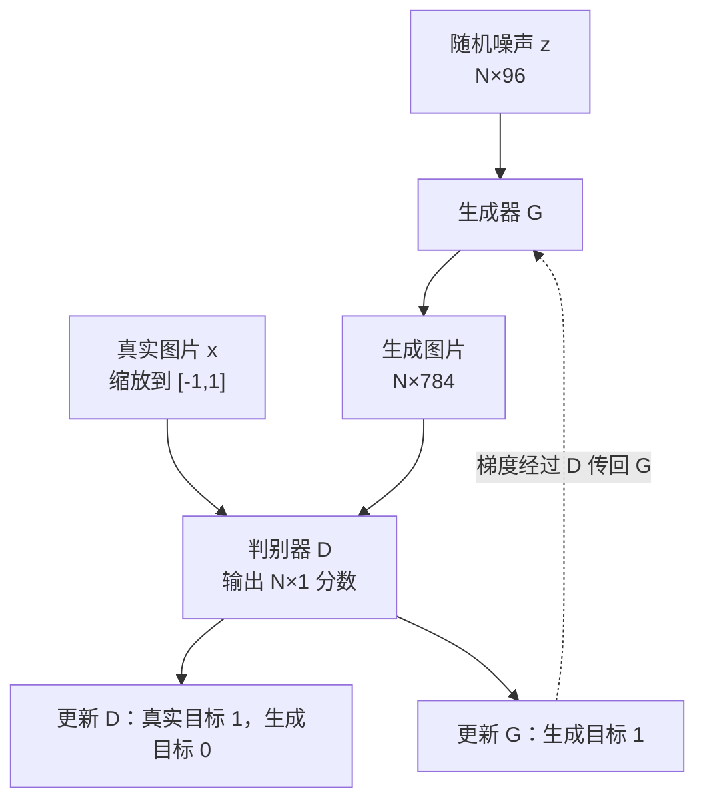
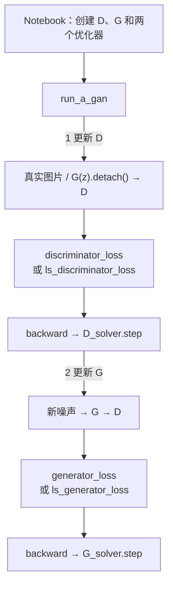

# GAN：全连接 GAN、LSGAN 与 DCGAN

对应 [gan.py](/D:/Study/Phd-Study/EECS498-WI22-main/A6/gan.py) 和 [GAN Notebook](/D:/Study/Phd-Study/EECS498-WI22-main/A6/generative_adversarial_networks.ipynb)。三组实验都学习：**随机噪声 → 生成数字图片**；区别在于使用什么损失、如何利用图片的空间结构。

## 1. 共有流程：生成图片与判断真假



| 符号 | 含义 | 对应张量 |
| --- | --- | --- |
| `N,Z` | batch 大小、噪声维度 | 本作业 `Z=96` |
| `z` | 各维独立的均匀噪声 | `(N,Z)`，范围 `[-1,1)` |
| `x,G(z)` | 真实图片、生成图片 | 展平后 `(N,784)` |
| `s(x)` | 判别器原始分数 | `(N,1)` |
| `D(x)=σ(s(x))` | BCE GAN 的真实性概率 | 取值 `(0,1)` |

标准 GAN 的判别器是**判断真实/生成的二分类器**。数字类别标签在训练中被丢弃，所以不能直接指定生成某个数字。生成器没有配对的真实图片作为重建目标，而是学习让生成分布接近真实数据分布。

## 2. 全连接 GAN：对抗目标与损失

### 2.1 两个网络

```text
判别器：
(N,784) → Linear(784,256) → LeakyReLU(0.01)
        → Linear(256,256) → LeakyReLU(0.01)
        → Linear(256,1) → logits

生成器：
(N,Z) → Linear(Z,1024) → ReLU
      → Linear(1024,1024) → ReLU
      → Linear(1024,784) → Tanh → (N,784)
```

生成器末尾的 Tanh 输出 `[-1,1]`，真实 MNIST 像素也需要从 `[0,1]` 缩放：

$$
x_{\mathrm{real}}'=2x_{\mathrm{real}}-1
$$

否则判别器可能仅利用像素范围差异区分真假。

### 2.2 判别器与生成器各自优化什么

原始 GAN 是一个极小极大博弈：

$$
\min_G\max_D V(D,G)
=\mathbb E_x[\log D(x)]
+\mathbb E_z[\log(1-D(G(z)))]
$$

判别器希望 $D(x)\to1$、$D(G(z))\to0$；生成器希望 $D(G(z))\to1$。实际代码统一使用梯度下降，判别器损失为：

$$
\boxed{
L_D=-\mathbb E_x[\log D(x)]
-\mathbb E_z[\log(1-D(G(z)))]
}
$$

本作业使用非饱和生成器损失：

$$
\boxed{L_G=-\mathbb E_z[\log D(G(z))]}
$$

| 更新对象 | 输入来源 | 目标标签 | 期望效果 |
| --- | --- | --- | --- |
| D | 真实图片 | 1 | 识别为真实 |
| D | 生成图片 | 0 | 识别为生成 |
| G | 生成图片经过 D | 1 | 让 D 将生成图片判为真实 |

网络直接输出 logits，损失使用 `binary_cross_entropy_with_logits`，内部已包含 Sigmoid。D 的两项分别取均值后相加，G 的一项取均值，均不再除以 batch size。

### 2.3 为什么修改生成器目标

令 $d=D(G(z))=\sigma(s)$。原始生成器最小化 $\log(1-d)$，本作业最小化 $-\log d$，单样本损失对分数的导数分别为：

$$
\frac{\partial\log(1-\sigma(s))}{\partial s}=-d,\qquad
\frac{\partial[-\log\sigma(s)]}{\partial s}=d-1
$$

训练初期 $d\approx0$，原始目标的分数梯度接近 0；非饱和目标的梯度接近 $-1$，能给生成器更强的改进信号。两者都鼓励提高真实性分数，但梯度强度不同。

理想条件下，固定 G 的最优判别器与原始目标满足：

$$
D^*(x)=\frac{p_{\mathrm{data}}(x)}{p_{\mathrm{data}}(x)+p_g(x)},\qquad
V(D^*,G)=-\log4+2D_{\mathrm{JS}}(p_{\mathrm{data}}\|p_g)
$$

当 $p_g=p_{\mathrm{data}}$ 时，$D^*=0.5$。这是理想分析，不保证实际交替训练一定收敛。

## 3. LSGAN：保持网络，改成平方损失

LSGAN 沿用全连接网络，判别器输出无界分数 $s(x)$，不经过 Sigmoid：

$$
\boxed{
L_D^{\mathrm{LS}}
=\frac12\mathbb E_x[(s(x)-1)^2]
+\frac12\mathbb E_z[s(G(z))^2]
}
$$

$$
\boxed{
L_G^{\mathrm{LS}}
=\frac12\mathbb E_z[(s(G(z))-1)^2]
}
$$

真实目标仍为 1，生成目标仍为 0，生成器则希望生成分数接近 1。生成器单样本梯度为 $s-1$，远离目标时仍有明显的分数梯度。

```python
loss_D = (
    0.5 * ((scores_real - 1) ** 2).mean()
    + 0.5 * (scores_fake ** 2).mean()
)
loss_G = 0.5 * ((scores_fake - 1) ** 2).mean()
```

平方误差比较的是**判别分数与真假目标**，不是生成图片和真实图片的像素差。

## 4. DCGAN：利用图片的空间结构

### 4.1 卷积判别器

卷积通过局部连接和权重共享提取笔画、边缘与形状。本题结构为：

| 层 | 输出形状 |
| --- | --- |
| Unflatten | `(N,1,28,28)` |
| Conv2d：1→32，kernel=5，stride=1 + LeakyReLU | `(N,32,24,24)` |
| MaxPool：kernel=2，stride=2 | `(N,32,12,12)` |
| Conv2d：32→64，kernel=5，stride=1 + LeakyReLU | `(N,64,8,8)` |
| MaxPool：kernel=2，stride=2 | `(N,64,4,4)` |
| Flatten → Linear(1024,1024) + LeakyReLU | `(N,1024)` |
| Linear(1024,1) | `(N,1)` |

`nn.Unflatten(1,(1,28,28))` 将第 1 维的 784 个元素恢复为 `通道×高×宽`。灰度图也需要通道维，因此批量输入应为 `(N,1,28,28)`。

### 4.2 转置卷积生成器

```text
z (N,Z)
→ Linear(Z,1024) → ReLU → BatchNorm1d
→ Linear(1024,7×7×128) → ReLU → BatchNorm1d
→ Unflatten → (N,128,7,7)
→ ConvTranspose2d(128,64,4,stride=2,padding=1)
→ ReLU → BatchNorm2d → (N,64,14,14)
→ ConvTranspose2d(64,1,4,stride=2,padding=1)
→ Tanh → (N,1,28,28)
→ Flatten → (N,784)
```

在 dilation=1、output_padding=0 时：

$$
H_{\mathrm{out}}=(H_{\mathrm{in}}-1)s-2p+k
$$

取 $s=2,p=1,k=4$，空间尺寸变为 $7\to14\to28$。转置卷积实现可学习的上采样，并非普通卷积的逆运算。DCGAN 在本作业中使用与全连接 GAN 相同的 BCE 损失。

## 5. 三组实验如何比较

| 项目 | 全连接 GAN | LSGAN | DCGAN |
| --- | --- | --- | --- |
| 网络 | 全连接 | 同左 | 卷积 + 转置卷积 |
| 判别器输出解释 | 经 Sigmoid 得到概率 | 直接回归分数 | 经 Sigmoid 得到概率 |
| 训练损失 | BCE | 平方误差 | BCE |
| 主要变化 | 基础对抗训练 | 更换目标函数 | 引入空间结构 |
| 本题训练轮数 | 10 | 10 | 5 |

当前保存的 [全连接 GAN 样例](/D:/Study/Phd-Study/EECS498-WI22-main/A6/fc_gan_results.jpg) 有较多背景散点和破碎笔画；[LSGAN 样例](/D:/Study/Phd-Study/EECS498-WI22-main/A6/ls_gan_results.jpg) 多数数字可辨认，但仍有噪点；[DCGAN 样例](/D:/Study/Phd-Study/EECS498-WI22-main/A6/dc_gan_results.jpg) 的背景更干净、笔画更连续。这仅是当前小批样例的观察，三组训练预算也不同。

判断效果要同时看**清晰度与多样性**。许多不同噪声都生成相似数字，是模式崩溃的典型表现；损失较低或图片清晰，都不能单独排除它。不同损失的数值也不能直接比较。

## 6. 训练与生成：梯度经过哪里

### 6.1 每个 batch 先更新 D，再更新 G

| 阶段 | 主要计算 | 梯度与参数更新 |
| --- | --- | --- |
| 更新 D | `D(real)`、`D(G(z).detach())` → D loss | 切断通往 G 的梯度，只调用 `D_solver.step()` |
| 更新 G | 重新采样 `z`，`D(G(z))` → G loss | 梯度经过 D 回到 G，只调用 `G_solver.step()` |

G 阶段的梯度路径为：

$$
\nabla_\theta L_G
=\frac{\partial L_G}{\partial s}
\frac{\partial s_\phi(\tilde x)}{\partial\tilde x}
\frac{\partial G_\theta(z)}{\partial\theta}
$$

**不更新 D 的参数，仍然需要经过 D 计算输入梯度。** 因此 G 阶段不能对生成图片 detach，也不能用 `no_grad()` 包住 D。Notebook 会同时计算 D 的参数梯度，但不更新 D，并在下一次 D 阶段前清零。

两个模型分别使用 Adam：`lr=1e-3, betas=(0.5,0.999)`。生成新图片只需 `sample_noise → G`，不再调用 D。

### 6.2 潜空间插值

随机取两个潜向量，在它们之间线性插值，再分别输入生成器：

$$
z(\alpha)=(1-\alpha)z_0+\alpha z_1,\qquad
x(\alpha)=G(z(\alpha)),\qquad \alpha\in[0,1]
$$

每一行对应一对端点，观察笔画、倾斜或数字形状是否平滑变化。插值发生在潜向量之间，不是直接混合两张图片的像素。

本题采样 12 对 96 维向量，每对取 12 个插值点：`(12,12,96) → (144,96) → G → (144,784)`，最后显示为 12×12 网格。原代码权重顺序为 `w*z0+(1-w)*z1`，所以每行从 `z1` 走向 `z0`。


平滑过渡说明这些潜空间路径上存在连续的形状变化，但不保证模型覆盖所有数字和书写方式。

## 7. 组件与手写代码如何对应

| 组件 | 代码入口 | 对应步骤 |
| --- | --- | --- |
| 噪声采样 | [sample_noise](/D:/Study/Phd-Study/EECS498-WI22-main/A6/gan.py:14) | `(N,Z)` 均匀噪声，保留 dtype/device |
| 全连接 D | [discriminator](/D:/Study/Phd-Study/EECS498-WI22-main/A6/gan.py:41) | 图片 → 真假 logit |
| 全连接 G | [generator](/D:/Study/Phd-Study/EECS498-WI22-main/A6/gan.py:65) | 噪声 → 784 维图片 |
| BCE 的 D loss | [discriminator_loss](/D:/Study/Phd-Study/EECS498-WI22-main/A6/gan.py:91) | 真实目标 1、生成目标 0 |
| BCE 的 G loss | [generator_loss](/D:/Study/Phd-Study/EECS498-WI22-main/A6/gan.py:121) | 生成目标 1 |
| 优化器 | [get_optimizer](/D:/Study/Phd-Study/EECS498-WI22-main/A6/gan.py:145) | 为 D、G 分别创建 Adam |
| LSGAN 的 D loss | [ls_discriminator_loss](/D:/Study/Phd-Study/EECS498-WI22-main/A6/gan.py:173) | 真假分数的平方误差 |
| LSGAN 的 G loss | [ls_generator_loss](/D:/Study/Phd-Study/EECS498-WI22-main/A6/gan.py:197) | 生成分数逼近 1 |
| 卷积 D | [build_dc_classifier](/D:/Study/Phd-Study/EECS498-WI22-main/A6/gan.py:220) | 卷积提取空间特征 → 分数 |
| 转置卷积 G | [build_dc_generator](/D:/Study/Phd-Study/EECS498-WI22-main/A6/gan.py:251) | `7×7 → 14×14 → 28×28` |
| 训练总入口 | Notebook 中的 `run_a_gan` | 交替计算损失与参数更新 |
| 图片显示 | [show_images](/D:/Study/Phd-Study/EECS498-WI22-main/A6/a6_helper.py:272) | 展平图片 → 网格显示 |



网络构造函数返回 `nn.Sequential`，训练时调用的是返回的模型对象 `D` 和 `G`；损失由 `run_a_gan` 在模型前向之后计算。
