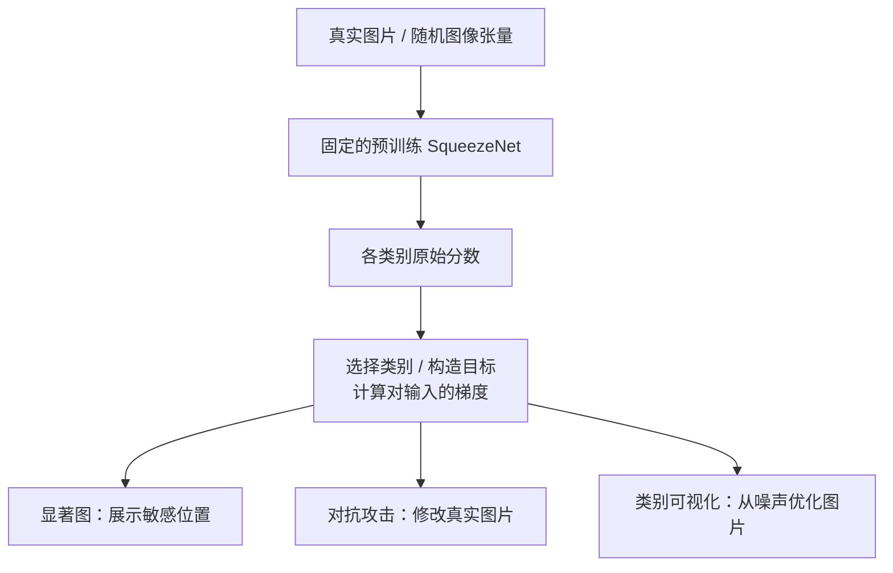

# 网络可视化：显著图、定向对抗攻击与类别可视化

对应 [network_visualization.py](/D:/Study/Phd-Study/EECS498-WI22-main/A6/network_visualization.py) 和 [Network Visualization Notebook](/D:/Study/Phd-Study/EECS498-WI22-main/A6/network_visualization.ipynb)。本题使用 ImageNet 预训练 SqueezeNet，核心是：**固定模型参数，对输入图片求梯度，用来解释预测或优化像素。**

## 1. 共有流程：从更新参数到更新图片

普通训练固定图片，更新模型参数；本题固定模型，对图片求导。设 $s_j(X)$ 为模型对类别 $j$ 的原始分数，$y$ 为真实类别，$t$ 为指定目标类别：



| 方法 | 起点 | 求导目标 | 是否修改图片 |
| --- | --- | --- | --- |
| 显著图 | 真实图片 | 真实类别分数 $s_y(X)$ | 否 |
| 定向对抗攻击 | 真实图片 | 攻击目标分数 $s_t(X)$ | 是 |
| 类别可视化 | 随机噪声 | $s_t(I)-\lambda\|I\|_2^2$ | 是 |

| 张量 | 形状 | 含义 |
| --- | --- | --- |
| 输入 `X` | `(N,3,H,W)` | 预处理后的 RGB 图片，本题空间大小为 224×224 |
| 标签 `y` | `(N,)` | 每张图片的真实类别编号 |
| `scores` | `(N,1000)` | ImageNet 各类别原始分数 |
| 输入梯度 | `(N,3,H,W)` | 每个输入值对应的导数 |
| 显著图 | `(N,H,W)` | 每个像素的敏感程度 |

预处理将像素缩放到 $[0,1]$，再按通道标准化 $X_c=(x_c-\mu_c)/\sigma_c$。后续求导和更新都发生在标准化输入空间。模型使用 `eval()`，并关闭参数的 `requires_grad`，输入图片仍可求导。

## 2. 显著图：哪些像素影响真实类别分数

显著图计算真实类别分数对输入的梯度，取绝对值后，再沿 RGB 通道取最大值：

$$
\boxed{
M_{i,h,w}=\max_c\left|
\frac{\partial s_{y_i}(X_i)}{\partial X_{i,c,h,w}}
\right|
}
$$

```python
X.requires_grad_()
scores = model(X)                              # (N,1000)
correct_scores = scores.gather(1, y[:, None])   # (N,1)
grads = torch.autograd.grad(correct_scores.sum(), X)[0]
saliency = grads.abs().amax(dim=1)              # (N,H,W)
```

三个关键操作：

- **选择类别**：`gather(1,y[:,None])` 为每行选择自己的真实类别分数；也可写成 `scores[torch.arange(N,device=X.device),y]`。`scores[:,y]` 会为每行取出 `y` 中的所有列。
- **分数求和**：把所有真实类别分数合成标量。当前模型在 eval 模式下各图片独立，因此求和后仍能得到每张图片自己的输入梯度。
- **通道归约**：`amax(dim=1)` 直接返回最大值；`max(dim=1)` 返回最大值和索引，需要取 `.values`。

梯度绝对值越大，说明当前分数对该输入值的微小变化越敏感。显著图表达局部敏感度，不能直接当作物体分割结果。

## 3. 定向对抗攻击：提高指定错误类别的分数

攻击从真实图片开始，指定通常不同于真实标签的目标类别 $t$，希望模型最终预测为 $t$：

$$
\max_X s_t(X)
\quad\Longleftrightarrow\quad
\min_X L_{\mathrm{attack}}(X),\qquad L_{\mathrm{attack}}=-s_t(X)
$$

因此不需要额外定义交叉熵，目标分数本身就是求导目标。每一步使用 L2 归一化的梯度上升：

$$
g_k=\nabla_X s_t(X_k),\qquad
\boxed{X_{k+1}=X_k+\eta\frac{g_k}{\|g_k\|_2}}
$$

```python
X_adv = X.detach().clone().requires_grad_(True)

for _ in range(max_iter):
    scores = model(X_adv)
    if scores[0].argmax().item() == target_y:
        break

    grad = torch.autograd.grad(scores[0, target_y], X_adv)[0]
    grad_norm = grad.norm()
    if grad_norm.item() == 0:
        break

    with torch.no_grad():
        X_adv.add_(learning_rate * grad / grad_norm)
```

`detach().clone()` 创建独立于原图及其计算历史的输入；`grad.norm()` 计算整个梯度的 L2 范数。归一化保留方向，让每次更新的 L2 长度等于 $\eta$。零梯度时停止，避免除零。

成功条件是 $\arg\max_j s_j(X_{\mathrm{adv}})=t$，仅提高目标分数还不够，因为其他类别分数也可能变化。**每步梯度归一化不等于限制总扰动大小**，本题实现没有额外的扰动预算投影。

## 4. 类别可视化：从噪声优化类别特征

### 4.1 分数与 L2 正则

从随机图像 $I$ 开始，最大化目标分数，同时约束像素数值：

$$
\boxed{J(I)=s_t(I)-\lambda\|I\|_2^2}
$$

对应更新为普通梯度上升：

$$
I\leftarrow I+\eta\nabla_I J
=I+\eta\left(\nabla_I s_t-2\lambda I\right)
$$

```python
scores = model(img)
objective = scores[0, target_y] - l2_reg * img.square().sum()
grad = torch.autograd.grad(objective, img)[0]
with torch.no_grad():
    img.add_(learning_rate * grad)
```

L2 项放入 `objective` 后，自动求导已经包含 $-2\lambda I$。本题采用普通梯度上升，默认 `learning_rate=25`、`l2_reg=1e-3`；对抗攻击才明确要求梯度 L2 归一化。

### 4.2 外层循环与正则化

```text
随机噪声 → jitter → 梯度上升 → 撤销 jitter
         → clamp → 定期 blur → 下一轮
```

| 操作 | 作用 |
| --- | --- |
| L2 正则 | 限制像素数值大小，不直接约束相邻像素平滑 |
| Jitter | 随机平移后优化，减少对固定位置的依赖 |
| Clamp | 裁剪到合法标准化像素范围 |
| Blur | 平滑图片，抑制部分高频噪声 |

合法范围为 $-\mu_c/\sigma_c\le I_c\le(1-\mu_c)/\sigma_c$，对应反标准化后的像素处于 $[0,1]$。

类别可视化展示模型偏好的特征。目标分数高不保证物体结构完整、画面自然，因为目标函数没有直接约束这些性质。

## 5. 梯度计算与参数更新

| 操作 | 含义 |
| --- | --- |
| `X.requires_grad_()` | 记录后续计算对输入的依赖，允许求输入梯度 |
| `torch.autograd.grad(J,X)[0]` | 返回 $\partial J/\partial X$，不累积到 `X.grad` |
| `J.backward()` | 将梯度累积到相关叶子张量的 `.grad` |
| `with torch.no_grad()` | 更新像素时不记录更新操作 |

当前三个函数使用 `autograd.grad`，不需要每轮清空 `img.grad`。末尾 `[0]` 是取梯度返回元组的第一个元素，不是取第一张图片。

**固定模型参数，仍然需要通过模型计算输入梯度。** 因此模型前向与求梯度应保留计算图，只有修改像素的操作放在 `no_grad()` 中。

与 VAE、GAN 学习生成网络参数不同，本题直接优化当前图片的像素；每生成一张新图，都需要重新迭代。

## 6. 组件与手写代码如何对应

| 组件 | 代码入口 | 对应步骤 |
| --- | --- | --- |
| 显著图 | [compute_saliency_maps](/D:/Study/Phd-Study/EECS498-WI22-main/A6/network_visualization.py:18) | 真实类别分数 → 输入梯度 → 绝对值与通道最大值 |
| 定向攻击 | [make_adversarial_attack](/D:/Study/Phd-Study/EECS498-WI22-main/A6/network_visualization.py:62) | 目标分数 → 归一化梯度上升 → 检查目标预测 |
| 类别可视化一步 | [class_visualization_step](/D:/Study/Phd-Study/EECS498-WI22-main/A6/network_visualization.py:125) | 目标分数减 L2 → 梯度上升 |
| 预处理与显示 | [preprocess](/D:/Study/Phd-Study/EECS498-WI22-main/A6/a6_helper.py:37)、[deprocess](/D:/Study/Phd-Study/EECS498-WI22-main/A6/a6_helper.py:49) | RGB 图片与标准化张量之间的转换 |
| 平移与模糊 | [jitter](/D:/Study/Phd-Study/EECS498-WI22-main/A6/a6_helper.py:103)、[blur_image](/D:/Study/Phd-Study/EECS498-WI22-main/A6/a6_helper.py:82) | 类别可视化的隐式正则操作 |
| 总流程 | Notebook 中 `show_saliency_maps`、`create_class_visualization` | 准备输入、调用手写函数、组织循环与显示 |
