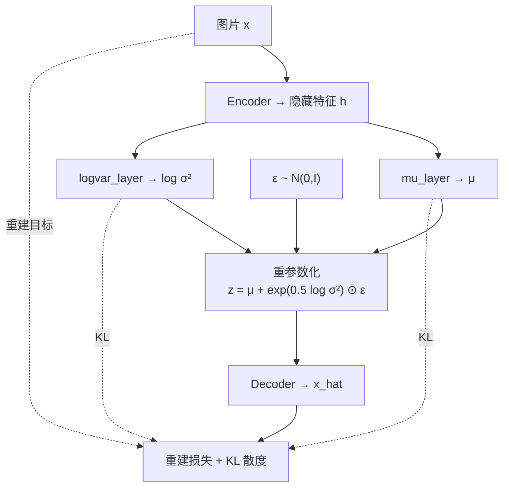
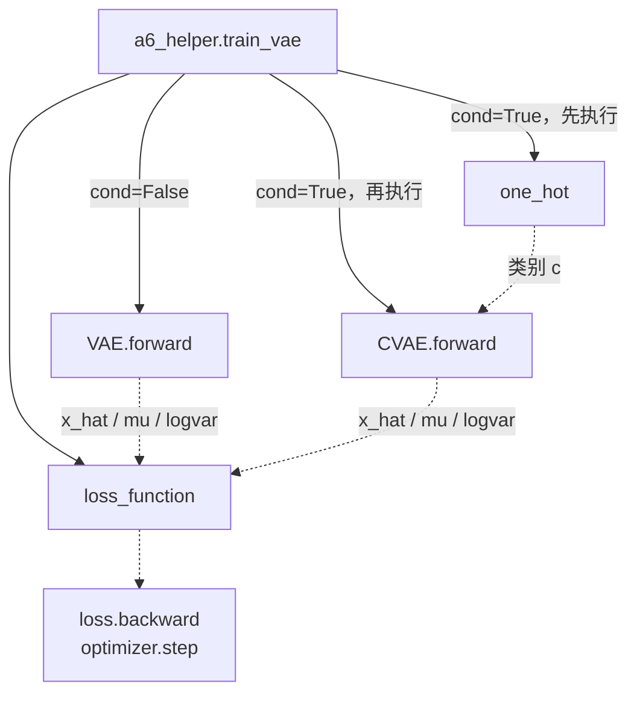
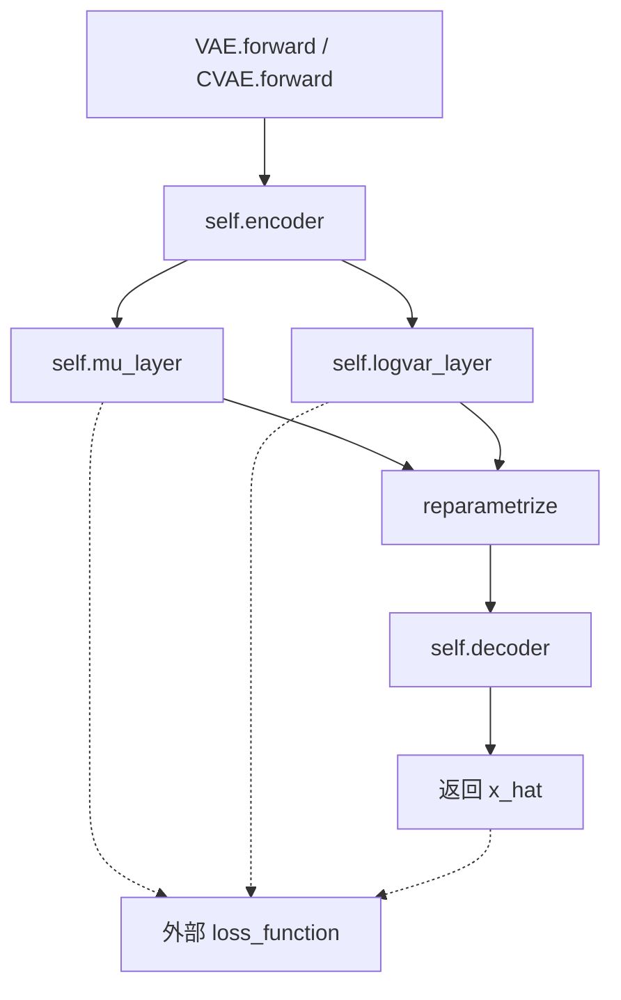

# VAE 与 CVAE：训练流程和概率公式

本文对应 A6.1 的 [vae.py](/D:/Study/Phd-Study/EECS498-WI22-main/A6/vae.py)。任务是在 MNIST 上训练全连接 VAE，并进一步使用类别条件实现 CVAE。VAE 的关键区别是：编码器输出的是潜变量分布，而不是单个确定向量。

概率部分参考 [APlayBoy：一文搞懂所有 VAE 模型，第 4.1、4.2 节](https://zhuanlan.zhihu.com/p/682709613)，并结合本作业的固定标准正态先验、Bernoulli/BCE 重建模型重新推导。阅读主线是：**最大似然 → 难以计算的边缘积分 → 引入近似后验 → 推导 ELBO → 重参数化 → BCE + KL 的代码实现**。

## 1. 训练流程



设 batch size 为 `N`、展平图像维度为 `D=784`、隐藏维度为 `H`、潜变量维度为 `Z=15`：

| 张量 | 形状 | 含义 |
| --- | --- | --- |
| `x`、`x_hat` | `(N,1,28,28)` | 输入和重建图片 |
| `h` | `(N,H)` | 编码器隐藏特征 |
| `mu`、`logvar` | `(N,Z)` | 高斯分布的均值和对数方差 |
| `z` | `(N,Z)` | 采样得到的潜变量 |

## 2. 全连接 VAE

### 2.1 Encoder

| 组件 | 变换／输出 |
| --- | --- |
| Flatten | `(N,1,28,28) → (N,784)` |
| 第一层 Linear + ReLU | `784 → H` |
| 第二、三层 Linear + ReLU | 各为 `H → H` |
| 隐藏特征 h | `(N,H)` |
| mu_layer | `Linear(H,Z) → mu:(N,Z)` |
| logvar_layer | `Linear(H,Z) → logvar:(N,Z)` |

编码器定义近似后验：

$$
q_\phi(z\mid x)
=\mathcal N\left(\mu_\phi(x),
\operatorname{diag}(\sigma_\phi^2(x))\right)
$$

输出 `logvar` 而不是方差本身：

$$
\ell=\log\sigma^2,\qquad
\sigma^2=e^\ell,\qquad
\sigma=e^{\ell/2}
$$

均值和 logvar 都可以取任意实数，因此两个输出层不加 ReLU 或 Sigmoid。“对角”表示给定 `x` 后，潜变量各维在这个近似分布中相互独立。

### 2.2 重参数化

如果使用不保留采样路径梯度的接口，从 `q_\phi(z\mid x)` 得到的随机样本无法通过普通反向传播连接到 Encoder 参数。为此，将采样改写为：

$$
\epsilon\sim\mathcal N(0,I),\qquad
z=\mu+\sigma\odot\epsilon
=\mu+e^{\ell/2}\odot\epsilon
$$

因为 $\mathbb E[\epsilon]=0$、$\operatorname{Cov}(\epsilon)=I$：

$$
\mathbb E[z\mid x]=\mu,\qquad
\operatorname{Cov}(z\mid x)=\operatorname{diag}(\sigma^2)
$$

所以它仍然采样自原来的高斯分布；但随机性只在与模型参数无关的 `epsilon` 中，`z` 对 `mu` 和 `logvar` 是可微的。

### 2.3 Decoder

```text
z (N,Z)
→ Linear(Z,H) → ReLU
→ Linear(H,H) → ReLU
→ Linear(H,H) → ReLU
→ Linear(H,784) → Sigmoid
→ Unflatten → x_hat (N,1,28,28)
```

Sigmoid 输出 `[0,1]` 的像素概率/条件均值。给定 `z` 后，Decoder 定义图片分布 `p_theta(x|z)`。

### 2.4 损失函数

$$
\boxed{
\mathcal J(x)=
-\mathbb E_{q_\phi(z\mid x)}
[\log p_\theta(x\mid z)]
+
D_{\mathrm{KL}}\left(q_\phi(z\mid x)\|p(z)\right)
}
$$

其中先验为：

$$
p(z)=\mathcal N(0,I)
$$

第一项要求图片能被重建；第二项让编码分布接近标准正态，使生成时直接从先验采样仍然有效。

## 3. 条件 VAE

CVAE 将 one-hot 类别向量 `c` 同时输入 Encoder 和 Decoder：

| 阶段 | 拼接后的输入 | 输出 |
| --- | --- | --- |
| Encoder | `cat(x_flat,c)`：`(N,784+10)` | mu、logvar → z |
| Decoder | `cat(z,c)`：`(N,15+10)` | x_hat：`(N,1,28,28)` |

条件分布变为：

$$
q_\phi(z\mid x,c),\qquad p_\theta(x\mid z,c)
$$

本作业仍使用无条件先验 `p(z)=N(0,I)`，因此：

$$
\mathcal J(x,c)=
-\mathbb E_{q_\phi(z\mid x,c)}
[\log p_\theta(x\mid z,c)]
+
D_{\mathrm{KL}}\left(q_\phi(z\mid x,c)\|p(z)\right)
$$

VAE 和 CVAE 的损失形式相同，区别只是 Encoder/Decoder 多了类别条件。生成时固定 `c`，从标准正态采样 `z`，即可指定生成数字类别。

## 4. 生成与潜空间

已有图片的重建需要 Encoder：

```text
x → q(z|x) → sample z → Decoder → x_hat
```

生成新图片不需要 Encoder：

```text
z ~ N(0,I) → Decoder → 新图片
```

潜空间插值使用：

$$
z(\alpha)=(1-\alpha)z_0+\alpha z_1,\qquad0\le\alpha\le1
$$

再将各个插值点送入 Decoder。连续的潜空间通常会产生平滑的数字变化，但不保证每个插值点都生成清晰图片。

## 5. 概率模型与 ELBO 推导

### 5.1 起点：为什么要最大化数据似然

给定独立同分布的训练集 $\mathcal D=\{x^{(i)}\}_{i=1}^{M}$，希望生成模型给观察到的数据较高的概率质量或概率密度。最大似然目标是：

$$
\theta^*
=\arg\max_\theta\prod_{i=1}^{M}p_\theta(x^{(i)})
=\arg\max_\theta\sum_{i=1}^{M}\log p_\theta(x^{(i)})
$$

第二个等式使用了对数的单调性，并将乘积变成求和。对连续数据，$p_\theta(x)$ 表示密度，不是“恰好采样出这一张图片”的事件概率。

模型真正想优化的是边缘对数似然 $\log p_\theta(x)$。后面出现的重建对数似然 $\log p_\theta(x\mid z)$ 是给定潜变量后的条件量，两者不能直接等同。

此时目标只有生成模型参数 $\theta$；编码器参数 $\phi$ 将在引入近似推断后出现。

### 5.2 联合分布、边缘似然和后验

VAE 的生成过程是：

$$
z\sim p(z),\qquad x\sim p_\theta(x\mid z)
$$

所以联合分布为：

$$
p_\theta(x,z)=p(z)p_\theta(x\mid z)
$$

训练时只观察到 `x`，需要把潜变量积分掉：

$$
p_\theta(x)=\int p(z)p_\theta(x\mid z)\,dz
$$

这就是边缘似然。真实后验由贝叶斯公式给出：

$$
p_\theta(z\mid x)
=\frac{p_\theta(x\mid z)p(z)}{p_\theta(x)}
$$

由于分母的积分难以计算，使用编码器定义的 $q_\phi(z\mid x)$ 来近似真实后验。

困难通常来自高维潜空间和非线性 Decoder：即使 $p(z)$ 很简单，积分 $\int p(z)p_\theta(x\mid z)\,dz$ 也没有解析解。直接从先验采样可以估计积分，但对某张指定图片，许多先验样本的条件似然可能极小，估计效率很低；再对估计值取对数也不会自动得到无偏的对数似然估计。

| 分布 | 含义 |
| --- | --- |
| $p(z)$ | 潜变量先验 |
| $p_\theta(x\mid z)$ | Decoder 定义的生成分布 |
| $p_\theta(z\mid x)$ | 真实后验，通常难算 |
| $q_\phi(z\mid x)$ | Encoder 定义的近似后验 |

这里 $p_\theta(z\mid x)$ 是由先验和 Decoder 通过贝叶斯公式确定的后验；它不是 Encoder 直接输出的分布。Encoder 输出的是另一个可计算的分布 $q_\phi(z\mid x)$。

标准正态先验也不意味着真实后验一定为高斯：经过非线性 Decoder 的似然与先验相乘后，真实后验可能很复杂，甚至有多个峰。Encoder 使用对角高斯，是为了方便计算而作出的近似选择。

### 5.3 为什么引入 q，以及“变分”是什么意思

对给定的 $x$，真正有助于解释它的潜变量通常只占潜空间的一部分。我们希望从接近真实后验的分布采样，以便高效地学习这些潜变量。

为此，选择一个容易采样、容易计算密度的分布族：

$$
q_\phi(z\mid x)
=\mathcal N\!\left(\mu_\phi(x),
\operatorname{diag}(\exp(\ell_\phi(x)))\right)
$$

这里 $\ell_\phi(x)$ 就是 `logvar`。网络输出的是分布参数，不是直接输出一份“真实后验”，也不是让 $q$ 无条件等于先验。

“变分推断”指在一个分布族中寻找接近真实后验的分布，将难处理的推断转为参数优化。VAE 还让所有样本共用同一个 Encoder：输入不同图片，网络给出对应的分布参数，这称为摊销推断。无需为每张新图片单独优化一组变分参数。

对于本文的高斯分布族，下面推导中的密度、期望和 KL 假定存在且有限。Jensen 路线中还要求 $q$ 的支持覆盖相关联合密度的支持。

### 5.4 第一条推导：Jensen 不等式与 ELBO

在边缘似然积分中乘除 $q_\phi(z\mid x)$：

$$
\begin{aligned}
\log p_\theta(x)
&=\log\int q_\phi(z\mid x)
\frac{p_\theta(x,z)}{q_\phi(z\mid x)}\,dz\\
&=\log\mathbb E_{q_\phi(z\mid x)}
\left[\frac{p_\theta(x,z)}{q_\phi(z\mid x)}\right]
\end{aligned}
$$

因为 $\log$ 是凹函数：

$$
\log\mathbb E[Y]\ge\mathbb E[\log Y]
$$

因此：

$$
\begin{aligned}
\log p_\theta(x)
&\ge
\mathbb E_q[\log p_\theta(x,z)-\log q_\phi(z\mid x)]\\
&=
\mathbb E_q[\log p_\theta(x\mid z)]
+\mathbb E_q[\log p(z)-\log q_\phi(z\mid x)]
\end{aligned}
$$

KL 散度定义为：

$$
D_{\mathrm{KL}}(q\|p)
=\mathbb E_q\left[\log\frac{q(z)}{p(z)}\right]
$$

所以得到证据下界：

$$
\boxed{
\operatorname{ELBO}(x)
=
\mathbb E_q[\log p_\theta(x\mid z)]
-
D_{\mathrm{KL}}(q_\phi(z\mid x)\|p(z))
\le\log p_\theta(x)
}
$$

训练时最大化 ELBO，等价于最小化其相反数，即 VAE 的损失：

$$
-\operatorname{ELBO}
=
-\mathbb E_q[\log p_\theta(x\mid z)]
+D_{\mathrm{KL}}(q_\phi(z\mid x)\|p(z))
$$

这里的“证据”是观测数据的边缘似然 $p_\theta(x)$，因此 ELBO 是 evidence lower bound，即边缘对数似然的下界。等号成立需要 $p_\theta(x,z)/q_\phi(z\mid x)$ 在 $q$ 下几乎处处为常数，也就是 $q_\phi(z\mid x)=p_\theta(z\mid x)$。

### 5.5 第二条推导：从近似后验与真实后验的 KL 展开

参考文章采用这条路线。先固定一张图片 $x$，记 $q=q_\phi(z\mid x)$。希望近似后验接近真实后验：

$$
\begin{aligned}
D_{\mathrm{KL}}\left(q_\phi(z\mid x)\|p_\theta(z\mid x)\right)
&=\int q(z)\log\frac{q(z)}{p_\theta(z\mid x)}\,dz\\
&=\int q(z)\log\frac{q(z)p_\theta(x)}{p_\theta(x,z)}\,dz\\
&=\log p_\theta(x)
+\int q(z)\log\frac{q(z)}{p_\theta(x,z)}\,dz\\
&=\log p_\theta(x)
+\int q(z)\log\frac{q(z)}{p(z)p_\theta(x\mid z)}\,dz\\
&=\log p_\theta(x)
+D_{\mathrm{KL}}\left(q_\phi(z\mid x)\|p(z)\right)
-\mathbb E_q[\log p_\theta(x\mid z)]
\end{aligned}
$$

逐步使用了三个事实：贝叶斯公式 $p_\theta(z\mid x)=p_\theta(x,z)/p_\theta(x)$；$\log p_\theta(x)$ 对积分变量 $z$ 是常数且 $\int q(z)dz=1$；联合分布可以分解为 $p(z)p_\theta(x\mid z)$。

把可计算的两项定义为：

$$
\mathcal L_{\theta,\phi}(x)
=\mathbb E_{q_\phi(z\mid x)}[\log p_\theta(x\mid z)]
-D_{\mathrm{KL}}\left(q_\phi(z\mid x)\|p(z)\right)
$$

重新排列得到精确恒等式：

$$
\boxed{
\log p_\theta(x)
=
\underbrace{\mathcal L_{\theta,\phi}(x)}_{\operatorname{ELBO}}
+
D_{\mathrm{KL}}\left(q_\phi(z\mid x)\|p_\theta(z\mid x)\right)
}
$$

KL 非负，所以 ELBO 不超过真实对数似然。这与 Jensen 推导得到的是同一个下界。

训练使用其相反数：

$$
\boxed{
\mathcal J_{\theta,\phi}(x)
=-\mathcal L_{\theta,\phi}(x)
=-\log p_\theta(x)
+D_{\mathrm{KL}}\left(q_\phi(z\mid x)\|p_\theta(z\mid x)\right)
}
$$

因此负 ELBO 是负对数似然的一个上界。虽然右侧的边缘似然和真实后验都难算，把它整理为“重建项 + 与先验的 KL”以后，就能用采样和解析公式计算。

### 5.6 推导中出现的两个 KL 有什么区别

| KL | 比较对象 | 在推导中的作用 | 本作业是否直接计算 |
| --- | --- | --- | --- |
| $D_{\mathrm{KL}}(q_\phi(z\mid x)\|p_\theta(z\mid x))$ | 近似后验与真实后验 | 衡量 ELBO 与边缘对数似然的间隙 | 否，真实后验难算 |
| $D_{\mathrm{KL}}(q_\phi(z\mid x)\|p(z))$ | 近似后验与先验 | 与重建项共同组成可训练目标 | 是，对角高斯有解析式 |

固定 $\theta$ 时，$\log p_\theta(x)$ 与 $\phi$ 无关，所以最大化 ELBO 对 $\phi$ 而言，等价于最小化近似后验与真实后验的 KL。

但联合更新 $\theta,\phi$ 时，$\log p_\theta(x)$ 也会变化，不能将它对 $\theta$ 当作常数。VAE 联合优化的是下界；有限的近似分布族和有限的网络能力会留下推断误差，因此不能把训练表述为“精确最大化边缘似然”。

同样，“让近似后验靠近先验”只描述了损失中的一项。如果把每张图片的 $q_\phi(z\mid x)$ 都强行变成同一个标准正态，它就不再携带输入信息，重建通常会受到影响。模型需要同时兼顾两项。

### 5.7 为什么 KL 的方向不能互换

KL 并不对称：

$$
D_{\mathrm{KL}}(q\|p)
=\mathbb E_q\left[\log\frac{q}{p}\right]
\ne
D_{\mathrm{KL}}(p\|q)
$$

选择 $D_{\mathrm{KL}}(q_\phi(z\mid x)\|p_\theta(z\mid x))$，使期望位于可以采样的 $q_\phi$ 下，并能整理出上述 ELBO。如果交换方向，期望将位于难以采样的真实后验下，无法沿用这条可计算的目标。

参考文章用“高估/低估信息”概括两个方向；更具体地说，在用受限分布族逼近多峰分布时，$D_{\mathrm{KL}}(p\|q)$ 往往更重视覆盖 $p$ 的概率质量，$D_{\mathrm{KL}}(q\|p)$ 往往更强烈地惩罚 $q$ 落在 $p$ 密度很低的位置，可能只覆盖部分模式。这是常见倾向，不是适用于所有分布的定律。

### 5.8 CVAE 的条件概率推导

固定已知条件 $c$ 后，生成模型与边缘似然为：

$$
p_\theta(x,z\mid c)=p(z\mid c)p_\theta(x\mid z,c),
\qquad
p_\theta(x\mid c)=\int p(z\mid c)p_\theta(x\mid z,c)\,dz
$$

引入 $q_\phi(z\mid x,c)$，重复上面的 KL 展开：

$$
\begin{aligned}
\log p_\theta(x\mid c)
&=\mathcal L(x,c)
+D_{\mathrm{KL}}\left(q_\phi(z\mid x,c)\|p_\theta(z\mid x,c)\right),\\
\mathcal L(x,c)
&=\mathbb E_{q_\phi(z\mid x,c)}[\log p_\theta(x\mid z,c)]
-D_{\mathrm{KL}}\left(q_\phi(z\mid x,c)\|p(z\mid c)\right)
\end{aligned}
$$

一般 CVAE 可以使用依赖条件的先验 $p(z\mid c)$；本作业使用固定的 $p(z\mid c)=p(z)=\mathcal N(0,I)$。所以 VAE 与 CVAE 可以共用同一个 BCE + 高斯 KL 损失函数，类别只改变 Encoder 和 Decoder 的输入。

### 5.9 一个可以精确验算的例子

考虑一维线性高斯模型：

$$
p(z)=\mathcal N(0,1),\qquad
p_\theta(x\mid z)=\mathcal N(z,\tau^2),\quad \tau^2>0
$$

这相当于 $x=z+\eta$，其中 $\eta\sim\mathcal N(0,\tau^2)$ 且与 $z$ 独立。于是边缘分布和真实后验均有解析式：

$$
p_\theta(x)=\mathcal N(0,1+\tau^2)
$$

$$
p_\theta(z\mid x)=
\mathcal N(m_*,v_*),\qquad
m_*=\frac{x}{1+\tau^2},\quad
v_*=\frac{\tau^2}{1+\tau^2}
$$

选近似后验 $q(z\mid x)=\mathcal N(m,v)$，则：

$$
\mathbb E_q[\log p_\theta(x\mid z)]
=-\frac12\log(2\pi\tau^2)
-\frac{(x-m)^2+v}{2\tau^2}
$$

$$
D_{\mathrm{KL}}(q\|p(z))
=\frac12(m^2+v-1-\log v)
$$

将这两项代入 ELBO，可直接验证：

$$
\log p_\theta(x)-\operatorname{ELBO}(x)
=\frac12\left[
\log\frac{v_*}{v}
+\frac{v+(m-m_*)^2}{v_*}-1
\right]
=D_{\mathrm{KL}}\!\left(\mathcal N(m,v)\|\mathcal N(m_*,v_*)\right)
$$

当 $m=m_*,v=v_*$ 时，下界恰好等于边缘对数似然。神经网络 VAE 的生成模型更复杂，但使用的是同一个恒等式。

## 6. 两个损失项的具体公式

### 6.1 重建项为什么是 BCE

设 Decoder 输出 $r=f_\theta(z)$，每个像素的值在 `[0,1]`。采用逐像素伯努利模型：

$$
p_\theta(x_d\mid z)
=r_d^{x_d}(1-r_d)^{1-x_d}
$$

假设给定 `z` 后各像素条件独立：

$$
p_\theta(x\mid z)
=\prod_{d=1}^{D}
r_d^{x_d}(1-r_d)^{1-x_d}
$$

取对数并取负：

$$
\boxed{
-\log p_\theta(x\mid z)
=
-\sum_{d=1}^{D}
\left[
x_d\log r_d+(1-x_d)\log(1-r_d)
\right]
}
$$

这正是对所有像素求和的 binary cross entropy。MNIST 在作业中是 `[0,1]` 灰度值，因此沿用 BCE 表达式；严格的伯努利解释本身对应二值像素。若选择固定方差的高斯观测模型，重建项则会变成与平方误差成比例的形式。

例如一个二值目标像素为 $x_d=1$，Decoder 给出 $r_d=0.9$ 时，该像素的负对数似然为 $-\log0.9$；若仅给出 $r_d=0.1$，损失为 $-\log0.1$，明显更大。因此它直接约束重建像素，不需要额外的数字分类器。

若使用连续高斯观测模型：

$$
p_\theta(x\mid z)=\mathcal N(f_\theta(z),\tau^2I)
$$

则：

$$
-\log p_\theta(x\mid z)
=\frac{D}{2}\log(2\pi\tau^2)
+\frac{1}{2\tau^2}\|x-f_\theta(z)\|_2^2
$$

当 $\tau^2$ 固定时，第一项是常数，重建项与像素平方误差成比例。若方差也要学习，归一化项就不能随意删掉。**BCE 或 MSE 的概率依据来自观测分布的选择；仅凭最后一层用了 Sigmoid，并不能唯一确定损失。**

本作业 `decoder(z)` 返回的是 $r=f_\theta(z)$，即 Bernoulli 分布参数/条件均值图。严格按生成模型采样还可以令每个像素 $x_d\sim\operatorname{Bernoulli}(r_d)$；Notebook 为了展示平滑的灰度结果，直接显示 $r$。

### 6.2 KL 项为什么有解析式

对一维分布：

$$
q(z)=\mathcal N(\mu,\sigma^2),\qquad
p(z)=\mathcal N(0,1)
$$

两者的对数密度相减并在 `q` 下取期望：

$$
D_{\mathrm{KL}}(q\|p)
=
-\frac12\log\sigma^2
-\frac{\mathbb E_q[(z-\mu)^2]}{2\sigma^2}
+\frac12\mathbb E_q[z^2]
$$

利用：

$$
\mathbb E_q[(z-\mu)^2]=\sigma^2,\qquad
\mathbb E_q[z^2]=\mu^2+\sigma^2
$$

得到：

$$
D_{\mathrm{KL}}(q\|p)
=
\frac12(\mu^2+\sigma^2-1-\log\sigma^2)
$$

对角高斯的各维 KL 相加：

$$
\boxed{
D_{\mathrm{KL}}(q\|p)
=
\frac12\sum_{j=1}^{Z}
\left(\mu_j^2+\sigma_j^2-1-\log\sigma_j^2\right)
}
$$

因为 $\operatorname{logvar}_j=\log\sigma_j^2$：

$$
\boxed{
D_{\mathrm{KL}}(q\|p)
=
-\frac12\sum_{j=1}^{Z}
\left(1+\operatorname{logvar}_j-\mu_j^2-e^{\operatorname{logvar}_j}\right)
}
$$

只看 KL 项时，最小值在：

$$
\mu_j=0,\qquad
\sigma_j^2=1,\qquad
\operatorname{logvar}_j=0
$$

KL 让分布接近先验；重建项则要求分布保留图片信息，最终模型是两者的折中。

### 6.3 Batch 目标和归约方式

对每张图片的重建期望用一次采样近似：

$$
-\mathbb E_q[\log p_\theta(x_i\mid z)]
\approx
-\log p_\theta(x_i\mid z_i)
$$

于是 batch 目标为：

$$
\boxed{
\mathcal J_{\mathrm{batch}}
\approx
\frac1N\sum_{i=1}^{N}
\left[
\operatorname{BCE}_{\mathrm{sum}}(\hat x_i,x_i)
+
\frac12\sum_{j=1}^{Z}
\left(\mu_{ij}^2+e^{\ell_{ij}}-1-\ell_{ij}\right)
\right]
}
$$

像素维度和潜变量维度都求和，最后只对 batch 样本取平均。若 BCE 使用默认的全元素平均，重建项会额外除以像素数 `D`，改变它与 KL 项的相对权重。

### 6.4 重参数化怎样让期望可训练

重建期望的采样分布依赖 Encoder 参数 $\phi$。直接调用不保留参数梯度的随机采样接口，普通反向传播无法沿采样结果传回 Encoder；这不意味着随机模型在数学上不能求导，也可以使用 score-function 等其他梯度估计。

对本作业的对角高斯，采用可微变换：

$$
\epsilon\sim\mathcal N(0,I),\qquad
z=g_\phi(x,\epsilon)
=\mu_\phi(x)+\exp\!\left(\tfrac12\ell_\phi(x)\right)\odot\epsilon
$$

于是：

$$
\mathbb E_{q_\phi(z\mid x)}[\log p_\theta(x\mid z)]
=\mathbb E_{\epsilon\sim\mathcal N(0,I)}
[\log p_\theta(x\mid g_\phi(x,\epsilon))]
$$

随机变量 $\epsilon$ 的分布不再依赖 $\phi$。在满足交换梯度与期望的常规条件下：

$$
\nabla_\phi\mathbb E_\epsilon[\log p_\theta(x\mid g_\phi(x,\epsilon))]
=\mathbb E_\epsilon\left[
(\nabla_\phi g_\phi(x,\epsilon))^\top
\nabla_z\log p_\theta(x\mid z)
\right]
$$

对每个潜变量分量，有：

$$
\frac{\partial z_j}{\partial\mu_j}=1,\qquad
\frac{\partial z_j}{\partial\ell_j}
=\frac12e^{\ell_j/2}\epsilon_j
$$

所以重建梯度可以从 Decoder 经 $z$ 回到 `mu_layer`、`logvar_layer` 和 Encoder。KL 项则直接对分布参数求导：

$$
\frac{\partial D_{\mathrm{KL}}}{\partial\mu_j}=\mu_j,\qquad
\frac{\partial D_{\mathrm{KL}}}{\partial\ell_j}
=\frac12(e^{\ell_j}-1)
$$

重参数化没有去掉随机性，只是把随机性放在与参数无关的基础噪声中。训练中通常每张图片采样一次，再通过不同 batch 和不同迭代持续平均；采样次数少不等于将期望替换成均值向量。

### 6.5 公式怎样落到本作业的代码

`vae.loss_function` 的核心可以对应为：

```python
reconstruction_per_sample = F.binary_cross_entropy(
    x_hat, x, reduction="none"
).flatten(start_dim=1).sum(dim=1)  # 像素求和，得到 (N,)

kl_per_sample = -0.5 * (
    1 + logvar - mu.pow(2) - logvar.exp()
).sum(dim=1)  # 潜变量维度求和，得到 (N,)

loss = (reconstruction_per_sample + kl_per_sample).mean()
```

完整训练目标是：

$$
\min_{\theta,\phi}
\frac1M\sum_{i=1}^{M}
\left\{
-\mathbb E_{\epsilon}
[\log p_\theta(x^{(i)}\mid g_\phi(x^{(i)},\epsilon))]
+D_{\mathrm{KL}}(q_\phi(z\mid x^{(i)})\|p(z))
\right\}
$$

`x_hat` 来自一次重参数化采样和 Decoder 前向，BCE 给出重建期望的 Monte Carlo 估计，KL 则精确计算。训练时没有求出 $p_\theta(x)$，也没有显式算出真实后验。

### 6.6 先验正则与生成能力的关系

普通 AE 可以将不同图片编码到零散位置；随意从一个标准正态分布取点，并不保证能落在 Decoder 训练过的区域。VAE 引入先验，并通过 KL 约束编码分布，改善训练潜变量与生成采样潜变量之间的匹配。

更准确地说，设所有图片混合后的聚合后验为：

$$
q_\phi(z)=\int p_{\mathrm{data}}(x)q_\phi(z\mid x)\,dx
$$

在相应 KL 有限时，加入并减去 $\log q_\phi(z)$ 可得：

$$
\mathbb E_{p_{\mathrm{data}}(x)}
D_{\mathrm{KL}}(q_\phi(z\mid x)\|p(z))
=I_q(X;Z)+D_{\mathrm{KL}}(q_\phi(z)\|p(z))
$$

其中 $I_q(X;Z)$ 是联合分布 $p_{\mathrm{data}}(x)q_\phi(z\mid x)$ 下的互信息。这个式子说明，KL 项既推动整体潜变量分布接近先验，也限制潜变量携带的输入信息；重建项则要求保留有用信息。

如果 Decoder 忽略 $z$、近似后验退化到先验，可能出现后验坍塌。增大 KL 权重并不必然提高生成质量，也不保证每个潜变量维度自动对应可解释的语义。

## 7. 关键实现约定

- `nn.Flatten()` 默认从维度 1 开始，`(N,1,28,28) → (N,784)`；`torch.flatten` 若直接使用默认参数会连 batch 维也展平，通常应写 `torch.flatten(x,start_dim=1)`。
- `nn.Unflatten(1,(1,28,28))` 将 `(N,784)` 恢复为 `(N,1,28,28)`。
- 重参数化中的标准差是 `exp(0.5*logvar)`，不是 `exp(logvar)`。
- Decoder 使用 Sigmoid 时，BCE 的输入和目标都应位于 `[0,1]`。
- CVAE 的类别向量应分别与展平图像、潜变量在最后一维拼接。
- VAE 的 `eval()` 不会取消前向中的随机采样；它只改变 Dropout 等训练层的行为。


## 8. 组件与手写代码如何对应

VAE/CVAE 的 Encoder、Decoder 和两个输出头是 `nn.Sequential / nn.Linear` 属性，**没有额外的手写 `encode` 或 `decode` 函数**。它们在 `__init__` 中定义，在 `forward` 中直接调用。

| 组件／公式 | 代码入口 | 对应属性或返回值 |
| --- | --- | --- |
| 模型结构与隐藏维度 | [VAE.\_\_init\_\_](/D:/Study/Phd-Study/EECS498-WI22-main/A6/vae.py:14)<br/>[CVAE.\_\_init\_\_](/D:/Study/Phd-Study/EECS498-WI22-main/A6/vae.py:113) | hidden_dim、encoder、decoder、两个输出头 |
| VAE 前向 | [VAE.forward](/D:/Study/Phd-Study/EECS498-WI22-main/A6/vae.py:72) | x → h → mu/logvar → z → x_hat |
| CVAE 前向与类别拼接 | [CVAE.forward](/D:/Study/Phd-Study/EECS498-WI22-main/A6/vae.py:168) | cat(x_flat,c)；cat(z,c) |
| 近似后验参数 | [VAE.forward](/D:/Study/Phd-Study/EECS498-WI22-main/A6/vae.py:72)<br/>[CVAE.forward](/D:/Study/Phd-Study/EECS498-WI22-main/A6/vae.py:168) | self.mu_layer(h)、self.logvar_layer(h) |
| $z=\mu+e^{\ell/2}\odot\epsilon$ | [reparametrize](/D:/Study/Phd-Study/EECS498-WI22-main/A6/vae.py:217) | 返回可微的潜变量 z |
| BCE + 高斯 KL | [loss_function](/D:/Study/Phd-Study/EECS498-WI22-main/A6/vae.py:258) | 输入 x_hat、x、mu、logvar，返回标量 |
| 一轮训练 | [train_vae](/D:/Study/Phd-Study/EECS498-WI22-main/A6/a6_helper.py:324) | 取 batch、调用模型、计算 loss、更新参数 |
| 类别向量 | [one_hot](/D:/Study/Phd-Study/EECS498-WI22-main/A6/a6_helper.py:305) | 整数标签 → (N,C) |
| 生成与可视化 | [VAE.\_\_init\_\_](/D:/Study/Phd-Study/EECS498-WI22-main/A6/vae.py:14)<br/>[CVAE.\_\_init\_\_](/D:/Study/Phd-Study/EECS498-WI22-main/A6/vae.py:113)<br/>[show_images](/D:/Study/Phd-Study/EECS498-WI22-main/A6/a6_helper.py:272) | Notebook 直接调用 model.decoder，再显示 |

### 8.1 外层训练调用

实线表示调用，虚线表示结果进入后续计算。`cond` 决定同一批次走 VAE 或 CVAE 分支。



`loss_function` 是训练 helper 调用的，模型 `forward` 本身不计算损失；原始图片 `x` 也由 helper 传给它。

### 8.2 模型内部：公式落在哪个组件

图中实线表示调用或数据推进，虚线表示分布参数提供给损失。



CVAE 在 Encoder 前拼接 `x_flat+c`，在 Decoder 前拼接 `z+c`。两种模型都返回 `x_hat,mu,logvar`，其中后两项是近似后验的分布参数。

生成时的入口在 Notebook：`torch.randn → model.decoder → show_images`；CVAE 在 decoder 前再调用 `torch.cat((z,c),dim=1)`。这条路径不经过 `VAE.forward/CVAE.forward`，也不调用 `reparametrize` 和 `loss_function`。

## 9. 参考资料与符号说明

- [APlayBoy：一文搞懂所有 VAE 模型（4个AE+12个VAE原理汇总）](https://zhuanlan.zhihu.com/p/682709613)：本文主要参考第 4.1 节的最大似然、后验 KL 展开和重参数化，以及第 4.2 节的 CVAE 条件形式。
- [Kingma 与 Welling：Auto-Encoding Variational Bayes](https://arxiv.org/abs/1312.6114)：VAE、变分下界和重参数化梯度的原始论文。

本文统一用 $\theta$ 表示 Decoder/生成模型参数、$\phi$ 表示 Encoder/推断模型参数。本作业固定先验为 $p(z)=\mathcal N(0,I)$，因此不为先验添加 $\theta$ 下标；其他 VAE 可以学习先验。$\sigma$ 表示标准差、$\sigma^2$ 表示方差、$\odot$ 表示逐元素乘法。

ELBO 是对数似然的下界，最小化的负 ELBO 则是负对数似然的上界。阅读参考文章时，应同时检查公式前的正负号，以及所讨论的是边缘似然还是条件似然。
