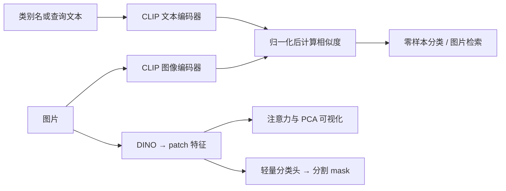

# CLIP 与 DINO：图文匹配、图像检索与分割

对应 [CLIP_DINO.ipynb](/D:/Study/Phd-Study/EECS498-WI22-main/assignment3/CLIP_DINO.ipynb) 与 [clip_dino.py](/D:/Study/Phd-Study/EECS498-WI22-main/assignment3/cs231n/clip_dino.py)。沿用 Notebook 的顺序：**CLIP 原理 → COCO 图文数据 → 特征与相似度 → 零样本分类 → 检索 → DINO 原理 → 注意力 → PCA 特征 → 单帧分割**。代码为参考实现，未在真实数据上验证任务指标。

本文涉及三种不同的 loss：**CLIP 预训练用图文对比交叉熵，DINO 预训练用 teacher–student 分布交叉熵，本题分割头用带标签的 patch 分类交叉熵。** 零样本分类、检索、可视化本身只做前向推理。

| 符号 | 含义 |
| --- | --- |
| N、D | 配对图文的 batch 大小、共享向量维度 |
| v、t | L2 归一化后的图像向量、文本向量 |
| A | CLIP 训练 logits，行是图片、列是文本：`(N,N)` |
| S | 本题相似度函数输出，行是文本、列是图片：`(文本数,图片数)` |
| λ、τ | logits 的正缩放系数和温度，λ = 1/τ |
| P、C | 分割中的 patch 数、标注类别数 |

## 1. CLIP：用图文对齐学习共享空间



| 模型 | 预训练思想 | 本题用途 |
| --- | --- | --- |
| CLIP | 让配对图文更接近、其他图文更远，学习共享特征空间 | 图文匹配、零样本分类、检索 |
| DINO | teacher–student 自蒸馏，使同图不同视图的输出一致；teacher 用 EMA 更新 | 提取局部表示，观察结构并训练分割头 |

本题不重新训练 CLIP 或 DINO；分割阶段只训练新增分类头。

### 1.1 从 SimCLR 到图文对比学习

SimCLR 对齐同一图片的两种增强视图，两个分支共享编码器；CLIP 对齐配对的图片和文字，图像编码器与文本编码器各有自己的参数，将两种输入映射到相同维度。

#### 1.1.1 两个 Encoder 输出什么

设 batch 为 N 对正确配对的 `(图片 I_i, 描述 T_i)`。图像、文本分别编码，再由各自投影映射到共享空间：

$$
v_i=\frac{W_I f_\theta(I_i)}{\lVert W_I f_\theta(I_i)\rVert_2},
\qquad
t_i=\frac{W_T g_\phi(T_i)}{\lVert W_T g_\phi(T_i)\rVert_2}
$$

v 和 t 都是 D 维单位向量，不能把不同维度的原始 Encoder 输出直接做点积。本题 `encode_image/encode_text` 已包含这些投影，调用后还需显式归一化。

#### 1.1.2 CLIP 的 loss：两个方向的“找配对”

**先构造 logits。** 定义“图片为行、文本为列”的矩阵：

$$
A_{ij}=\lambda v_i^\top t_j,
\qquad \lambda=\exp(a)=\frac1\tau>0
$$

a 是可学习的对数缩放参数，对应 OpenAI CLIP 的 `logit_scale`。对角线 `(i,i)` 是正确配对；固定一张图片时，其他 `N-1` 条描述都是 batch 内的负候选。

**图找文本。** 对每一行做 softmax，要求第 i 张图找到第 i 条描述：

$$
P(T_j\mid I_i)=\frac{\exp(A_{ij})}{\sum_{k=1}^{N}\exp(A_{ik})}
$$

$$
L_{I\to T}=-\frac1N\sum_{i=1}^{N}\log P(T_i\mid I_i)
$$

**文本找图。** 对每一列做 softmax，要求第 j 条描述找到第 j 张图：

$$
P(I_i\mid T_j)=\frac{\exp(A_{ij})}{\sum_{k=1}^{N}\exp(A_{kj})}
$$

$$
L_{T\to I}=-\frac1N\sum_{j=1}^{N}\log P(I_j\mid T_j)
$$

**最后取两个方向的平均：**

$$
\boxed{L_{\mathrm{CLIP}}=\frac12\left(L_{I\to T}+L_{T\to I}\right)}
$$

若三对图文给某张图的正确描述概率为 0.8，这张图在“图找文本”方向贡献 `-ln(0.8)≈0.223`。第二个方向还会检查这条描述能否在三张图中找回正确图片。

这里公式按 `1,…,N` 编号，代码使用 `0,…,N-1`。交叉熵标签是 **batch 内配对索引 `[0,…,N-1]`**，不是图片的物体类别；也不是把两个向量逐维相减的 MSE。损失通过两个方向共同更新图像 Encoder、文本 Encoder、投影和缩放参数。

与 SimCLR 的 `(2N,2N)` 矩阵不同，CLIP 的 `(N,N)` 矩阵是跨模态比较，**对角线正是正确配对，必须保留**。原始 batch 配对目标也可能把语义相近的其他描述当作负例。

#### 1.1.3 对应到代码

下面是独立的预训练损失示例，帮助对照公式；本题没有要求重新预训练 CLIP。输入为未归一化的共享空间特征，`logit_scale` 是标量 Tensor：

```python
import torch
import torch.nn.functional as F

def clip_contrastive_loss(image_features, text_features, logit_scale):
    image = F.normalize(image_features.float(), dim=-1)
    text = F.normalize(text_features.float(), dim=-1)
    logits = logit_scale.exp() * (image @ text.T)   # 图像 × 文本
    labels = torch.arange(logits.shape[0], device=logits.device)
    image_loss = F.cross_entropy(logits, labels)   # 对行 softmax
    text_loss = F.cross_entropy(logits.T, labels)  # 对原矩阵的列 softmax
    return (image_loss + text_loss) / 2
```

`cross_entropy` 接收 logits，内部已经计算 log-softmax。对同一个矩阵只做一次交叉熵，会漏掉另一个检索方向。

### 1.2 思考题 1：为什么 batch size 重要

每个图文对都将 batch 内其他配对当作候选，因此 batch 越大，可提供的负样本通常越多。固定物理 batch 时，可以考虑跨 batch 特征缓存、队列等策略；普通梯度累积只累计多个小损失的梯度，不会自动构造更大的相似度矩阵。

## 2. Loading COCO dataset：正确对应描述与图片

Notebook 先加载 COCO 描述，再去掉 `<START>/<END>/<UNK>` 等特殊符号。每条描述对应哪张图片由 `val_image_idxs` 决定，不能把描述的行号直接当成图片行号：

```text
描述行号 → val_captions → 解码为自然语言
同一行号 → val_image_idxs → val_urls → 下载真实图片
```

虽然 `load_coco_data(pca_features=True)` 也读取旧的 VGG 特征，这里 CLIP 使用的是原始图片重新提取的特征；不能直接把 VGG/PCA 向量送给 CLIP 的图像编码器。

Notebook 固定选择 10 对图文供匹配、分类和检索使用。图片 URL 可能失效；图文对应关系正确之后，后面的相似度热图才有意义。

## 3. Running the CLIP Model：提取特征与相似度

本题加载 `clip.load("ViT-B/32", device=device)`：文本通过 `clip.tokenize` 和 `encode_text`，图片通过该模型附带的 `clip_preprocess` 和 `encode_image`。这个版本的共享特征维度是 512。

设文本特征为 `(K,D)`，图片特征为 `(N,D)`，L2 归一化后点积就是余弦相似度：

$$
S_{kn}=\frac{t_k^\top v_n}{\|t_k\|\|v_n\|},\qquad
\hat y_n=\arg\max_k S_{kn}
$$

下面代码使用这些导入；`clip` 对应 Notebook 使用的 OpenAI CLIP 包：

```python
import torch
from torch import nn
import torch.nn.functional as F
import clip
from PIL import Image

def get_similarity_no_loop(text_features, image_features):
    text = F.normalize(text_features.float(), dim=-1)
    image = F.normalize(image_features.float(), dim=-1)
    return text @ image.T                         # (K,N)
```

归一化后比较向量夹角，减少特征模长对结果的影响；矩阵乘法一次计算所有配对，不需要在相似度函数中循环。

**注意矩阵方向变化：** 第 1 节的 A 是训练时的“图片 × 文本”；本函数按作业接口返回“文本 × 图片”的余弦相似度 S。对于相同的配对 batch，两者满足：

$$
A=\lambda S^\top
$$

相似度 S 是模型给出的分数，只有加入目标配对并计算负对数概率，才成为训练 loss。只画热图不会产生参数更新。

Notebook 先对该函数做数值检查，要求相对误差 `<1e-5`，再画 10×10 图文相似度热图。对角线应有较高匹配分数，但语义相近的非配对图文也可能得分较高。

## 4. Zero Shot Classifier：把类别名称作为候选文本

类别集合为 `a person / an animal / food / a landscape / other`。先编码各类别描述，再为每张图片选择最相似的一项。以下函数沿用上一节的导入：

```python
@torch.no_grad()
def clip_zero_shot_classifier(clip_model, clip_preprocess, images,
                              class_texts, device):
    clip_model.eval()
    pixels = torch.stack([
        clip_preprocess(Image.fromarray(img)) for img in images
    ]).to(device)
    tokens = clip.tokenize(class_texts).to(device)
    image_features = clip_model.encode_image(pixels)
    text_features = clip_model.encode_text(tokens)
    scores = get_similarity_no_loop(text_features, image_features)
    indices = scores.argmax(dim=0).tolist()
    return [class_texts[i] for i in indices]
```

“零样本”指不使用当前分类任务的带标签图片训练分类头，类别通过文本给出。可以使用 `a photo of ...` 等提示模板；比较固定类别时，softmax 与正温度缩放不改变 argmax 的分类结果。

若有 K 个候选类别描述，图片 n 的类别概率及预测为：

$$
P(y=k\mid I_n)=\frac{\exp(\lambda S_{kn})}
{\sum_{j=1}^{K}\exp(\lambda S_{jn})},
\qquad \widehat y_n=\arg\max_k S_{kn}
$$

分母是当前提供的 K 个类别文本，而不是预训练 batch 的 N 条描述。这里没有真实类别标签参与优化，不计算分类训练 loss，也不调用 `backward()`。

分类依赖给定的类别集合和描述措辞。它会在候选中选择一个，即使候选无法准确覆盖图片内容；这里的 `other` 也是普通文本类别，并不是校准过的拒识机制。

Notebook 给出的 10 张图片预期结果为：

```text
person, animal, animal, food, person,
landscape, other, other, other, person
```

## 5. Image Retrieval using CLIP：根据文本检索图片

初始化时计算并缓存图片向量；每次查询只需要一次文本编码、矩阵乘法和 Top-k。以下类使用上一节的导入：

```python
class CLIPImageRetriever:
    @torch.no_grad()
    def __init__(self, clip_model, clip_preprocess, images, device):
        self.model = clip_model.eval()
        self.device = device
        pixels = torch.stack([
            clip_preprocess(Image.fromarray(img)) for img in images
        ]).to(device)
        features = self.model.encode_image(pixels).float()
        self.image_features = F.normalize(features, dim=-1)

    @torch.no_grad()
    def retrieve(self, query, k=2):
        tokens = clip.tokenize([query]).to(self.device)
        text = self.model.encode_text(tokens).float()
        text = F.normalize(text, dim=-1)
        scores = (text @ self.image_features.T).squeeze(0)
        return scores.topk(k).indices.tolist()
```

相似度函数的输出是“文本 × 图片”；零样本分类沿文本维选类别，检索沿图片维选索引，不要混淆两种方向。

Notebook 用 `sports` 检索运动场景，预期返回网球、滑板图片；用 `black and white` 则可匹配浴室和斑马图片。检索比较的是语义表示，图片不需要带有查询关键词的文字标签。

思考题 2 可推广为：为音频、视频等模态增加各自的编码器，映射到共享空间，再组合配对模态间的对比损失。不同模态之间需要有可靠的对应关系，不能只令输出维度相同就期待自动对齐。

## 6. DINO：用 teacher–student 自蒸馏学习视觉结构

### 6.1 预训练 loss：匹配 teacher 的分布

与依赖显式负样本的 SimCLR 不同，原始 DINO 让 student 匹配 teacher 对同一图片不同视图的输出分布。设 Encoder 后的投影头输出 K_D 维 logits `u_s(v)`、`u_t(v)`，则：

$$
p_s(v)_k=\frac{\exp(u_s(v)_k/\tau_s)}
{\sum_{j=1}^{K_D}\exp(u_s(v)_j/\tau_s)}
$$

$$
p_t(v)_k=\frac{\exp((u_t(v)_k-c_k)/\tau_t)}
{\sum_{j=1}^{K_D}\exp((u_t(v)_j-c_j)/\tau_t)}
$$

c 是 teacher logits 的运行中心，τₛ、τₜ 是两个温度。K_D 是投影分布的维度，既不是 patch 特征的 384 维，也不是人工标注的类别数。teacher 的输出作为软标签：

$$
H(p_t(v),p_s(v'))
=-\sum_{k=1}^{K_D}\operatorname{stopgrad}(p_t(v)_k)\log p_s(v')_k
$$

设 V 是同一图片的全部 global/local 裁剪，G 是其中两张 global 视图。teacher 只读取 global，student 读取全部视图，排除两者输入相同视图的配对：

$$
L_{\mathrm{DINO}}=\frac1Z
\sum_{v\in G}\ \sum_{\substack{v'\in V\\v'\ne v}}
H(p_t(v),p_s(v'))
$$

Z 是有效跨视图配对数；训练再对 batch 求平均。和 CLIP 的硬配对索引标签不同，这里监督信号是一整组 teacher 概率。此处描述的是原始 DINO，不包含 DINOv2 的额外目标。

### 6.2 谁通过梯度更新

student 通过上述交叉熵反向传播更新；`stopgrad` 表示 teacher 目标不接收这条梯度。teacher 改为 student 参数的指数移动平均：

$$
\theta_{\mathrm{teacher}}\leftarrow
m\theta_{\mathrm{teacher}}+(1-m)\theta_{\mathrm{student}}
$$

中心也按运行平均更新：

$$
c\leftarrow m_c c+(1-m_c)\operatorname{mean}_{\mathrm{batch,global}}(u_t)
$$

centering 减少少数维度长期主导，较低 teacher 温度产生 sharpening，配合 EMA、多裁剪等设计帮助避免塌缩。只要求两份网络输出一致，本身并不能排除所有图片输出同一分布的平凡解。

本题使用训练好的 `dino_vits8`，关注它能否在没有像素级监督的预训练中形成局部物体结构。Notebook 先释放 CLIP，再加载 DINO，以降低显存占用。

因此，**原始 DINO 预训练更新 student，并通过 EMA 更新 teacher；本次作业加载的 DINO 不再进行这一训练**。后面的分割实验只训练新的分类头。

## 7. DINO Attention Maps：观察 CLS 读取哪些 patch

本题使用带 `[CLS]` 的 `ViT-S/8`：patch 边长 8，特征维度 384，注意力头数 6。输入缩放到 `480×480` 后，有 `60×60=3600` 个 patch。

| 张量 | 形状 |
| --- | --- |
| 输入图片 | `(N,3,480,480)` |
| 完整 token | `(N,3601,384)`，含 1 个 CLS |
| patch 特征 | `(N,3600,384)` |
| 最后一层注意力 | `(N,6,3601,3601)` |
| CLS 对各 patch 的权重 | `(N,6,3600)`，可重排为 6 张 `60×60` 热图 |

图片须先按 Notebook 做 ImageNet 归一化；`dino_model` 是已经加载的预训练模型：

```python
dino_model.eval()
with torch.no_grad():
    attention = dino_model.get_last_selfattention(img_tensor)
cls_attention = attention[:, :, 0, 1:]
head_maps = cls_attention[0].reshape(6, 60, 60)
head_maps = F.interpolate(head_maps[None], size=(480, 480),
                          mode="nearest")[0]
```

`[0,:,0,1:]` 分别选择第一张图、所有头、CLS 的 query 行、所有 patch 的 key 列；删除的是 CLS 自己的 key。每张热图展示一个头的空间关注分布，不同头可能强调不同物体或区域。

思考题 3 的形状推导是：`480/8=60`，所以有 3600 个 patch，加 CLS 得到 3601 个 token；ViT-S 的 token 特征维度是 384。注意力权重沿 key 维归一化，移除 CLS 列后，剩余权重不一定恰好加和为 1。

## 8. DINO Features：用 PCA 显示 patch 内容

注意力图显示“读哪里”，patch 特征显示“该位置编码了什么”。Notebook 从最后一层取 token，去掉 CLS，再把 384 维特征降到 3 维：

```python
from sklearn.decomposition import PCA

with torch.no_grad():
    tokens = dino_model.get_intermediate_layers(img_tensor, n=1)[0]
patch_features = tokens[:, 1:, :]                  # (1,3600,384)
values = PCA(n_components=3).fit_transform(
    patch_features[0].cpu().numpy())               # (3600,3)
low, high = values.min(axis=0), values.max(axis=0)
rgb = (values - low) / (high - low + 1e-8)
patch_rgb_image = rgb.reshape(60, 60, 3)
```

PCA 找到方差最大的三个方向，而不是直接预测语义类别。相近颜色说明这些主方向上的特征相近；显著不同的颜色表示局部表示不同，可能对应前景、背景或物体的不同部位。

设 patch 特征矩阵 `F:(P,384)`，按特征维求均值得到 `μ:(384,)`，三个主方向组成 `U₃:(384,3)`：

$$
Y=(F-\mathbf{1}\mu^\top)U_3\in\mathbb{R}^{P\times3}
$$

随后对 Y 的各列做 min–max 缩放并恢复空间排列，才得到 RGB 图；这一过程没有使用分割标签或训练交叉熵。

这是思考题 4 的重点：颜色不是固定类别编号，独立拟合的不同图片 PCA 颜色也不能直接对应；可视化结构清晰不等于已经获得了可靠的分割标签。

## 9. A Simple Segmentation Model：从单帧标注预测整段视频

### 9.1 DAVIS 数据与 patch 标签

DAVIS 视频中选择第 40 帧，将冻结的 DINO 特征 `(3600,384)` 与降采样后的标签 `(3600,)` 配对，训练逐 patch 分类器，再预测其他帧。本题训练的是特征上的分类头，没有训练完整 DINO，也没有专门建模时间关系。

Notebook 固定取 `davis_ds.get_sample(7)` 的视频，类别数为 `masks.max()+1`，包含背景。`process_frames` 提取每帧的 patch 特征，`process_masks` 将像素标注缩小到 60×60 并展平，使同一位置的特征和标签一一对应。

### 9.2 DINOSegmentation：只训练一个轻量头

下面给出线性头作为起点。`inp_dim` 与 `num_classes` 来自特征和视频标注；训练参数仍需根据实际效果调整。

```python
class DINOSegmentation:
    def __init__(self, device, num_classes, inp_dim=384):
        self.device = device
        self.model = nn.Linear(inp_dim, num_classes).to(device)
        self.optimizer = torch.optim.AdamW(
            self.model.parameters(), lr=1e-3, weight_decay=1e-3)
        self.criterion = nn.CrossEntropyLoss()

    def train(self, X_train, Y_train, num_iters=500):
        X = X_train.detach().to(self.device).float()
        y = Y_train.detach().to(self.device).long()
        self.model.train()
        for _ in range(num_iters):
            logits = self.model(X)                # (3600,类别数)
            loss = self.criterion(logits, y)
            self.optimizer.zero_grad()
            loss.backward()
            self.optimizer.step()

    @torch.no_grad()
    def inference(self, X_test):
        self.model.eval()
        X = X_test.to(self.device).float()
        return self.model(X).argmax(dim=-1)       # (patch数量,)
```

设冻结 DINO 在 patch p 输出 `f_p∈R^384`，训练帧共有 P 个 patch，真实标签为 yₚ。线性头给出 C 个类别的 logits：

$$
a_p=Wf_p+b\in\mathbb{R}^{C},
\qquad q_{p,c}=\frac{\exp(a_{p,c})}{\sum_{k=0}^{C-1}\exp(a_{p,k})}
$$

$$
L_{\mathrm{seg}}=-\frac1P\sum_{p=1}^{P}\log q_{p,y_p},
\qquad \widehat y_p=\arg\max_c a_{p,c}
$$

这里的 yₚ 来自 DAVIS 人工 mask，与 DINO 预训练的 teacher 软标签不同。梯度只更新 W、b；`P=3600`，并不意味着有 3600 张独立标注图片。

评估使用各类别 IoU 的均值：

$$
\operatorname{IoU}_k=\frac{|P_k\cap G_k|}{|P_k\cup G_k|},\qquad
\operatorname{mIoU}=\frac1C\sum_{k=0}^{C-1}\operatorname{IoU}_k
$$

`detach()` 切断到 DINO 的梯度；训练只改变线性头。模型足够轻，能减少仅有一帧标签时的过拟合，必要时可比较线性层与两层 MLP、调整学习率和 weight decay。

### 9.3 测试帧、整段视频与结果展示

先检查帧 `[0,40,98]`，其中 40 是训练帧；另外两帧用于观察跨帧迁移。然后逐帧预测，将 3600 个类别编号恢复为 60×60 mask，再放大并叠加到原图上。

标签缩放与预测 mask 放大应使用最近邻插值，避免产生不存在的类别编号。预测不依赖上一帧结果，所以能够迁移主要依靠 DINO 特征的稳定性。

| 实验 | Notebook 目标 |
| --- | --- |
| 第 0 帧 | mIoU `>0.45` |
| 第 98 帧 | mIoU `>0.50` |
| 整段视频 | 各帧 mIoU 的算术平均 `>0.55` |

本题 `compute_iou` 对包括背景的所有类别求平均，某类预测与真实都为空时按 0 计。整段视频指标也包含训练帧，因此这不是在独立视频测试集上的泛化结果。

Notebook 最后将真实标注与预测结果左右拼接为 `(T,H,2W,3)` 的视频，导出 `dino_res.mp4`。观察目标是否随姿态与遮挡变化仍保持一致，也要留意边界粗糙和背景误分；数值门槛不由示例参数保证。

## 10. 思考题与实现入口回顾

| 问题 | 理解重点 |
| --- | --- |
| CLIP 为什么依赖 batch size | batch 内其他图文提供负样本；batch 固定时可考虑特征队列或跨 batch 特征缓存，普通梯度累积不会自动增加单次损失的负样本集合 |
| 如何扩展到多模态 | 各模态用独立编码器映射到共享空间，再组合配对模态之间的对比损失 |
| DINO 的张量形状 | patch 数、CLS、384 维特征和 6 个头共同决定，见第 7 节 |
| PCA 颜色代表什么 | 局部特征沿主变化方向的差异，可显现前景、背景及物体结构 |
| CLIP 与 DINO 谁更适合分割 | DINO 常有较好的局部结构；CLIP 偏向全局图文语义，但最终优劣仍取决于模型、数据和评估方式 |

前四题分别对应 CLIP batch、跨模态扩展、DINO 形状、PCA 含义；第五题结合分割实验理解预训练目标如何影响局部特征。CLIP 的全局语义对齐不会直接保证 patch 特征适合精确边界分割。

| 组件 | 代码入口 | 验证方式 |
| --- | --- | --- |
| 图文相似度 | `get_similarity_no_loop` | 固定数值与 10×10 热图 |
| 零样本分类 | `clip_zero_shot_classifier` | 固定图片的预期类别 |
| 文本检索 | `CLIPImageRetriever` | 查询词对应的 Top-2 图片 |
| DINO 可视化 | Notebook 的 attention/PCA 单元格 | token 形状与空间结构 |
| 单帧分割 | `DINOSegmentation` | 测试帧 mIoU 与整段视频 |

| 阶段 | loss 或计算 | 参数如何更新 |
| --- | --- | --- |
| CLIP 原始预训练 | 两个方向的图文配对交叉熵 | 图像／文本 Encoder、投影与 logit scale |
| 本题 CLIP 分类与检索 | 余弦相似度、argmax 或 Top-k | 不更新 |
| DINO 原始预训练 | 跨视图 teacher–student 分布交叉熵 | student 用梯度；teacher 用 EMA |
| 本题 DINO 注意力／PCA | 注意力权重、特征降维 | 不更新 |
| 本题 DAVIS 分割 | 人工 patch 标签的分类交叉熵 | 只更新分割头 |
