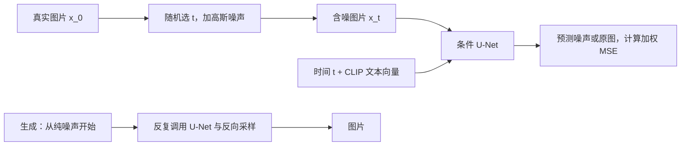

# DDPM：加噪、去噪与文本条件生成

对应 [DDPM.ipynb](/D:/Study/Phd-Study/EECS498-WI22-main/assignment3/DDPM.ipynb)。按原 Notebook 的顺序：**前向／反向过程与去噪目标 → Emoji 数据 → q_sample → U-Net → p_losses → p_sample → 预训练模型 → 采样 → Classifier-Free Guidance**。任务是用文本条件生成 `32×32` Emoji；下面代码为参考实现。

理解主线：**人为加噪得到输入 → U-Net 预测已知目标 → MSE 训练网络 → 固定网络后从噪声逐步采样**。加噪公式和采样公式都是计算规则；真正学习的是 U-Net 参数。

| 符号 | 含义 |
| --- | --- |
| x₀、xₜ | 归一化到 `[-1,1]` 的干净图、时间 t 的含噪图 |
| T、t | 扩散总步数、当前步；数学记作 `1,…,T` |
| βₜ、αₜ、ᾱₜ | 每步噪声方差、单步信号系数、累计信号系数 |
| ε | 训练时采样的标准高斯噪声，作为噪声预测标签 |
| ε̂、x̂₀ | 网络预测的噪声、由其还原或直接预测的原图 |
| c、θ | CLIP 文本向量、条件 U-Net 的参数 |
| N、Dₓ | batch 大小、每张图片元素数 `3*H*W` |

网络输入是 `(x_t,t,c)`，输出与图片同形状 `(N,3,H,W)`；它预测一张噪声图或原图，不输出物体类别概率。

## 1. Denoising Diffusion Probabilistic Models：概率过程



训练每次只抽一个时间步，直接构造 `x_t`；生成需要逐步执行整个反向过程。与 VAE 的单次 Decoder、GAN 的单次 Generator 相比，DDPM 的生成通常更慢。

### 1.1 Forward Process：逐步破坏图片

先定义噪声计划及两个信号系数：

$$
0<\beta_t<1,\qquad
\alpha_t=1-\beta_t,\qquad
\bar\alpha_t=\prod_{s=1}^{t}\alpha_s,
\qquad \bar\alpha_0=1
$$

前向过程是人为设定的马尔可夫链，每一步只依赖前一步：

$$
q(x_t\mid x_{t-1})=\mathcal N(\sqrt{1-\beta_t}x_{t-1},\beta_tI)
$$

$$
q(x_{1:T}\mid x_0)=\prod_{t=1}^Tq(x_t\mid x_{t-1})
$$

`beta_t` 控制每步加入多少噪声；经过足够多步，原图信号逐渐衰减，末端接近标准正态。这个过程不需要神经网络，也不需要学习参数。

### 1.2 Reverse Process：学习每一个小去噪步

生成时从高斯噪声出发，学习条件高斯转移：

$$
p_\theta(x_{0:T}\mid c)=p(x_T)\prod_{t=1}^Tp_\theta(x_{t-1}\mid x_t,c)
$$

$$
p(x_T)=\mathcal N(0,I),\qquad
p_\theta(x_{t-1}\mid x_t,c)=
\mathcal N\!\left(\mu_\theta(x_t,t,c),\tilde\sigma_t^2I\right)
$$

这里是整条生成路径的联合分布；图片似然 `p_theta(x_0|c)` 还需要对中间状态积分。模型的工作是预测噪声或原图，再据此确定每步高斯分布的均值；本题使用预先计算的后验方差，不学习方差。

### 1.3 Denoising Objective：为什么能训练“预测噪声”

原论文从似然的变分界导出去噪目标，并使用简化的噪声 MSE。给定原图、时间和自己采样的噪声，训练目标天然已知，不需要人工为每张含噪图制作答案：

$$
L_{\mathrm{simple}}=\mathbb E_{x_0,t,\epsilon}
\left[\frac{1}{D_x}\lVert\epsilon-\epsilon_\theta(x_t,t,c)\rVert_2^2\right]
$$

期望表示对数据、均匀抽取的时间步和高斯噪声取平均；实际用一个 batch 估计它，详见第 5 节。这里写出 `1/Dₓ`，与代码按像素和通道求均值一致。

网络预测的是构造该 `x_t` 时加入的噪声。采样过程中另加的随机扰动是新的高斯随机数，两者承担不同作用。

## 2. In This Notebook：Emoji 数据与文本条件

`EmojiDataset(32)` 返回 `(image, model_kwargs)`。图像经过 Resize、CenterCrop、ToTensor，像素在 `[0,1]`；`model_kwargs` 包含文本字符串 `text` 和预先计算的 CLIP 向量 `text_emb`。

同一个 Emoji 条目可能有多张图片或多个描述，取样时随机选取。训练直接读取已编码的文本向量以节省计算；推理时的新文本才需要调用 CLIP 文本编码器。

| 张量 | 形状／含义 |
| --- | --- |
| x_0、x_t、noise、模型输出 | `(N,3,H,W)` |
| t | `(N,)`，每张图片可选择不同时间步 |
| text_emb | `(N,512)`，由预训练 CLIP 文本编码器提供 |
| context | `(N,4*dim)`，时间嵌入与文本投影之和 |

## 3. q_sample：一步得到任意时间的含噪图片

由第 1.1 节的单步高斯链，可以直接得到任意时间的条件分布：

$$
q(x_t\mid x_0)=\mathcal N(\sqrt{\bar\alpha_t}x_0,(1-\bar\alpha_t)I)
$$

从中取样使用“均值 + 标准差 × 标准高斯噪声”：

$$
x_t=\sqrt{\bar\alpha_t}x_0+\sqrt{1-\bar\alpha_t}\epsilon
\qquad \epsilon\sim\mathcal N(0,I)
$$

信号系数越小，原图贡献越弱。注意噪声乘的是**标准差** `sqrt(1-alpha_bar)`，不是方差。该式还直接给出两种反推关系：

$$
\widehat x_0=
\frac{x_t-\sqrt{1-\bar\alpha_t}\,\widehat\epsilon}{\sqrt{\bar\alpha_t}}
$$

$$
\widehat\epsilon=
\frac{x_t-\sqrt{\bar\alpha_t}\,\widehat x_0}{\sqrt{1-\bar\alpha_t}}
$$

给定真实 ε 可代数还原 x₀；生成时只能使用网络估计的 ε̂，所以还原存在误差。系数已在 [GaussianDiffusion](/D:/Study/Phd-Study/EECS498-WI22-main/assignment3/cs231n/gaussian_diffusion.py) 中注册为 buffer；`extract` 按 t 取出系数并变成 `(N,1,1,1)`，用于广播。以下方法放在该类中，使用文件已有的 `torch` 与 `extract`：

```python
def q_sample(self, x_start, t, noise):
    a = extract(self.sqrt_alphas_cumprod, t, x_start.shape)
    b = extract(self.sqrt_one_minus_alphas_cumprod, t, x_start.shape)
    return a * x_start + b * noise

def predict_start_from_noise(self, x_t, t, noise):
    a = extract(self.sqrt_alphas_cumprod, t, x_t.shape)
    b = extract(self.sqrt_one_minus_alphas_cumprod, t, x_t.shape)
    return (x_t - b * noise) / a

def predict_noise_from_start(self, x_t, t, x_start):
    a = extract(self.sqrt_alphas_cumprod, t, x_t.shape)
    b = extract(self.sqrt_one_minus_alphas_cumprod, t, x_t.shape)
    return (x_t - a * x_start) / b
```

数学公式常从 1 编号，代码 buffer 从 0 编号；代码中的 `t=0` 是第一个加噪步。`q_sample` 接收已归一化到 `[-1,1]` 的原图，不在内部重复归一化。

这条闭式公式避免训练时真的执行 t 次加噪。Notebook 先用固定输入检查 `q_sample`，再展示不同 t 的图片，最后检查两个反推函数能否还原原图和噪声。

系数由 `beta_schedule` 决定：本题提供 linear、cosine 和 sigmoid 三种 schedule，默认使用 sigmoid。累计系数注册为 buffer，会随模型迁移设备和保存，但不会通过梯度更新。

## 4. UNet Model：条件卷积网络与 skip connection

对应 [unet.py](/D:/Study/Phd-Study/EECS498-WI22-main/assignment3/cs231n/unet.py)。下采样汇总较大范围的信息，上采样恢复分辨率，skip connection 补回细节；输出形状始终与输入图片相同。

```text
init_conv → [ResBlock → ResBlock → Downsample] × 多级
          → 两个中间 ResBlock
          → [Upsample → 拼接 skip → ResBlock → 拼接 skip → ResBlock] × 多级
          → final_conv
```

### 4.1 时间与文本怎样进入卷积网络

时间 t 先经过正弦嵌入和 MLP，文本向量经过另一组 MLP，两者相加为 context：

$$
u=\mathrm{MLP}_{\mathrm{time}}(\mathrm{SinEmbed}(t))+
\mathrm{MLP}_{\mathrm{text}}(c)
$$

每个 ResBlock 再将 u 投影为 scale 和 shift，广播到各个空间位置。卷积特征经过 `h*(1+scale)+shift`，随后非线性变换和残差连接。这里条件信息影响整张特征图，没有文本到图片 patch 的交叉注意力。

$$
(\gamma(u),\delta(u))=\mathrm{Split}(\mathrm{MLP}_{\mathrm{block}}(u)),
\qquad h'=h\odot(1+\gamma(u))+\delta(u)
$$

γ、δ 每个样本、通道一组值，再广播到 H×W；不是对每个像素提供人工标签。它们的投影参数和其他 U-Net 参数一起由去噪 loss 学习。

### 4.2 构造上下采样组件

下面两段分别填入 `Unet.__init__` 原有的下采样和上采样循环，保留循环中的 `append` 以及两者之间已有的中间层。`nn`、`ResnetBlock`、`Downsample`、`Upsample` 和 `context_dim` 均由原文件给出。

```python
# 下采样循环：dim_in → dim_out，空间尺寸减半
down_block = nn.ModuleList([
    ResnetBlock(dim_in, dim_in, context_dim=context_dim),
    ResnetBlock(dim_in, dim_in, context_dim=context_dim),
    Downsample(dim_in, dim_out),
])
```

```python
# 上采样循环：dim_in → dim_out，空间尺寸翻倍
up_block = nn.ModuleList([
    Upsample(dim_in, dim_out),
    ResnetBlock(2 * dim_out, dim_out, context_dim=context_dim),
    ResnetBlock(2 * dim_out, dim_out, context_dim=context_dim),
])
```

上采样后的特征与 skip 沿通道维拼接，因此 ResBlock 输入为 `2*dim_out`。这里的通道数和模块顺序需要与预训练权重一致。

### 4.3 前向传播与特征形状

原 `forward` 已计算 `context=time_mlp(t)+condition_mlp(text_emb)`，并执行 `x=init_conv(x)`；以下填入其后的 TODO，最后保留原有的 `final_conv`：

```python
skips = []
for block1, block2, down in self.downs:
    x = block1(x, context)
    skips.append(x)
    x = block2(x, context)
    skips.append(x)
    x = down(x)

x = self.mid_block1(x, context)
x = self.mid_block2(x, context)

for up, block1, block2 in self.ups:
    x = up(x)
    x = block1(torch.cat([x, skips.pop()], dim=1), context)
    x = block2(torch.cat([x, skips.pop()], dim=1), context)
```

每级保存两个 skip，并按后进先出的顺序取回。以正式配置 `dim=48、dim_mults=(1,2,4,8)` 为例，忽略 batch 维：

| 位置 | 下采样后输出 C×H×W | 该级保存的 skip（各两份） |
| --- | --- | --- |
| init_conv | `48×32×32` | — |
| 第 1 级 | `48×16×16` | `48×32×32` |
| 第 2 级 | `96×8×8` | `48×16×16` |
| 第 3 级 | `192×4×4` | `96×8×8` |
| 第 4 级 | `384×2×2` | `192×4×4` |
| 中间层 | `384×2×2` | — |

上采样按相反顺序恢复到 `48×32×32`，最终 `1×1` 卷积输出 `3×32×32`。skip 连接在通道维拼接，不是逐元素相加；ResBlock 自身还包含另一种残差相加连接。

Notebook 先验证模块结构能正确构造，再用固定随机输入检查 U-Net 前向结果；这两步都通过后，再接入扩散损失。

## 5. p_losses：随机时间步的去噪训练

一个训练 batch 的步骤是：均匀采样 `t_n∈{1,…,T}` → 采样 ε → 构造 xₜ → U-Net 输出预测 → 与已知目标比较。用 fθ 统一表示两种输出，实际代码对应的标量损失为：

$$
\widehat L=\frac1N\sum_{n=1}^{N}w_{t_n}
\left[\frac1{D_x}\sum_{d=1}^{D_x}
\left(f_\theta(x_{t_n}^{(n)},t_n,c_n)_d-y_{n,d}\right)^2\right]
$$

| objective | target | 本题权重 w_t |
| --- | --- | --- |
| `pred_noise` | 加入的噪声 epsilon | 1 |
| `pred_x_start` | 真实原图 x_0 | `SNR=alpha_bar/(1-alpha_bar)` |

其中 d 遍历一张图片的通道和像素，y 是表中的目标，不是类别标签。一个 batch 中每张图只抽一个 t，不需要把所有 t 的 U-Net 前向都运行一遍。

若把原图预测按第 3 节换算为噪声预测，则误差满足：

$$
\widehat\epsilon-\epsilon
=-\sqrt{\frac{\bar\alpha_t}{1-\bar\alpha_t}}
(\widehat x_0-x_0)
$$

$$
\lVert\widehat\epsilon-\epsilon\rVert_2^2
=\underbrace{\frac{\bar\alpha_t}{1-\bar\alpha_t}}_{\mathrm{SNR}_t}
\lVert\widehat x_0-x_0\rVert_2^2
$$

这解释了代码在预测原图时乘 SNR 的原因：两种参数化可以对应到相同的噪声预测误差。这是对相互换算的预测成立的代数关系，并不保证两份独立训练的网络得到相同结果。

`GaussianDiffusion.p_losses` 的参考实现：

```python
def p_losses(self, x_start, model_kwargs=None):
    x_start = self.normalize(x_start)  # 数据 [0,1] → 模型 [-1,1]
    t = torch.randint(self.num_timesteps, (x_start.shape[0],),
                      device=x_start.device)
    noise = torch.randn_like(x_start)
    x_t = self.q_sample(x_start, t, noise)
    pred = self.model(x_t, t, model_kwargs=model_kwargs or {})
    target = noise if self.objective == "pred_noise" else x_start
    weight = extract(self.loss_weight, t, target.shape)
    return (weight * (pred - target).square()).mean()
```

`p_losses` 内部完成归一化、随机 t、随机噪声、模型预测和损失；`backward` 与优化器更新由外部 Trainer 完成，模型只需调用一次。

更新关系可用梯度下降示意：

$$
\theta\leftarrow\theta-\eta\nabla_\theta\widehat L
$$

实际 Trainer 使用 Adam。θ 包括 U-Net 卷积、时间 MLP、文本条件 MLP 等可训练参数。噪声计划是固定 buffer，训练数据中的 CLIP 向量是预先提取的，本题没有通过此 loss 微调 CLIP。

## 6. p_sample：从 x_t 得到上一时间步

先预测并裁剪原图 `x0_hat`，再用已实现的 `q_posterior` 计算高斯后验的均值和标准差：

$$
x_{t-1}=\tilde\mu_t(x_t,\hat x_0)+\tilde\sigma_t\xi_t,
\qquad \xi_t\sim\mathcal N(0,I)
$$

已给定原图时，前向链的后验有解析形式；本题用预测的原图代入：

$$
\tilde\mu_t=
\frac{\beta_t\sqrt{\bar\alpha_{t-1}}}{1-\bar\alpha_t}\hat x_0+
\frac{(1-\bar\alpha_{t-1})\sqrt{\alpha_t}}{1-\bar\alpha_t}x_t
$$

$$
\tilde\sigma_t^2=
\frac{1-\bar\alpha_{t-1}}{1-\bar\alpha_t}\beta_t
$$

因此本题的方差是后验方差 `tilde_beta_t`；`q_posterior` 返回的是均值和**标准差**，只需正确提供 `x0_hat` 和 `x_t`。最后一步令 ξ 为 0；这对应代码的 `t=0`，即数学的 `t=1`。

采样时没有真实 x₀ 或 ε 标签，不计算训练 loss，也不反向传播。网络参数固定，只更新“当前图片状态”xₜ。

```python
@torch.no_grad()
def p_sample(self, x_t, t, model_kwargs=None):
    times = torch.full((x_t.shape[0],), t, device=x_t.device,
                       dtype=torch.long)
    pred = self.model(x_t, times, model_kwargs=model_kwargs or {})
    x0 = (self.predict_start_from_noise(x_t, times, pred)
          if self.objective == "pred_noise" else pred)
    mean, std = self.q_posterior(x0.clamp(-1, 1), x_t, times)
    noise = torch.randn_like(x_t) if t > 0 else torch.zeros_like(x_t)
    return mean + std * noise
```

最后一步不再加随机噪声。已有 `sample` 从标准正态开始，倒序调用 `p_sample`，最终将图片还原到 `[0,1]`。

## 7. Training：组合模型并加载预训练权重

Notebook 的正式配置为图片 32×32、U-Net 基础通道 48、文本维度 512、扩散步数 100、`objective="pred_noise"`。Trainer 中给出的训练配置是 batch size 256、学习率 `1e-3`、训练步数 50000。

Trainer 的单步流程是：取数据和文本向量 → 清空梯度 → 调用 `p_losses` → 反向传播 → 梯度范数裁剪到 1 → 优化器更新，并定期保存权重与生成样例。

本题不要求从头训练；Notebook 实际调用 `trainer.download_pretrained()` 和 `trainer.load(70000)` 加载 `model-70000.pt`。50000 是可选训练配置，70000 是提供的 checkpoint 标识，两者不是同一个数值。

## 8. Sampling：把一段文本变成多张图片

```text
文本 → CLIP 文本编码器 → (512,)
→ 扩展为 (N,512)
→ 每张图片从独立的高斯噪声开始
→ 100 次反向采样 → N 张图片
```

在 Notebook 已初始化 trainer 和 `get_text_emb` 后：

```python
text_emb = get_text_emb("face with cowboy hat")
text_emb = text_emb[None].expand(5, -1).to(device)
trainer.diffusion_model.eval()
with torch.no_grad():
    images = trainer.diffusion_model.sample(
        batch_size=5,
        model_kwargs={"text_emb": text_emb},
        return_all_timesteps=True,
    )
```

同一句文本可以生成不同图片，因为起始噪声和反向采样都具有随机性。`return_all_timesteps=True` 返回 `(N,T+1,3,H,W)`，含最初的噪声状态；`images[:,::20]` 可观察逐步去噪，`images[:,-1]` 是最终图片。

先观察训练中出现过的描述，再试组合出的陌生描述；后者效果可能较差，反映的是有限数据下的泛化能力。

## 9. Classifier Free Guidance：控制条件强度与多样性

训练时以一定概率丢弃文本条件，同一个网络同时学习有条件和无条件预测。推理时组合两者，本题使用：

$$
\hat\epsilon=(1+s)\epsilon_\theta(x_t,t,c)-s\epsilon_\theta(x_t,t,\varnothing)
$$

令有条件、无条件输出为 εc、εu，同一个公式可以重写为：

$$
\widehat\epsilon=\epsilon_u+(1+s)(\epsilon_c-\epsilon_u)
$$

这是沿“增加文本条件带来的变化”进行外推，不是额外的训练 loss。若其他资料写 `εu+w(εc-εu)`，则其 w 对应本题的 `1+s`；不能直接比较同名 scale 的数值。

对应 `Unet.cfg_forward`；复制参数字典，避免采样下一步时丢失 `cfg_scale`：

```python
def cfg_forward(self, x, time, model_kwargs=None):
    kwargs = dict(model_kwargs or {})
    scale = kwargs.pop("cfg_scale")
    cond = self.forward(x, time, model_kwargs=kwargs)
    uncond = self.forward(x, time,
                          model_kwargs={**kwargs, "text_emb": None})
    return (1 + scale) * cond - scale * uncond
```

按本题定义，`s=0` 对应普通有条件预测；增大 s 通常增强文本引导，也可能降低多样性。生成前需 `model.eval()`，关闭 Dropout 和随机丢弃条件。

训练中的丢弃概率默认是 0.2；无条件分支使用零文本向量，经相同的 condition MLP 处理。推理时每步调用两次 U-Net，所以引导会增加计算量，但不需要额外训练一个分类器。

比较不同 s 时，尽量固定随机种子、文本和样本数，观察“是否符合描述、图像是否清晰、五张结果是否过于相似”。

## 10. 按 Notebook 顺序检查实现

| 检查位置 | 应关注什么 |
| --- | --- |
| q_sample 与两个反推函数 | 固定输入数值、归一化范围、时间索引及广播 |
| U-Net 构造与 forward | 通道数、两个 skip 的顺序、输出形状与 context |
| p_losses | objective 对应的目标和权重、随机 t、MSE 的均值 |
| p_sample | 原图裁剪、后验均值／标准差、最后一步不加噪声 |
| 预训练采样 | 模型配置与权重匹配、eval 模式、文本编码与图片形状 |
| CFG | 条件／无条件组合的符号、保留原参数字典、引导强度定义 |

Notebook 的固定数值与真实生成实验承担不同作用：前者检查计算是否符合实现约定，后者检验学到的分布与文本条件是否有效；本文没有新增完整训练结果。

| 阶段 | 输入与已知目标 | 参数／状态变化 |
| --- | --- | --- |
| 前向加噪 | x₀、t、采样的 ε；按闭式公式得到 xₜ | 没有参数学习 |
| 去噪训练 | xₜ、t、文本；标签是 ε 或 x₀ | MSE 的梯度更新 U-Net |
| 反向采样 | xₜ、t、文本；没有真实标签 | 固定网络，逐步更新图片 xₜ |
| CFG 采样 | 同一步的有条件与无条件预测 | 固定网络，改变采样方向 |
