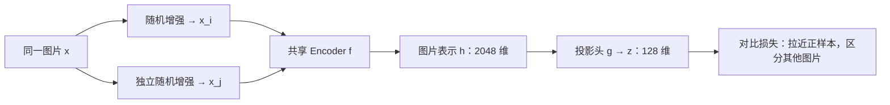

# SimCLR：数据增强、对比学习与线性评估

对应 [Self_Supervised_Learning.ipynb](/D:/Study/Phd-Study/EECS498-WI22-main/assignment3/Self_Supervised_Learning.ipynb)。按原 Notebook 顺序阅读：**自监督表示 → 预训练权重 → 数据增强 → Encoder/投影头 → 对比损失 → 继续预训练 → 线性评估与比较**。代码是按作业接口整理的参考实现，实验指标仍需实际运行验证。

先区分三个对象：**Encoder 把图片变成特征，投影头把特征映射到对比空间，loss 决定哪些参数应该如何改变**。Encoder 是网络结构，SimCLR 是包含增强、网络和损失的训练方法；它并不限定必须使用 ResNet-50。

| 本文符号 | 含义 |
| --- | --- |
| N | 一个 batch 的原图数，增强后共有 2N 个视图 |
| f、θ | Encoder 及其参数，本作业是修改后的 ResNet-50 |
| g、φ | 投影头及其参数 |
| h、z | Encoder 的原始特征、投影后再 L2 归一化的向量 |
| τ | 对比损失的温度，必须大于 0 |
| W、b | 下游分类头参数，与预训练投影头不同 |

## 1. Self-Supervised Learning：先学习图片表示

有监督分类使用人工类别作为目标，自监督学习从数据本身构造训练信号。本题将“同一图片的两个增强视图”视为应该匹配的样本，无需在预训练中读取类别标签。

理想表示应保留物体和语义信息，对无关的裁剪、颜色变化较稳定。SimCLR 的训练目标直接保证的是同图视图的一致性；不同图片即使语义相同，也可能被当作负样本，并不直接保证同类图片全部聚在一起。



一个 batch 有 `N` 张原图、`2N` 个增强视图。同一图片的两个视图是正样本，其他图片的视图作为负样本，原图的类别标签不参与预训练。

| 组件 | 本题结构／形状 |
| --- | --- |
| 两组增强图片 | 各为 `(N,3,32,32)` |
| Encoder f | 修改首层卷积并移除 maxpool、分类层的 ResNet-50，输出 h：`(N,2048)` |
| 投影头 g | `Linear(2048,512) → BN → ReLU → Linear(512,128)` |
| 返回值 | `model(x)` 返回归一化的 `(h,z)`，对比损失使用 z |
| 下游分类 | 丢弃 g，在 h 上训练 `Linear(2048,10)` |

网络已由 [model.py](/D:/Study/Phd-Study/EECS498-WI22-main/assignment3/cs231n/simclr/model.py) 给出。投影头让损失在 z 空间施加约束，同时让 h 保留更适合下游任务的信息。

## 2. Pretrained Weights：为什么先下载权重

Notebook 提供已在 CIFAR-10 上训练较长时间的权重 `pretrained_model/pretrained_simclr_model.pth`，后面只需在其基础上继续训练 1 个 epoch。这能让作业重点放在损失与训练逻辑，而不必从随机参数完成长时间预训练。

后续继续训练保存到 `pretrained_model/trained_simclr_model.pth`，线性评估使用这个新文件。两个文件分别对应“课程提供的起点”和“本次继续训练后的模型”。

## 3. Data Augmentation：构造两个不同视图

对应 [data_utils.py](/D:/Study/Phd-Study/EECS498-WI22-main/assignment3/cs231n/simclr/data_utils.py)。相同语义、不同外观的视图，促使模型学习对裁剪和颜色变化较稳定的表示。

```python
import random
import torch
import torch.nn.functional as F
from torchvision import transforms

def compute_train_transform(seed=123456):
    random.seed(seed)
    torch.manual_seed(seed)
    return transforms.Compose([
        transforms.RandomResizedCrop(32),
        transforms.RandomHorizontalFlip(p=0.5),
        transforms.RandomApply([
            transforms.ColorJitter(0.4, 0.4, 0.4, 0.1)
        ], p=0.8),
        transforms.RandomGrayscale(p=0.2),
        transforms.ToTensor(),
        transforms.Normalize([0.4914, 0.4822, 0.4465],
                             [0.2023, 0.1994, 0.2010]),
    ])
```

`CIFAR10Pair.__getitem__` 将原图转为 PIL 图片后，分别调用两次增强：

```python
x_i = self.transform(img)
x_j = self.transform(img)
```

两次调用共享增强规则，但独立抽取随机参数；不要直接令 `x_j=x_i`，也不要在每次取样前重置随机种子。

| 增强步骤 | 期望学到的稳定性 |
| --- | --- |
| 随机裁剪、缩放到 32×32 | 不过度依赖固定位置或完整背景 |
| 随机水平翻转 | 对左右朝向变化较稳定 |
| 随机颜色扰动、灰度化 | 避免仅凭颜色统计匹配两张图片 |
| ToTensor + Normalize | 转为模型输入，并保持训练、评估的像素标准化一致 |

Notebook 先用固定种子检查增强实现，再展示图片。评估用的 `compute_test_transform` 只做 ToTensor 和 Normalize，不再随机裁剪或扰动颜色。

## 4. Base Encoder and Projection Head：区分 h 与 z

**本作业的 Encoder 就是 `model.f`：修改后的 ResNet-50，包括最后的全局平均池化，去掉分类层。** 它负责将一张图片压缩成一个 2048 维向量，不直接输出 CIFAR-10 的十类概率。两组视图经过同一套 f 和 g，参数共享：

$$
h_i=f_\theta(\widetilde{x}_i)\in\mathbb{R}^{2048}
$$

$$
r_i=g_\phi(h_i)\in\mathbb{R}^{128},
\qquad z_i=\frac{r_i}{\lVert r_i\rVert_2}
$$

其中 h 是希望迁移到下游任务的图片特征，r 是投影头的原始输出，z 是对比损失实际使用的单位向量。具体顺序为：

```text
(N,3,32,32) → 修改后的 ResNet-50 → 全局平均池化
→ Flatten → h:(N,2048)
→ Linear(2048,512) → BN → ReLU → Linear(512,128) → z:(N,128)
```

本题将 ResNet 首层换成 `3×3、stride=1、padding=1`，去掉 maxpool，以适应 32×32 小图；去掉原分类层以返回特征。已有 `Model.forward` 的关键代码是：

```python
def forward(self, x):
    h = self.f(x).flatten(start_dim=1)
    z = self.g(h)
    return F.normalize(h, dim=-1), F.normalize(z, dim=-1)
```

训练时使用 z 计算对比损失；kNN 和下游分类使用 h。不能因为两个返回值都是向量，就把 `model(x)` 的第一个输出当成投影头输出。

上面代码返回的第一个值实际为 `h / ||h||`，供 kNN 使用；下游 `Classifier` 直接调用 `self.f`，读取未做这一步归一化的 h。投影头通常在下游阶段被丢弃，但它在预训练期间会通过梯度影响 Encoder。

## 5. SimCLR: Contrastive Loss：预测哪个视图与自己配对

对应 [contrastive_loss.py](/D:/Study/Phd-Study/EECS498-WI22-main/assignment3/cs231n/simclr/contrastive_loss.py)。这个损失叫 **NT-Xent**：把每个视图当成一次“找配对”的分类题，正确类别是同一原图的另一个视图，而不是猫、狗等人工类别。

将两组表示按 `out=[out_left;out_right]` 拼接。索引从 0 开始，正样本位置为：

$$
p(i)=(i+N)\bmod 2N,
\qquad i=0,\ldots,2N-1
$$

**第一步：相似度变成 logits。** 因为 z 已归一化，点积就是余弦相似度：

$$
s_{ik}=z_i^\top z_k,
\qquad a_{ik}=\frac{s_{ik}}{\tau}
$$

全部视图两两比较得到 `(2N,2N)` 矩阵。对角线是自己与自己，不能作为匹配候选。

**第二步：对候选做 softmax。** 固定查询视图 i，在除自身以外的 `2N-1` 个候选中定义匹配概率：

$$
\pi_{ik}=\frac{\exp(a_{ik})}
{\displaystyle\sum_{j\ne i}\exp(a_{ij})},
\qquad k\ne i
$$

**第三步：提高正确配对的概率。** 单个视图的交叉熵和整个 batch 的损失为：

$$
\ell_i=-\log\pi_{i,p(i)}
=-a_{i,p(i)}+\log\sum_{k\ne i}\exp(a_{ik})
$$

$$
L_{\mathrm{NT\text{-}Xent}}=\frac{1}{2N}
\sum_{i=0}^{2N-1}\ell_i
$$

分母排除自己，**包含正样本**；每个视图有 1 个正样本、`2N-2` 个负样本。温度 τ 越小，相似度差异对 softmax 的影响越强。

例如 `N=3`，拼接顺序为 `[a_0,a_1,a_2,b_0,b_1,b_2]`，则正样本列索引为 `[3,4,5,0,1,2]`。一对视图既计算 `a→b`，也计算 `b→a`，所以最终除以 `2N`。

若 `a_0` 给它的正样本 `b_0` 分配概率 0.8，它贡献的损失是 `-ln(0.8)≈0.223`；若概率只有 0.1，损失就是 `2.303`。若所有候选分数相同，损失为 `ln(2N-1)`；这只是帮助理解数值的均匀预测基线。

对每个有效 logit，梯度为：

$$
\frac{\partial\ell_i}{\partial a_{ik}}
=\pi_{ik}-\mathbf{1}[k=p(i)]
$$

正样本项倾向于提高分数，负样本项倾向于降低分数。再沿 `a → z → g → h → f` 反向传播，就能更新两个网络；不是直接把“loss 数字”加到权重上。

### 5.1 sim：单对余弦相似度

以下函数使用上面的 `torch` 和 `F` 导入：

```python
def sim(z_i, z_j):
    return (F.normalize(z_i, dim=-1) *
            F.normalize(z_j, dim=-1)).sum()
```

### 5.2 simclr_loss_naive：先逐个理解公式

```python
def simclr_loss_naive(out_left, out_right, tau):
    out = torch.cat([out_left, out_right], dim=0)
    N = out_left.shape[0]
    total = out.new_zeros(())
    for i in range(2 * N):
        positive = (i + N) % (2 * N)
        scores = torch.stack([
            sim(out[i], out[k]) / tau
            for k in range(2 * N) if k != i
        ])
        total = total + torch.logsumexp(scores, dim=0)
        total = total - sim(out[i], out[positive]) / tau
    return total / (2 * N)
```

### 5.3 simclr_loss_vectorized：从矩阵得到整批损失

先实现两个辅助函数：`sim_positive_pairs` 对两组向量逐行匹配，返回 `(N,1)`；`compute_sim_matrix` 计算所有组合，返回 `(2N,2N)`，对角线是每个向量与自己的相似度。

```python
def sim_positive_pairs(out_left, out_right):
    left = F.normalize(out_left, dim=-1)
    right = F.normalize(out_right, dim=-1)
    return (left * right).sum(dim=-1, keepdim=True)  # (N,1)

def compute_sim_matrix(out):
    out = F.normalize(out, dim=-1)
    return out @ out.T                            # (2N,2N)
```

Notebook 将向量化分为四步：

| 步骤 | 计算内容 | 形状 |
| --- | --- | --- |
| 1 | 所有相似度除以 tau，再取指数 | `(2N,2N)` |
| 2 | 排除对角线后，对每行求和得到分母 | `(2N,1)` |
| 3 | 提取正样本相似度，取指数得到分子 | `(2N,1)` |
| 4 | 对 `-log(分子/分母)` 求均值 | 标量 |

下面用交叉熵稳定地计算同一公式，等价于题目中的“指数 → 分子／分母 → 负对数”；保留 `device` 参数以兼容作业调用，实际设备跟随输入。

```python
def simclr_loss_vectorized(out_left, out_right, tau, device="cuda"):
    out = torch.cat([out_left, out_right], dim=0)
    N = out_left.shape[0]
    scores = compute_sim_matrix(out) / tau
    diagonal = torch.eye(2 * N, device=out.device, dtype=torch.bool)
    scores = scores.masked_fill(diagonal, float("-inf"))
    target = (torch.arange(2 * N, device=out.device) + N) % (2 * N)
    return F.cross_entropy(scores, target)
```

相似度矩阵和损失的内存开销随 batch size 平方增长；增加负样本通常有帮助，但同类图片也可能被当成负样本。

### 5.4 如何验证这几步

Notebook 使用 `simclr_sanity_check.key`，依次检查 `sim`、循环版损失、正样本相似度、全相似度矩阵和向量化损失。除了比对参考数值，还应检查循环版与向量化版的损失及梯度一致。

最常见的错误是：把正样本也从分母中删除、保留自己的相似度、按交错顺序理解拼接、只算一个方向，或者把温度乘到相似度上。

## 6. Implement the train function：用两个分支更新同一个模型

对应 [utils.train](/D:/Study/Phd-Study/EECS498-WI22-main/assignment3/cs231n/simclr/utils.py:9)。下面是一个 batch 的核心；`x_i/x_j` 已移到模型设备，`model.train()` 已在循环外调用：

```python
_, out_left = model(x_i)
_, out_right = model(x_j)
loss = simclr_loss_vectorized(out_left, out_right, temperature)
train_optimizer.zero_grad()
loss.backward()
train_optimizer.step()
```

两个分支共同更新 f 和 g。标签只用于后面的有监督评估，不应加入这个损失。

### 6.1 “根据 loss 来 fine-tune”具体是什么意思

所有这些训练都需要先计算 loss，再计算它对可训练参数的梯度。以最简单的梯度下降示意：

$$
\theta\leftarrow\theta-\eta\nabla_\theta L,
\qquad \phi\leftarrow\phi-\eta\nabla_\phi L
$$

η 是学习率，实际作业使用 Adam，更新还会利用梯度的历史统计。`zero_grad()` 清除旧梯度，`backward()` 计算梯度，`step()` 按优化规则更新优化器管理的参数。

**是否叫微调，要看是否从预训练参数出发、使用什么任务；哪些参数更新，要看冻结设置和优化器。** 本题加载预训练 SimCLR 后，仍用 NT-Xent 更新 f、g，属于继续对比预训练；第 8 节换成类别标签和新分类头，属于下游训练。

若下游仅训练线性头，严格称为线性评估；若解冻预训练 Encoder 并用下游 loss 共同更新，才是通常所说的端到端微调。训练 loss 用于求梯度，验证指标用于选配置或 checkpoint，两者承担不同作用。

## 7. Train the SimCLR model：继续预训练与 kNN 检查

Notebook 的配置是：50% CIFAR-10 训练数据、batch size 64、`tau=0.5`、Adam 学习率 `1e-3`、weight decay `1e-6`，继续训练 1 个 epoch。

`utils.test` 在这个阶段用加权 kNN 检查 h 是否有用，不另外训练分类器：

1. 用确定性的评估增强提取训练集 h，组成特征库。
2. 提取测试图片 h，计算它与特征库的余弦相似度。
3. 找出最相近的 `k=200` 个训练样本，用它们的标签加权投票。

$$
\mathrm{score}_c(h)=\sum_{j\in\mathrm{TopK}(h)}
\mathbb 1[y_j=c]\exp\left(\frac{h^\top h_j}{\tau}\right)
$$

这里标签用于评估表示，不参与前面的对比损失。`test_acc@1` 表示得分最高的类别是否正确，`test_acc@5` 表示真实类别是否位于前五名；根据 kNN Top-1 保存继续训练后的权重。

## 8. Finetune a Linear Layer：冻结 Encoder 的线性评估

这一阶段丢弃 g，给 h 接十分类头。对第 n 张图：

$$
o_n=Wh_n+b\in\mathbb{R}^{10},
\qquad h_n=f_{\theta_0}(x_n)
$$

$$
P_{n,c}=\frac{\exp(o_{n,c})}{\sum_{k=0}^{9}\exp(o_{n,k})},
\qquad L_{\mathrm{cls}}=-\frac1N\sum_{n=1}^{N}\log P_{n,y_n}
$$

y 是 CIFAR-10 的真实类别编号；θ₀ 是固定的 Encoder 参数。此时的正确目标是“图片类别”，已经不是“另一个视图的 batch 索引”。

$$
W\leftarrow W-\eta\nabla_W L_{\mathrm{cls}},
\qquad b\leftarrow b-\eta\nabla_b L_{\mathrm{cls}},
\qquad \theta=\theta_0
$$

下面是严格固定特征提取器的一步参考代码，沿用 Notebook 的 `Classifier`、`device` 和已有导入；`images/labels` 是一批分类数据。实际循环每次调用整体 `train()` 后，都应再次保证 `classifier.f.eval()`：

```python
classifier = Classifier(num_class=10).to(device)
# 预训练组在此加载已训练的 Encoder 权重；随机组跳过加载。
classifier.f.requires_grad_(False)
classifier.f.eval()                 # 同时固定 BN 运行统计
classifier.fc.train()
optimizer = torch.optim.Adam(classifier.fc.parameters(), lr=1e-3)

logits = classifier(images.to(device))
loss = F.cross_entropy(logits, labels.to(device))
optimizer.zero_grad()
loss.backward()
optimizer.step()
```

### 8.1 Baseline: Without Self-Supervised Learning

移除投影头，在 Encoder 的原始池化输出上增加一个线性分类层。已有分类器的核心为：

```python
def forward(self, x):
    h = self.f(x).flatten(start_dim=1)
    return self.fc(h)  # Linear(2048,10)，返回类别 logits
```

注意这里的 `self.f` 直接返回 ResNet 特征，不经过前面 `Model.forward` 的显式 L2 归一化。它与 kNN 使用归一化 h 的细节有所不同。

本题加载已有 SimCLR 权重后继续预训练 1 个 epoch，再用 10% CIFAR-10 训练样本训练线性分类层，比较两组结果：

| 对照组 | Encoder 参数 | 训练内容 |
| --- | --- | --- |
| 无自监督预训练 | 随机初始化后冻结 | 线性分类层 |
| 有自监督预训练 | 加载 SimCLR 权重后冻结 | 同样的线性分类层 |

Notebook 文字称 baseline 会训练全部权重，但当前代码将 `model.f` 的参数冻结，优化器也只接收 `model.fc.parameters()`。因此按现有代码执行时，对照组是“随机 Encoder 参数 + 可训练线性头”。理解结果时应以实际代码为准。

### 8.2 With Self-Supervised Learning

第二组使用相同分类器，先加载 `trained_simclr_model.pth` 中的 Encoder 权重，再冻结 Encoder 参数。`strict=False` 允许预训练模型的投影头参数被忽略，以及新的分类头从随机参数开始。

两组都使用 10% 训练数据、batch size 128、10 个 epoch、Adam 学习率 `1e-3`，以普通分类交叉熵训练。预训练组的 Notebook 目标是最佳测试 Top-1 `≥70%`，这不是本文实测结果。

冻结参数不自动冻结 BN 的运行统计；严格固定特征提取器时，还需让 Encoder 保持 `eval()`。首先检查循环版与向量化版损失及梯度一致，再进行完整训练。

## 9. Plot your Comparison：怎样读最后的曲线

最后将两组 `test_acc@1` 画在同一坐标系中。关注的不只是最佳值，也包括预训练组是否在少量标签下更快收敛、整体曲线是否持续高于 baseline。

| 阶段 | 使用的向量 | loss／目标 | 更新参数 |
| --- | --- | --- | --- |
| SimCLR 预训练／继续预训练 | z | NT-Xent，目标为配对视图索引 | Encoder + 投影头 |
| 加权 kNN 评估 | 归一化 h | 无训练 loss，使用邻居标签投票 | 无 |
| 本题线性评估 | 原始池化 h | 分类交叉熵，目标为人工类别 | 仅分类头；BN 统计另行注意 |
| 端到端微调（供比较） | h | 下游分类交叉熵 | Encoder + 新分类头，丢弃投影头 |

这三步分别检验“训练目标能否实现”“表示能否区分类别”“少量标签能否容易地读出类别”，不能把对比损失数值直接解释为分类准确率。
